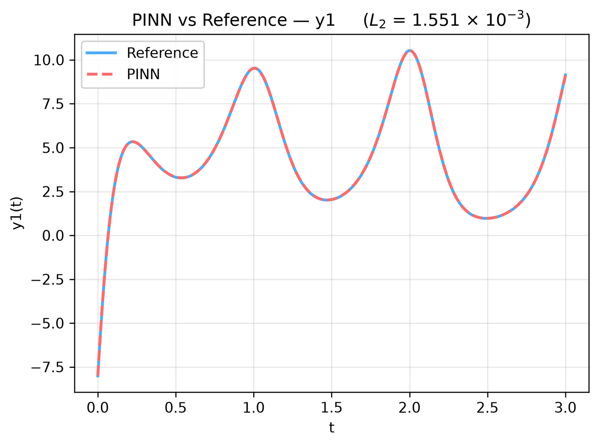
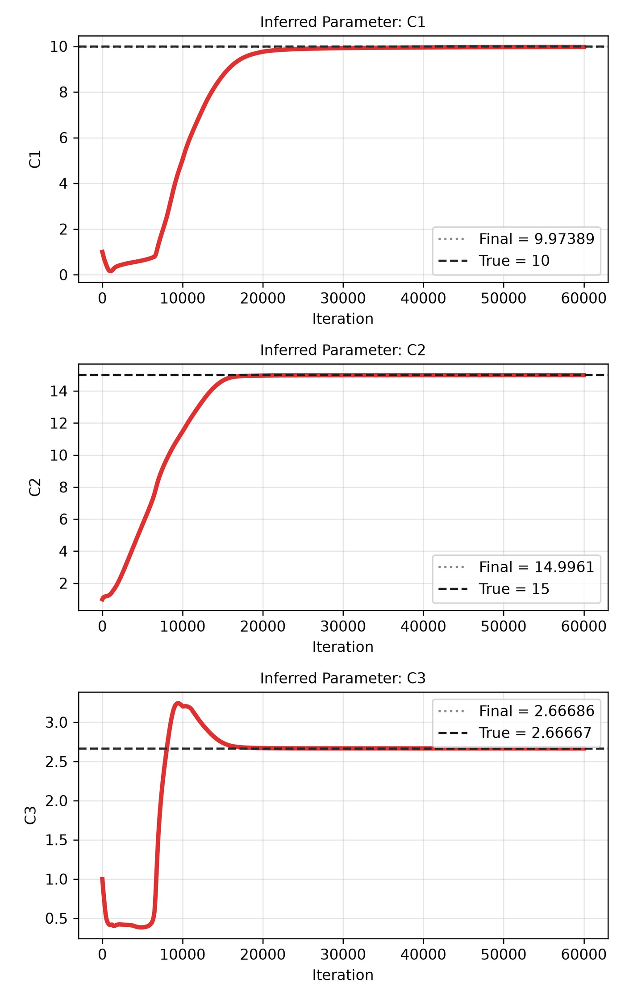
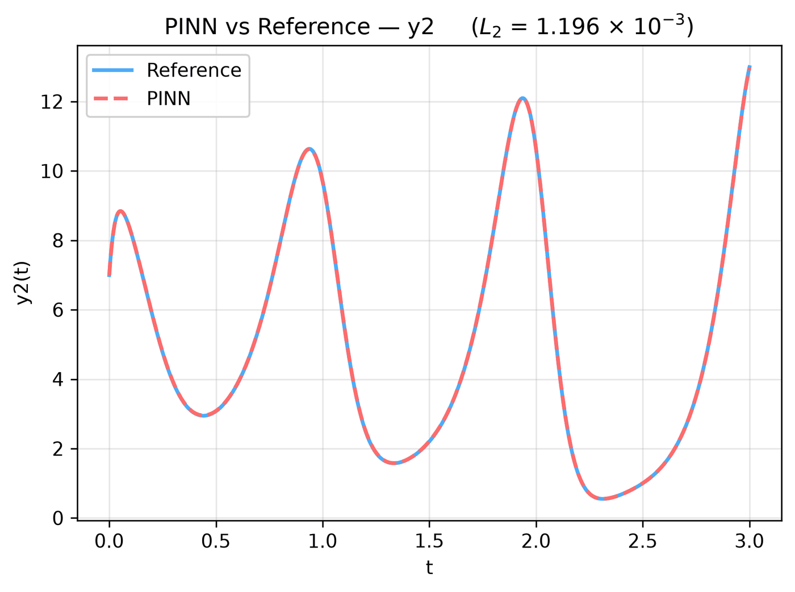
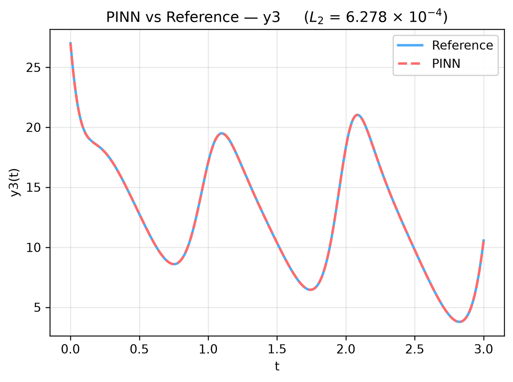

---
search:
  boost: 0.5
---

# Lorenz ODE – unknown C₁, C₂, C₃, exogenous input

| Example | |
|---|---|
| **Source** | DeepXDE example |
| **Problem** | Inverse (DeepXDE inverse example) |
| **Dimension** | ODE (t) |
| **Regime** | Time-dependent |
| **Geometry** | — (t only) |
| **Outputs** | `y1`, `y2`, `y3` |
| **Settings** | Default (no separate Tuned preset) |

## Governing equations

Mathematical form (from the benchmark records):

\[\frac{dy_1}{dt} = C_1(y_2 - y_1), \qquad \frac{dy_2}{dt} = y_1(C_2 - y_3) - y_2, \qquad \frac{dy_3}{dt} = y_1y_2 - C_3y_3 + 10\sin(2\pi t)\]

As typed in PINNStudio's **Equations** page (each expression is a residual, set to zero):

```text
dy1_t - C1*(y2 - y1)
dy2_t - y1*(C2 - y3) + y2
dy3_t - y1*y2 + C3*y3 - 10*sin(2*pi*t)
```

## Domain

- Time interval: \(t \in [0, 3]\)

## Initial conditions

| Output | Initial value | How it is imposed (Settings: Default) |
|---|---|---|
| `y1` | `-8` | loss term |
| `y2` | `7` | loss term |
| `y3` | `27` | loss term |

## Boundary conditions

No boundary-condition rows: the boundary values are imposed exactly through the network's output transform (see **Methods** below), or the problem has no boundary terms.

## Unknowns and measured data (Inverse)

| Trainable parameter | Initial value | True value |
|---|---|---|
| `C1` | 1 | 10 |
| `C2` | 1 | 15 |
| `C3` | 1 | 2.66667 |

Measured data (**Inverse** page, measured-data files):

- [`reference_data/deepxde/lorenz_forced/y1_obs.txt`](https://github.com/AsfandyarKhan72/PINNStudio/blob/v1.6.0/reference_data/deepxde/lorenz_forced/y1_obs.txt) → output `y1`, weight 1
- [`reference_data/deepxde/lorenz_forced/y2_obs.txt`](https://github.com/AsfandyarKhan72/PINNStudio/blob/v1.6.0/reference_data/deepxde/lorenz_forced/y2_obs.txt) → output `y2`, weight 1
- [`reference_data/deepxde/lorenz_forced/y3_obs.txt`](https://github.com/AsfandyarKhan72/PINNStudio/blob/v1.6.0/reference_data/deepxde/lorenz_forced/y3_obs.txt) → output `y3`, weight 1

## Settings

**Settings: Default** — DeepXDE's own settings

- **Network:** FNN, hidden layers 3 × 40, inputs (t), 3 outputs; activation tanh, initializer Glorot uniform
- **Points:** 400 domain, 2 boundary, 400 test
- **Loss weights:** `1,1,1,1,1,1` (equations, then boundary-condition rows, then initial conditions)

| Phase | Optimizer | Iterations | Learning rate | Decay |
|---|---|---|---|---|
| 1 | Adam | 60,000 | 0.001 | none |

No separate **Tuned** preset: the **Tuned** item is greyed out for this example (its Default settings are PINNStudio's best).

## Results

The configuration selected in PINNStudio's benchmark study, run on one RTX 4090. Forward: relative L₂ error of each output at the last reference time. Inverse: each parameter's relative error and, per seed, the largest of them (worst parameter error).

### Inverse problem

**Settings:** Default — the example's own settings (not in the tuning sweep); the example has no separate Tuned preset for this mode. **Values:** one run, seed 2026.

| Parameter | True value | Recovered | Relative error |
|---|---|---|---|
| C₁ | 10 | 9.97389 | 0.26 % |
| C₂ | 15 | 14.9961 | 0.026 % |
| C₃ | 2.66667 | 2.66686 | 0.0071 % |

Worst parameter error: **0.26 %**.

<figure markdown="span">
  { loading=lazy }
  <figcaption>Inverse, Default settings: PINN and reference along lines, y1.</figcaption>
</figure>

<figure markdown="span">
  { loading=lazy }
  <figcaption>Inverse, Default settings: parameter convergence.</figcaption>
</figure>

??? note "Other outputs (2 figures)"

    <figure markdown="span">
      { loading=lazy }
      <figcaption>Inverse, Default settings: PINN and reference along lines, y2.</figcaption>
    </figure>

    <figure markdown="span">
      { loading=lazy }
      <figcaption>Inverse, Default settings: PINN and reference along lines, y3.</figcaption>
    </figure>

**Full benchmark record:** every setting tried, the per-seed values and all figures are in [the benchmark records on GitHub](https://github.com/AsfandyarKhan72/PINNStudio/blob/v1.6.0/benchmarks/examples.md#dx-inverse-lorenz-system-with-exogenous-input).

## Loading it in PINNStudio

- Inverse: toolbar **Examples:** › **Inverse** › under the **── ODE ──** heading, **Lorenz ODE – unknown C₁, C₂, C₃, exogenous input** › **Default**, then **Solve**.

Loading an example fills in every setting; anything you change before **Solve** is listed in the Training Log. Your save folder, GPU, random-seed and plot-style settings are kept.

## Reference solution

- Reference data files: [`reference_data/deepxde/lorenz_forced/`](https://github.com/AsfandyarKhan72/PINNStudio/tree/v1.6.0/reference_data/deepxde/lorenz_forced)

## Notes

- As the Lorenz example with an exogenous input 10 sin(2 pi t) in the third equation, written as a formula (DeepXDE's script interpolates samples of the same function); measurements at 200 times.

## Definition and records

- **Definition:** `EXAMPLES` entry "Inverse: Lorenz system with exogenous input" in [`pinnstudio/core/deepxde_examples.py`](https://github.com/AsfandyarKhan72/PINNStudio/blob/v1.6.0/pinnstudio/core/deepxde_examples.py)
- **Equations:** [Governing equations](#governing-equations) on this page
- **Reference data:** [`reference_data/deepxde/lorenz_forced/`](https://github.com/AsfandyarKhan72/PINNStudio/tree/v1.6.0/reference_data/deepxde/lorenz_forced), written by [`tools/make_deepxde_reference_data.py`](https://github.com/AsfandyarKhan72/PINNStudio/blob/v1.6.0/tools/make_deepxde_reference_data.py)
- **Measured data** (Inverse): [`reference_data/deepxde/lorenz_forced/`](https://github.com/AsfandyarKhan72/PINNStudio/tree/v1.6.0/reference_data/deepxde/lorenz_forced), written by [`tools/make_deepxde_reference_data.py`](https://github.com/AsfandyarKhan72/PINNStudio/blob/v1.6.0/tools/make_deepxde_reference_data.py)
- **Benchmark records:** [`benchmarks/problems/lorenz-ode-unknown-c-c-c-exogenous-input.md`](https://github.com/AsfandyarKhan72/PINNStudio/blob/v1.6.0/benchmarks/problems/lorenz-ode-unknown-c-c-c-exogenous-input.md), its entry in the [examples overview](https://github.com/AsfandyarKhan72/PINNStudio/blob/v1.6.0/benchmarks/examples.md#dx-inverse-lorenz-system-with-exogenous-input), the [benchmark collection](https://github.com/AsfandyarKhan72/PINNStudio/blob/v1.6.0/benchmarks/README.md)
- **Tuning-study configurations** (records of the tuning study; open one with **Problem › Open Saved Problem...**; not presets of the Examples list): [`Lorenz ODE – unknown C₁, C₂, C₃, exogenous input (tuned).pinn.json`](https://github.com/AsfandyarKhan72/PINNStudio/blob/v1.6.0/benchmarks/tuning/Lorenz%20ODE%20%E2%80%93%20unknown%20C%E2%82%81%2C%20C%E2%82%82%2C%20C%E2%82%83%2C%20exogenous%20input%20%28tuned%29.pinn.json)
- **DeepXDE example:** [Lorenz_inverse_forced.py](https://github.com/lululxvi/deepxde/blob/master/examples/pinn_inverse/Lorenz_inverse_forced.py) ([documentation](https://deepxde.readthedocs.io/en/latest/demos/pinn_inverse/lorenz.inverse.forced.html))
- **Cite:** [Lu et al. 2021](../../about/references.md#lu2021deepxde) (DeepXDE)

How the benchmark values were measured and checked: [Reproducibility](../../reproducibility/benchmarks.md).

[← Back to the example gallery](../index.md)
