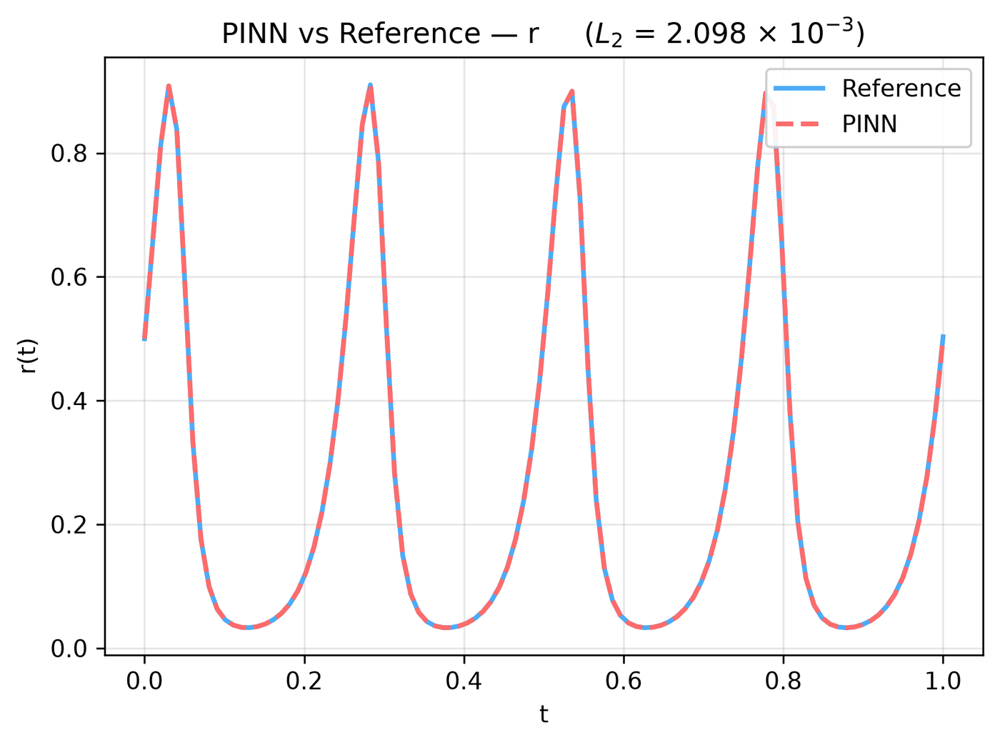
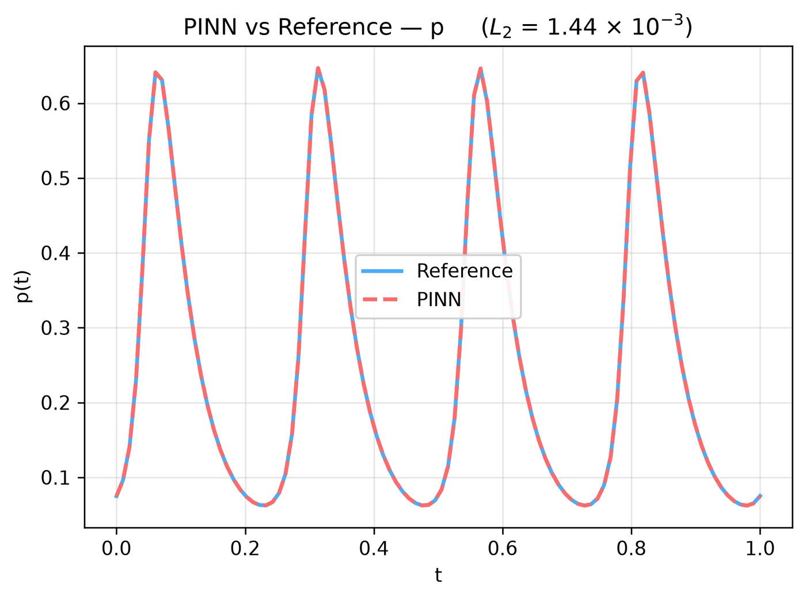
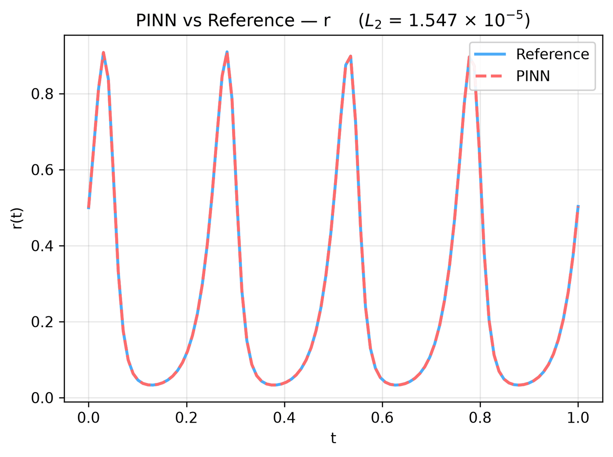
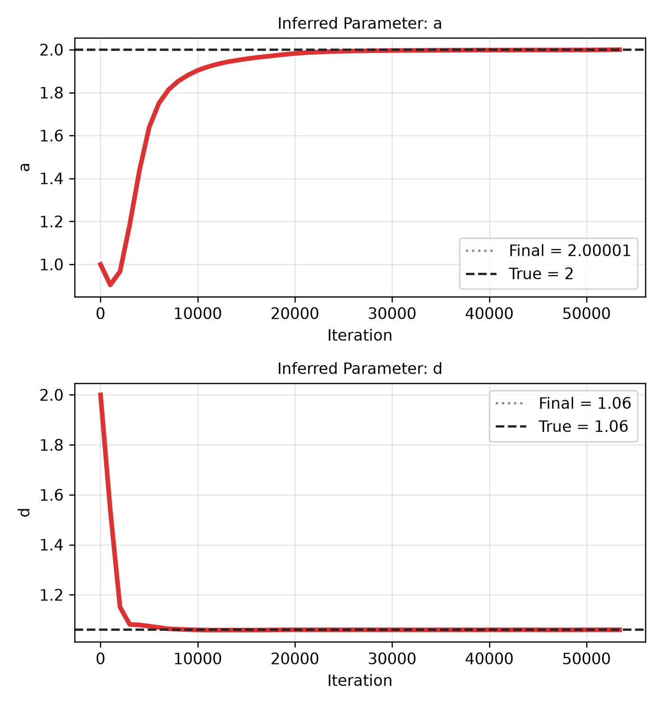
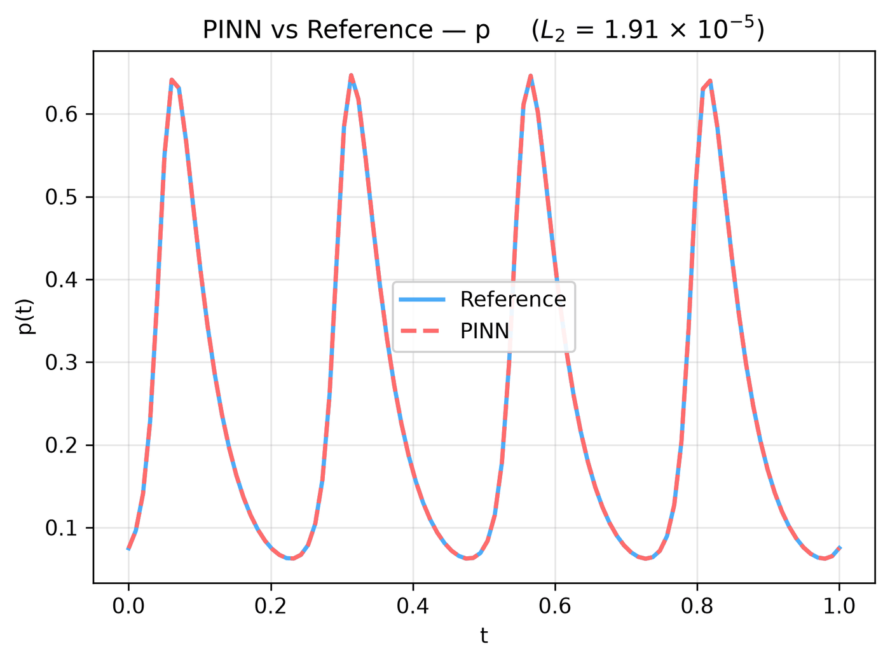

---
search:
  boost: 0.5
---

# Lotka-Volterra ODE

| Example | |
|---|---|
| **Source** | DeepXDE example |
| **Problem** | Forward and Inverse (the Inverse mode is PINNStudio's addition) |
| **Dimension** | ODE (t) |
| **Regime** | Time-dependent |
| **Geometry** | — (t only) |
| **Outputs** | `r`, `p` |
| **Settings** | Default (no separate Tuned preset) |

## Governing equations

Mathematical form (from the benchmark records):

\[\frac{dr}{dt} = \frac{R}{U}\left(2Ur - 0.04U^2 rp\right), \qquad \frac{dp}{dt} = \frac{R}{U}\left(0.02U^2 rp - 1.06Up\right), \qquad t \in [0, 1]\]

As typed in PINNStudio's **Equations** page (each expression is a residual, set to zero):

```text
dr_t - 1/ub*rb*(2.0*ub*r - 0.04*ub*r*ub*p)
dp_t - 1/ub*rb*(0.02*r*ub*p*ub - 1.06*p*ub)
```

Constants: `ub = 200`, `rb = 20`

As typed in PINNStudio's **Equations** page (Inverse mode) (each expression is a residual, set to zero):

```text
dr_t - 1/ub*rb*(a*ub*r - 0.04*ub*r*ub*p)
dp_t - 1/ub*rb*(0.02*r*ub*p*ub - d*p*ub)
```

Constants: `ub = 200`, `rb = 20`

## Domain

- Time interval: \(t \in [0, 1]\)

## Initial conditions

| Output | Initial value | How it is imposed (Settings: Default) |
|---|---|---|
| `r` | `0` | not used as a loss term |
| `p` | `0` | not used as a loss term |

## Boundary conditions

No boundary-condition rows: the boundary values are imposed exactly through the network's output transform (see **Methods** below), or the problem has no boundary terms.

## Unknowns and measured data (Inverse)

| Trainable parameter | Initial value | True value |
|---|---|---|
| `a` | 1 | 2 |
| `d` | 2 | 1.06 |

Measured data (**Inverse** page, measured-data files):

- [`reference_data/deepxde/lotka_volterra/r.txt`](https://github.com/AsfandyarKhan72/PINNStudio/blob/v1.6.0/reference_data/deepxde/lotka_volterra/r.txt) → output `r`, weight 100
- [`reference_data/deepxde/lotka_volterra/p.txt`](https://github.com/AsfandyarKhan72/PINNStudio/blob/v1.6.0/reference_data/deepxde/lotka_volterra/p.txt) → output `p`, weight 100

## Settings

### Forward mode

**Settings: Default** — DeepXDE's own settings

- **Network:** FNN, hidden layers 6 × 64, inputs (t), 2 outputs; activation tanh, initializer Glorot normal
- **Points:** 3,000 domain, 2 boundary, 3,000 test
- **Loss weights:** `1,1` (equations, then boundary-condition rows, then initial conditions)
- **Methods:** output transform `r*tanh(t) + 100/ub|p*tanh(t) + 15/ub` ([reference](../../reference/networks.md)); input features `t; sin(t); sin(2*t); sin(3*t); sin(4*t); sin(5*t); sin(6*t)` ([reference](../../reference/networks.md))

| Phase | Optimizer | Iterations | Learning rate | Decay |
|---|---|---|---|---|
| 1 | Adam | 50,000 | 0.001 | none |
| 2 | L-BFGS | 15,000 | — | none |

No separate **Tuned** preset: the **Tuned** item is greyed out for this example (its Default settings are PINNStudio's best).

### Inverse mode

**Settings: Default** — DeepXDE's settings with PINNStudio's Inverse-mode changes (see *Notes*)

- **Network:** FNN, hidden layers 6 × 64, inputs (t), 2 outputs; activation tanh, initializer Glorot normal
- **Points:** 3,000 domain, 2 boundary, 3,000 test
- **Loss weights:** `1,1` (equations, then boundary-condition rows, then initial conditions)
- **Methods:** output transform `r*tanh(t) + 100/ub|p*tanh(t) + 15/ub` ([reference](../../reference/networks.md)); input features `t; sin(t); sin(2*t); sin(3*t); sin(4*t); sin(5*t); sin(6*t)` ([reference](../../reference/networks.md))

| Phase | Optimizer | Iterations | Learning rate | Decay |
|---|---|---|---|---|
| 1 | Adam | 50,000 | 0.001 | none |
| 2 | L-BFGS | 15,000 | — | none |

No separate **Tuned** preset: the **Tuned** item is greyed out for this example (its Default settings are PINNStudio's best).

## Results

The configuration selected in PINNStudio's benchmark study, run on one RTX 4090. Forward: relative L₂ error of each output at the last reference time. Inverse: each parameter's relative error and, per seed, the largest of them (worst parameter error).

### Forward problem

**Settings:** Default — the example's own settings (not in the tuning sweep); the example has no separate Tuned preset for this mode. **Values:** median over seeds 2026, 1, 2.

| Output | Relative L₂ |
|---|---|
| r | 2.1 × 10⁻³ |
| p | 1.4 × 10⁻³ |

<figure markdown="span">
  { loading=lazy }
  <figcaption>Forward, Default settings: PINN and reference along lines, r.</figcaption>
</figure>

??? note "Other outputs (1 figure)"

    <figure markdown="span">
      { loading=lazy }
      <figcaption>Forward, Default settings: PINN and reference along lines, p.</figcaption>
    </figure>

### Inverse problem

**Settings:** Default — the example's own settings (no change did better); the example has no separate Tuned preset for this mode. **Values:** median over seeds 2026, 1, 2.

| Parameter | True value | Recovered | Relative error |
|---|---|---|---|
| a | 2 | 2 | 0 % |
| d | 1.06 | 1.06 | 0 % |

Worst parameter error: **0 %** (the median over the seeds of each seed's largest error).

<figure markdown="span">
  { loading=lazy }
  <figcaption>Inverse, Default settings: PINN and reference along lines, r.</figcaption>
</figure>

<figure markdown="span">
  { loading=lazy }
  <figcaption>Inverse, Default settings: parameter convergence.</figcaption>
</figure>

??? note "Other outputs (1 figure)"

    <figure markdown="span">
      { loading=lazy }
      <figcaption>Inverse, Default settings: PINN and reference along lines, p.</figcaption>
    </figure>

**Full benchmark record:** every setting tried, the per-seed values and all figures are in [the benchmark records on GitHub](https://github.com/AsfandyarKhan72/PINNStudio/blob/v1.6.0/benchmarks/examples.md#dx-lotka-volterra-equation).

## Loading it in PINNStudio

- Forward: toolbar **Examples:** › **Forward** › under the **── ODE ──** heading, **Lotka-Volterra ODE** › **Default**, then **Solve**.
- Inverse: toolbar **Examples:** › **Inverse** › under the **── ODE ──** heading, **Lotka-Volterra ODE** › **Default**, then **Solve**.

Loading an example fills in every setting; anything you change before **Solve** is listed in the Training Log. Your save folder, GPU, random-seed and plot-style settings are kept.

## Reference solution

- Reference data files: [`reference_data/deepxde/lotka_volterra/`](https://github.com/AsfandyarKhan72/PINNStudio/tree/v1.6.0/reference_data/deepxde/lotka_volterra)

## Notes

- Populations scaled by ub = 200, time by rb = 20, as in DeepXDE's script; the initial values (100/ub, 15/ub) are imposed exactly by the output transform. Reference computed with SciPy's solve_ivp by tools/make_deepxde_reference_data.py.
- Inverse mode (PINNStudio's addition): the prey growth rate a (2 in the forward equations; initial guess 1) and the predator death rate d (1.06; initial guess 2) are learned from both populations (reference_data/deepxde/lotka_volterra).

## Definition and records

- **Definition:** `EXAMPLES` entry "Lotka-Volterra equation" in [`pinnstudio/core/deepxde_examples.py`](https://github.com/AsfandyarKhan72/PINNStudio/blob/v1.6.0/pinnstudio/core/deepxde_examples.py)
    - Inverse mode (PINNStudio's addition): `ADDED_INVERSE["Lotka-Volterra equation"]`, same file
- **Equations:** [Governing equations](#governing-equations) on this page
- **Reference data:** [`reference_data/deepxde/lotka_volterra/`](https://github.com/AsfandyarKhan72/PINNStudio/tree/v1.6.0/reference_data/deepxde/lotka_volterra), written by [`tools/make_deepxde_reference_data.py`](https://github.com/AsfandyarKhan72/PINNStudio/blob/v1.6.0/tools/make_deepxde_reference_data.py)
- **Measured data** (Inverse): [`reference_data/deepxde/lotka_volterra/`](https://github.com/AsfandyarKhan72/PINNStudio/tree/v1.6.0/reference_data/deepxde/lotka_volterra), written by [`tools/make_deepxde_reference_data.py`](https://github.com/AsfandyarKhan72/PINNStudio/blob/v1.6.0/tools/make_deepxde_reference_data.py)
- **Benchmark records:** [`benchmarks/problems/lotka-volterra-ode.md`](https://github.com/AsfandyarKhan72/PINNStudio/blob/v1.6.0/benchmarks/problems/lotka-volterra-ode.md), its entry in the [examples overview](https://github.com/AsfandyarKhan72/PINNStudio/blob/v1.6.0/benchmarks/examples.md#dx-lotka-volterra-equation), the [benchmark collection](https://github.com/AsfandyarKhan72/PINNStudio/blob/v1.6.0/benchmarks/README.md)
- **Tuning-study configurations** (records of the tuning study; open one with **Problem › Open Saved Problem...**; not presets of the Examples list): [`Lotka-Volterra ODE (tuned).pinn.json`](https://github.com/AsfandyarKhan72/PINNStudio/blob/v1.6.0/benchmarks/tuning/Lotka-Volterra%20ODE%20%28tuned%29.pinn.json), [`Lotka-Volterra ODE, inverse mode (tuned).pinn.json`](https://github.com/AsfandyarKhan72/PINNStudio/blob/v1.6.0/benchmarks/tuning/Lotka-Volterra%20ODE%2C%20inverse%20mode%20%28tuned%29.pinn.json)
- **Methods** (Default and Tuned settings): [Networks and Fourier features](../../reference/networks.md)
- **DeepXDE example:** [Lotka_Volterra.py](https://github.com/lululxvi/deepxde/blob/master/examples/pinn_forward/Lotka_Volterra.py) ([documentation](https://deepxde.readthedocs.io/en/latest/demos/pinn_forward/lotka.volterra.html))
- **Cite:** [Lu et al. 2021](../../about/references.md#lu2021deepxde) (DeepXDE)

How the benchmark values were measured and checked: [Reproducibility](../../reproducibility/benchmarks.md).

[← Back to the example gallery](../index.md)
