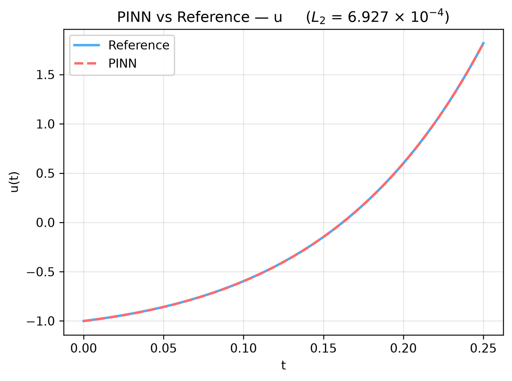
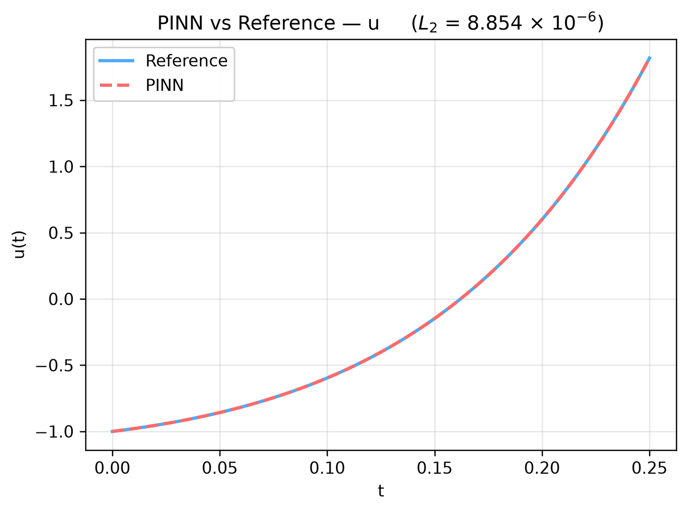

---
search:
  boost: 0.5
---

# Second-order ODE

| Example | |
|---|---|
| **Source** | DeepXDE example |
| **Problem** | Forward and Inverse (the Inverse mode is PINNStudio's addition) |
| **Dimension** | ODE (t) |
| **Regime** | Time-dependent |
| **Geometry** | — (t only) |
| **Outputs** | `u` |
| **Settings** | Default, Tuned |

## Governing equations

Mathematical form (from the benchmark records):

\[\frac{d^2u}{dt^2} - 10\frac{du}{dt} + 9u = 5t, \qquad t \in [0, 0.25]\]

As typed in PINNStudio's **Equations** page (each expression is a residual, set to zero):

```text
du_tt - 10*du_t + 9*u - 5*t
```

As typed in PINNStudio's **Equations** page (Inverse mode) (each expression is a residual, set to zero):

```text
du_tt - a*du_t + b*u - 5*t
```

## Domain

- Time interval: \(t \in [0, 0.25]\)

## Initial conditions

| Output | Initial value | How it is imposed (Settings: Default) |
|---|---|---|
| `u` | `-1` | loss term |

## Boundary conditions

| Type | Where | Output | Value | Details |
|---|---|---|---|---|
| Operator BC (advanced) | initial time | — | `du_t - 2` | applied at the initial time |

## Unknowns and measured data (Inverse)

| Trainable parameter | Initial value | True value |
|---|---|---|
| `a` | 5 | 10 |
| `b` | 4.5 | 9 |

Measured data (**Inverse** page, measured-data files):

- [`reference_data/deepxde/ode2_inverse/u_obs.txt`](https://github.com/AsfandyarKhan72/PINNStudio/blob/main/reference_data/deepxde/ode2_inverse/u_obs.txt) → output `u`, weight 100

## Settings

### Forward mode

**Settings: Default** — DeepXDE's own settings

- **Network:** FNN, hidden layers 3 × 50, inputs (t), 1 output; activation tanh, initializer Glorot uniform
- **Points:** 16 domain, 2 boundary, 500 test
- **Loss weights:** `0.01,1,1` (equations, then boundary-condition rows, then initial conditions)

| Phase | Optimizer | Iterations | Learning rate | Decay |
|---|---|---|---|---|
| 1 | Adam | 10,000 | 0.001 | none |

No separate **Tuned** preset: the **Tuned** item is greyed out for this example (its Default settings are PINNStudio's best).

### Inverse mode

**Settings: Default** — DeepXDE's settings with PINNStudio's Inverse-mode changes (see *Notes*)

- **Network:** FNN, hidden layers 3 × 50, inputs (t), 1 output; activation tanh, initializer Glorot uniform
- **Points:** 16 domain, 2 boundary, 500 test
- **Loss weights:** `0.01,1,1` (equations, then boundary-condition rows, then initial conditions)

| Phase | Optimizer | Iterations | Learning rate | Decay |
|---|---|---|---|---|
| 1 | Adam | 10,000 | 0.001 | none |
| 2 | L-BFGS | 15,000 | — | none |

??? note "Settings: Tuned"

    The Training Log reports: *Tuned settings: a larger network (hidden layers twice as wide, one more layer).* The change is applied to the example's own settings.

    - **Network:** FNN, hidden layers 4 × 100, inputs (t), 1 output; activation tanh, initializer Glorot uniform
    - **Points:** 16 domain, 2 boundary, 500 test
    - **Loss weights:** `0.01,1,1` (equations, then boundary-condition rows, then initial conditions)

    | Phase | Optimizer | Iterations | Learning rate | Decay |
    |---|---|---|---|---|
    | 1 | Adam | 10,000 | 0.001 | none |
    | 2 | L-BFGS | 15,000 | — | none |

## Results

From the benchmark records: one RTX 4090; relative L₂ error of the main output at the last reference time, and for an inverse problem the parameters it found (true value in brackets). *PINNStudio best* is what **Settings: Tuned** loads.

| | Default | PINNStudio best | Training time of the best (s) |
|---|---|---|---|
| Forward: relative L₂ at the last reference time | 6.9 × 10<sup>-4</sup> | **6.9 × 10<sup>-4</sup>** | 28 |
| Inverse: parameters found (true) | – | **a = 10.0003 (10); b = 8.99262 (9)** (worst error 0.082%) | 30 |

<figure markdown="span">
  { loading=lazy }
  <figcaption>DeepXDE's settings (also PINNStudio best) — PINN against the reference along a line, at the reference times</figcaption>
</figure>

<figure markdown="span">
  { loading=lazy }
  <figcaption>PINNStudio best — Larger network (2× width, one more layer) — PINN against the reference along a line, at the reference times</figcaption>
</figure>

Every setting tried, the papers' reported errors and all figures: [the benchmark records](https://github.com/AsfandyarKhan72/PINNStudio/blob/main/benchmarks/examples.md#dx-second-order-ode).

## Loading it in PINNStudio

- Forward: toolbar **Examples:** › **Forward** › under the **── ODE ──** heading, **Second-order ODE** › **Default**, then **Solve**.
- Inverse: toolbar **Examples:** › **Inverse** › under the **── ODE ──** heading, **Second-order ODE** › **Default** or **Tuned**, then **Solve**.

Loading an example fills in every setting; anything you change before **Solve** is listed in the Training Log. Your save folder, GPU, random-seed and plot-style settings are kept.

## Reference solution

- Exact solution, **Error Analysis** › reference from formula: `u = 50/81 + t*5/9 - 2*exp(t) + 31/81*exp(9*t)`

## Notes

- u(0) = -1 is the initial condition; u'(0) = 2 is an Operator BC 'du_t - 2' at the initial time.
- Inverse mode (PINNStudio's addition): the coefficients a (10 in the forward equation; initial guess 5) and b (9; initial guess 4.5) of u'' - a u' + b u = 5t are learned from u at 30 times (reference_data/deepxde/ode2_inverse). An L-BFGS phase follows Adam.

## Definition and records

- **Definition:** `EXAMPLES` entry "Second-order ODE" in [`pinnstudio/core/deepxde_examples.py`](https://github.com/AsfandyarKhan72/PINNStudio/blob/main/pinnstudio/core/deepxde_examples.py)
    - Inverse mode (PINNStudio's addition): `ADDED_INVERSE["Second-order ODE"]`, same file
    - Settings: Tuned: entry "Second-order ODE" in [`pinnstudio/resources/tuned_settings.json`](https://github.com/AsfandyarKhan72/PINNStudio/blob/main/pinnstudio/resources/tuned_settings.json)
- **Equations:** [Governing equations](#governing-equations) on this page
- **Reference data:** the exact-solution formula under *Reference solution* (no data files)
- **Measured data** (Inverse): [`reference_data/deepxde/ode2_inverse/`](https://github.com/AsfandyarKhan72/PINNStudio/tree/main/reference_data/deepxde/ode2_inverse), written by [`tools/make_deepxde_reference_data.py`](https://github.com/AsfandyarKhan72/PINNStudio/blob/main/tools/make_deepxde_reference_data.py)
- **Benchmark records:** [`benchmarks/problems/second-order-ode.md`](https://github.com/AsfandyarKhan72/PINNStudio/blob/main/benchmarks/problems/second-order-ode.md), its entry in the [examples overview](https://github.com/AsfandyarKhan72/PINNStudio/blob/main/benchmarks/examples.md#dx-second-order-ode), the [benchmark collection](https://github.com/AsfandyarKhan72/PINNStudio/blob/main/benchmarks/README.md)
- **Tuning-study configurations** (records of the tuning study; open one with **Problem › Open Saved Problem...**; not presets of the Examples list): [`Second-order ODE (tuned).pinn.json`](https://github.com/AsfandyarKhan72/PINNStudio/blob/main/benchmarks/tuning/Second-order%20ODE%20%28tuned%29.pinn.json), [`Second-order ODE, inverse mode (tuned).pinn.json`](https://github.com/AsfandyarKhan72/PINNStudio/blob/main/benchmarks/tuning/Second-order%20ODE%2C%20inverse%20mode%20%28tuned%29.pinn.json)
- **DeepXDE example:** [ode_2nd.py](https://github.com/lululxvi/deepxde/blob/master/examples/pinn_forward/ode_2nd.py) ([documentation](https://deepxde.readthedocs.io/en/latest/demos/pinn_forward/ode.2nd.html))
- **Cite:** [Lu et al. 2021](../../about/references.md#lu2021deepxde) (DeepXDE)

Verified error values are reported in the [Reproducibility](../../reproducibility/benchmarks.md) section, not on this page.

[← Back to the example gallery](../index.md)
