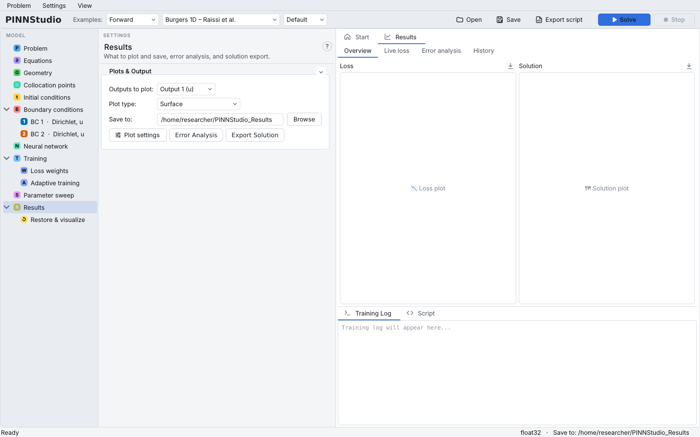

# First run

This page loads one of the built-in examples, trains it and shows where the results appear. It uses
**Burgers 1D – Raissi et al.**, the one-dimensional viscous Burgers equation
\( u_t + u u_x = (0.01/\pi) u_{xx} \) of [Raissi et al. (2019)](../about/references.md#raissi2019); the steps are
the same for every example.

## Start PINNStudio

Start PINNStudio from its icon or with the `pinnstudio` command (see
[Starting PINNStudio](installation.md#starting-pinnstudio)). The window opens on the **Start** tab.

{ .screenshot loading=lazy }

The window has four parts:

- **Toolbar** (top): the **Examples** list, **Open**, **Save**, **Export script**, **Solve** and **Stop**.
- **Model tree** (left): one node per part of the problem, from **Problem** to **Results** and
  **Restore & visualize**. Selecting a node shows its settings.
- **Settings** (middle): the page of the selected node.
- **Graphics** (right): the **Start** and **Results** tabs (and the domain views for 2D and 3D problems), with the
  **Training Log** and **Script** tabs below them.

The status bar at the bottom shows **Ready**, the floating-point precision (`float32` by default) and the folder
results are saved to (**Save to:**, by default `PINNStudio_Results` in your home folder).

The **Start** tab offers:

- **NEW**: an empty **1D problem**, **2D problem**, **3D problem** or **ODE system**;
- **Open a saved problem...**: a `.pinn.json` file saved from PINNStudio;
- **RECENT**: the problems you opened or saved last (shown once there are any);
- **EXAMPLES**: every forward example, grouped under **ODE**, **1D**, **2D** and **3D**. Each card gives the
  example's name and whether it is time-dependent or steady, its domain and its source (DeepXDE or PINNStudio).

## Load an example

There are two ways to load an example.

**From the Start tab.** Scroll to the **1D** group and click **Burgers 1D – Raissi et al.** This loads the forward
version of the example.

**From the toolbar.** The toolbar has three lists next to **Examples**:

| List | Choices | What it does |
|---|---|---|
| Category | **Forward**, **Inverse** | **Forward**: every example, solving for the field. **Inverse**: the examples that learn unknown parameters or fields from measured data. |
| Example | the examples of the category, under ODE / 1D / 2D / 3D headings | Loads the example. **None** when nothing is loaded. |
| Settings | **Default**, **Tuned** | **Default**: a DeepXDE example with DeepXDE's own settings; an example taken from a paper solved the way the paper solves it (network, points, training); PINNStudio's own examples as they are. **Tuned**: PINNStudio's best settings for the example from the project's benchmarks (the most accurate run, and of runs about as accurate, the fastest). |

Leave the category on **Forward** and the settings on **Default**, and choose **Burgers 1D – Raissi et al.** from
the example list.

!!! info "New in v1.6.0 (in development)"
    The **Default** / **Tuned** settings list is new in the development version. The current release (v1.5.0) loads
    each example with one set of settings.

Every setting fills in: the equation, the domain, the initial and boundary conditions, the network and the
training. The model tree now has one node per boundary condition (**BC 1 · Dirichlet, u** and
**BC 2 · Dirichlet, u**), and the Training Log says what was loaded:

{ .screenshot loading=lazy }

For this example the log reports that **Error analysis** was configured automatically with the example's reference
solutions (five files, at five times), so the error of the trained network is computed when training ends. Most
examples come with reference data or an exact solution in the same way.

Click through the model tree to see what the example contains. For instance, **Training** shows the
**Training phases**: with the **Default** settings this example trains with a single L-BFGS phase, as in the paper.

{ .screenshot loading=lazy }

You do not need to change anything for a first run. The [User guide](../guide/index.md) explains every page.

## Solve

Press **Solve** in the toolbar (or **Ctrl+Enter** or **F5**). PINNStudio first checks the settings. If a setting
would stop the run, the toolbar shows a button such as **1 setting to fix**, the model tree marks the node concerned,
and the Training Log lists the problem under `❌ Cannot start -- this configuration has invalid settings:`. A loaded
example has no such problems.

PINNStudio then writes the training script for these settings, starts it as a separate Python process, and switches
the graphics area to **Results › Live loss**, where the loss is plotted while the network trains.

While the run is going:

- the **Solve** button reads **Solving…** and **Stop** becomes active;
- the status bar shows the phase (for example `phase 1/1 (L-BFGS)`), a progress bar, the iteration, the current
  loss, the elapsed time and an estimate of the time left;
- the **Training Log** shows what the script prints: the device it trains on, the loss table that DeepXDE prints
  at regular intervals (step, training loss terms, test loss), and messages from PINNStudio.

**Stop** (or **Shift+F5**) ends the run at once; the log then says `⏹ Stopped by user.`

How long the run takes depends on the example, the settings and the computer. Larger 2D and 3D examples can take
much longer than this one; [Seeds, precision and hardware](../reproducibility/environment.md) discusses CPU and GPU
training.

## Results

When training ends, the Training Log says `✅ Training complete!` and the folder the results were saved to
(`💾 Results saved to: ...`). The status bar sums up the run: `Finished`, the training time, the final loss and,
when error analysis ran, the mean relative \( L_2 \) error.

The **Results** tab opens on **Overview**, with the loss curve and the solution plot of this run. The other tabs are:

| Tab | Shows |
|---|---|
| **Overview** | The loss history and the solution plot (for a 1D time-dependent problem, a surface plot of \( u(x, t) \) by default) |
| **Live loss** | The loss as it was recorded during training |
| **Error analysis** | The relative \( L_2 \) error (and the other error measures chosen) at each reference time, with the comparison plots |
| **History** | Earlier runs saved in the results folder, which can be compared on one plot |

The **Results** page of the model tree chooses what is plotted (**Outputs to plot**, **Plot type**), the results
folder (**Save to**), and opens **Plot settings**, **Error Analysis** and **Export Solution**:

{ .screenshot loading=lazy }

Each run gets its own folder inside **Save to**, named after the problem and the time of the run
(`<name>__<date>_<time>`). It holds the trained model, the figures, the training log and, when error analysis ran,
an `error_analysis` folder. The trained model can be loaded again under **Restore & visualize** without
retraining (see [Restore & visualize](../guide/restore.md)).

A small loss alone does not mean an accurate solution. When reference data or an exact solution is available, the
**Error analysis** tab is the measure to look at; when it is not, check the result in other ways (see
[Scope and limitations](../theory/limitations.md)).

## Next steps

- Try the same example in the **Inverse** category: it learns the equation's coefficients from measured data.
- Switch the settings list to **Tuned** and solve again to compare.
- [Save the problem, reopen it and export its script](save-and-export.md).
- Work through the [Tutorials](../tutorials/index.md), starting with
  [a first forward ODE](../tutorials/01-ode.md) and [the 1D Burgers equation](../tutorials/02-burgers.md).
