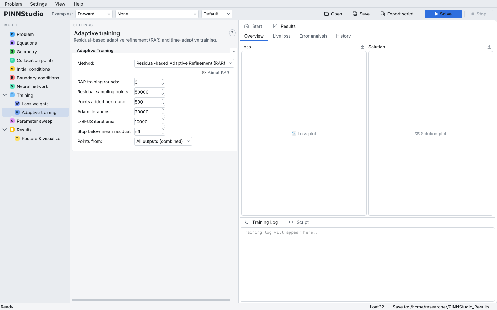

# Adaptive training

The **Adaptive training** page (under **Training** in the tree) offers two ways to change the training as
it goes. Choose one in **Method:**

- **Time Adaptive Training** — split the time interval into windows and train them one after another;
- **Residual-based Adaptive Refinement (RAR)** — after the training phases, repeatedly add training
  points where the residual is largest and train again;
- **None** (default).

Automatic loss weighting (per-point weights, causal training) is on the
[Loss weights](loss-weights.md) page and combines with either method, within the limits given there.

{ .screenshot loading=lazy }

Background: [Time windows and bc-PINN](../reference/time-windows.md), [RAR](../reference/rar.md).

## Time-adaptive training

Time-adaptive training trains one model per time window, each over its own short window instead of the
whole time range at once. This often follows fast-changing solutions better.

{ .screenshot loading=lazy }

### Set the windows

**Time step groups:** each row splits **Start time:** to **End time:** into **Steps (n):** windows. Use
several rows for finer windows where the solution changes fastest, for example 0 to 0.2 in 10 steps and
0.2 to 1 in 8 steps. **Add step group** adds a row; ✕ removes one.

For every window the [training phases](training.md) run in full, and the window's model is saved in
`time_adaptive_steps/step_NNN_…` in the run folder. The first window starts from the initial conditions;
each later window starts from the previous window's solution, sampled on a grid of
**IC grid resolution:** points per axis (squared in 2D, cubed in 3D; pick a preset or type a number). On a
disk, polygon or custom shape, only the grid points inside the domain carry the solution. In
3D a resolution of 51 or more is over 100,000 points per window and can exhaust GPU memory; the page
warns about it. The later windows use the loss weights as set (see
[Loss weights](loss-weights.md#weights-and-time-windows)).

### Carry the network from window to window

- **Enable transfer learning (warm start from previous step)** — each window's network starts from the
  previous window's weights instead of from scratch. **Transfer optimizer:** says which state is carried
  over: **Adam** (the network after the last Adam phase and the resampling rounds) or **L-BFGS** (as the
  window ended).

With transfer learning on, one network can be trained through all the windows:

- **Growing time range: each window trains on [start, t] (one network)** — each window trains on the
  whole time range so far, with the true initial condition at the start (Wight & Zhao's "approach I").
- **Backward compatibility (bc-PINN): keep the solution on earlier windows** — after each window the
  solution on the range so far is stored at **Times/window:** times and **Points:** points, and later
  windows are held to it with the loss **Weight:** (Mattey & Ghosh's bc-PINN).

Both need transfer learning; **Solve** says so if it is off.

### Optional steps inside each window

- **IC-guided learning:** — before each window's training, fit the window's starting profile, held
  constant over the window, for this fraction of the first Adam (or AdamW) phase's iterations
  (0 = off, at most 0.9). The fit uses that phase's learning rate and the mean squared error.
- **Resampling rounds:** — after the window's training, draw **Candidates per round:** random points in
  the window (default 10,000; at least as many as the points per round), add the **Points per round:**
  of them with the largest residual to its collocation points and train **Adam iterations per round:**
  more Adam iterations; repeat this many times (0 = off). The rounds use the optimizer, learning rate and loss
  function of the last first-order training phase.

### When it is not available

Time-adaptive training needs a time axis: it is greyed out for a **Stationary** problem and removed in
**Inverse** mode. For an ODE it can be selected, but it has no effect: the ODE is solved over the whole interval
at once. It cannot be combined with an exact initial condition or with *Scale by initial
losses*, and its resampling rounds not with per-point weights.

## Residual-based adaptive refinement (RAR)

RAR first trains with the training phases. Then, in each round, it evaluates the residual at
**Residual sampling points:** random points, adds the **Points added per round:** points with the
largest residual to the training points, and trains **Adam iterations:** Adam iterations followed by
**L-BFGS iterations:** L-BFGS iterations (0 skips L-BFGS). The rounds repeat **RAR training rounds:**
times, or stop earlier once the mean residual over the sampled points is below
**Stop below mean residual:** (**off** runs every round).

{ .screenshot loading=lazy }

**Points from:** says which residual ranks the points when there are several equations:
**All outputs (combined)** (the sum of the absolute residuals; **All equations (combined)** when
equations and outputs differ in number) or one equation.

Each round's first-order step uses the optimizer, learning rate, loss function and weights of the last
training phase that is not L-BFGS or NNCG (without its learning-rate decay), and its L-BFGS step the last
L-BFGS phase's loss function and weights (the first-order phase's when there is no L-BFGS phase). With a save folder, each round's model and a
picture of the collocation points are saved in the run folder.

RAR works for stationary and inverse problems too. It cannot be used with `frac(...)` equations.

## Settings on this page

| GUI label | Meaning | Default | Range | Saved as |
|---|---|---|---|---|
| **Method:** | None, Time Adaptive Training, Residual-based Adaptive Refinement (RAR) | None | | `adapt_method` (`None`, `Time Adaptive`, `RAR`), `time_adaptive` |
| **Start time:**, **End time:**, **Steps (n):** | One step group | 0, 1, 10 | steps 1–500 | `ta_step_groups` (JSON), `ta_num_steps` (total) |
| **IC grid resolution:** | Grid points per axis passed between windows | 201 | 1–1,000,000 | `ta_grid_size` |
| **Enable transfer learning (warm start from previous step)** | Start each window from the previous one | off | | `ta_transfer_learning` |
| **Transfer optimizer:** | Adam or L-BFGS state carried over | Adam | | `ta_transfer_optimizer` |
| **Growing time range: …** | One network on [start, t] | off | | `ta_growing` |
| **Backward compatibility (bc-PINN): …** | Hold later windows to earlier solutions | off | | `ta_backward` |
| **Weight:**, **Times/window:**, **Points:** | bc-PINN loss weight and stored points | 100, 10, 2000 | 0–1e6, 1–1000, 1–1,000,000 | `ta_backward_weight`, `ta_backward_times`, `ta_backward_points` |
| **IC-guided learning:** | Fraction of the first Adam phase | 0.00 | 0–0.9 | `ta_icgl_fraction` |
| **Resampling rounds:** | Rounds per window | 0 | 0–50 | `ta_resample_rounds` |
| **Points per round:** | Points added per round | 200 | 1–100,000 | `ta_resample_points` |
| **Candidates per round:** | Random candidate points per round | 10000 | 100–1,000,000 | `ta_resample_candidates` |
| **Adam iterations per round:** | Training per round | 2000 | 1–1,000,000 | `ta_resample_iters` |
| **RAR training rounds:** | Number of rounds | 3 | 1–1000 | `rar_cycles` |
| **Residual sampling points:** | Candidate points per round | 50000 | 1000–10,000,000 | `rar_candidates` |
| **Points added per round:** | Points added | 500 | 1–10,000 | `rar_add_points` |
| **Adam iterations:** | Adam per round | 20000 | 0–100,000,000 | `rar_adam_iters` |
| **L-BFGS iterations:** | L-BFGS per round (0 = none) | 10000 | 0–100,000,000 | `rar_lbfgs_iters` |
| **Stop below mean residual:** | Early stop of the rounds | off (0) | 0–1e6 | `rar_tolerance` |
| **Points from:** | Residual that ranks points | All outputs (combined) | | `rar_output_selector` (−1 = combined) |
