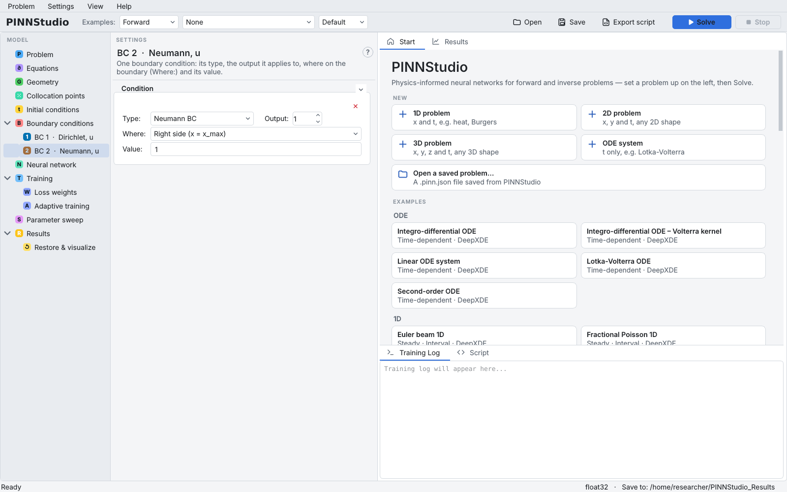
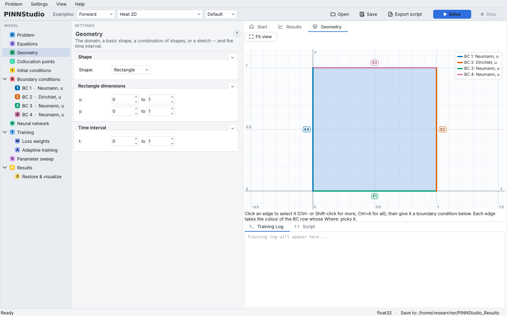

# Boundary conditions

The **Boundary conditions** page is a list of rows. Each row is one condition, and one loss term with its
own weight: its **Type** (Dirichlet, Neumann, …), the **Output** it applies to, **Where** on the boundary
it holds, and its **Value**. An example fills the list with its own rows; for your own problem the list
starts empty. Every row is editable and removable in both cases.

Each row also appears in the model tree under **Boundary conditions** as **BC 1**, **BC 2**, …, labelled
with its type and output. Selecting one shows that row alone.

{ .screenshot loading=lazy }

Background: [Boundary conditions](../reference/boundary-conditions.md),
[Exact constraints](../reference/exact-constraints.md).

## Add a condition

1. Click **Add Boundary Condition** (or right-click **Boundary conditions** in the tree and choose
   **Add boundary condition**). A Dirichlet row with value 0 on the whole boundary is added.
2. Choose its **Type** and its **Output** (1 is the first output, as numbered on the Equations page).
3. Choose **Where** it applies.
4. Type its **Value**.

For example, **to add a Neumann condition \( \partial u/\partial n = 1 \) on the right side** of a 1D
problem: add a row, set **Type** to **Neumann BC**, **Where** to **Right side (x = x_max)** and
**Value** to `1`.

{ .screenshot loading=lazy }

Right-click a **BC N** entry to **Duplicate** or **Delete** it; the ✕ at the top right of a row deletes it
too. Each new row adds a **BC N (type, output)** weight on the [Loss weights](loss-weights.md) page.

## Say where a condition holds

**Where** offers the common choices for the current dimension:

| Dimension | Choices |
|---|---|
| ODE | **Both ends (t₀ and t₁)**, **Start (t = t₀)**, **End (t = t₁)** |
| 1D | **Whole boundary**, **Left side (x = x_min)**, **Right side (x = x_max)**, **Left and right sides** |
| 2D | the 1D choices, plus **Bottom side (y = y_min)**, **Top side (y = y_max)**, **Bottom and top sides** |
| 3D | the 2D choices, plus **Front side (z = z_min)**, **Back side (z = z_max)**, **Front and back sides** |

and **Custom expression…**, which opens a box for any true/false expression in `x`, `y`, `z` (and `t`).
It is only evaluated at points that are already on the boundary, so it only has to say *which part*,
for example:

```text
left or right                    both ends in x
x <= 0.5 and bottom              the left half of the bottom side
np.isclose(x**2 + y**2, 0.25)    a circle of radius 0.5 (for example a hole)
```

The side names and the limits `x_min`, `x_max`, … are defined from the limits on the Geometry page. For
a disk, ellipse, polygon or combined shape, use **Whole boundary**, a custom expression, or pick edges
in the Geometry tab (below).

In 2D and 3D you can also pick edges (faces) with the mouse: with the **Boundary conditions** entry
selected, click edges in the **Geometry** or **Sketch** tab and use the **Edges picked in the sketch** box
(**＋ New BC on selected**, **Add to**, **Remove from BC**); with one **BC N** entry selected, clicking an
edge adds it to that row's **Where** or takes it out. See
[Geometry and domain](geometry.md#pick-boundary-edges-in-the-graphics).

{ .screenshot loading=lazy }

## Write the value

A value is an expression in the coordinates, the named constants and the domain limits, for example
`0`, `sin(pi*y)` or `x**2`.

!!! note "Sign of Neumann and Robin values"
    Neumann and Robin values are \( \partial u/\partial n \), the derivative along the **outward** normal:
    \( +\partial u/\partial x \) on a right side, \( -\partial u/\partial x \) on a left side (likewise in
    `y` and `z`).

## Condition types

| **Type** | What it imposes | Extra fields |
|---|---|---|
| **Dirichlet BC** | The output's value: \( u = g \) | |
| **Neumann BC** | The outward normal derivative: \( \partial u/\partial n = g \) | |
| **Robin BC** | \( \partial u/\partial n = g(x, u) \); the value may use the output by name, e.g. `2*u - 1` | |
| **Periodic BC** | The output (or, with **Derivative order** 1, its first derivative) is equal on two opposite sides | **Periodic in:** `x`, `y` or `z`, shown with the pair it ties together (*left ↔ right*, *bottom ↔ top*, *front ↔ back*); **Derivative order:** 0 or 1 |
| **Point Set BC** | Given values at given points (measured or known) | **Points:** **From file**, **Typed list** or **Generated** (a **Count** of random points **on the boundary (Where)** or **in the domain**); **Target values:** **From the file's value column(s)** or **Formula**; **Components (comma-separated):** several outputs at once; **Batch size (0 = off):** and **Shuffle** |
| **Point Set Operator BC (advanced, from file)** | An expression of the outputs and their derivatives, e.g. `du_x`, equals given values at given points (anywhere, also inside the domain) | **Function (func):**, points and target values as for Point Set BC |
| **Operator BC (advanced)** | An expression of the outputs and their derivatives is zero on the part of the boundary picked by **Where**, e.g. `du_x - 4` | **Function (func):**; **Applies on:** **the boundary** or **the initial time (t = t₀)** |
| **Interface 2D BC (advanced, Rectangle/Polygon only)** | Ties two matching edges together (DeepXDE's `Interface2DBC`) | **Where (side 2):**, **Direction:** normal or tangent. Offered only for a 2D problem with exactly 2 outputs; it switches **Point distribution** to **uniform** |

In operator expressions the derivative shorthand of the Equations page works (`u`, `du_x`, `du_xx`, …).
A periodic row needs no **Where**: the axis says which sides are tied, and **Where** is hidden while it
names one of those sides or the whole boundary.

## Make periodicity exact

Ticking **Exact periodicity (periodic inputs)** makes the solution periodic by construction: every axis
with a periodic row enters the network as \( \cos(2\pi x/L) \), \( \sin(2\pi x/L) \) instead of \( x \)
(\( L \) the domain's length on that axis), so values and all derivatives match at both ends. The
periodic rows can stay; their loss is then about zero. This replaces the input transform of the
Neural network page, which must stay off.

!!! info "New in v1.6.0 (in development)"
    Exact periodicity makes **every** output periodic along the periodic axis. If an output has no
    periodic row on that axis, **Solve** now refuses with an explanation instead of silently making it
    periodic too.

## Conditions built into the network instead

A row is a loss term, so the condition holds only approximately, as well as its weight asks for. To
impose a condition exactly, use **Exact periodicity**, an exact initial condition
([Initial conditions](initial-conditions.md#build-the-initial-condition-into-the-network)) or an
output-transform formula ([Neural network](network.md#impose-conditions-exactly-with-an-output-formula)).
A problem whose boundary conditions are all in an output formula has no rows; the note at the top of
the page then says so.

## Check that each row picks points

!!! info "New in v1.6.0 (in development)"
    A boundary condition that selects no training point (for example **Left side** after an example's
    domain was changed to a disk, which has no flat sides) used to give a NaN loss term. Both the
    Solve script and the exported script now print which condition is empty and why, before training.
    The settings check also flags a row whose last sketched edge was taken out.

Changing the dimension by hand removes every row (see [Problem](problem.md#choose-the-dimension)).

## Settings on this page

All rows are saved together as a JSON list in `custom_bc_json`, one object per row; the keys are given
in the last column.

| GUI label | Meaning | Default (new row) | Key in `custom_bc_json` |
|---|---|---|---|
| **Exact periodicity (periodic inputs)** | Periodic input features for the periodic axes | off | `periodic_inputs` (own field) |
| **Type:** | Condition type | Dirichlet BC | `type` (`dirichlet`, `neumann`, `robin`, `periodic`, `pointset`, `pointset_operator`, `operator`, `interface2d`) |
| **Output:** | Output the row applies to (shown from 1) | 1 | `component` (from 0) |
| **Where:** | Part of the boundary | Whole boundary | `location` (expression; `True` = whole boundary) |
| **Value:** / **Function (func):** | Value, or operator expression | `0` | `value` |
| **Periodic in:** | Periodic axis | x | `axis` |
| **Derivative order:** | 0: values equal; 1: first derivatives equal | 0 | `deriv_order` |
| **Points:** | From file, Typed list, Generated | From file | `points_mode`, `points_file`, `points_list`, `points_count`, `points_where` |
| **Target values:** | From the file's value column(s), or Formula | from the file | `values_mode`, `values_formula` |
| **Components (comma-separated):** | Several outputs for one Point Set row | blank | `components` |
| **Batch size (0 = off):** / **Shuffle** | Use a random batch of the points each step | 0 / on | `batch_size`, `shuffle` |
| **Applies on:** | Operator BC on the boundary or at t = t₀ | the boundary | `apply_at` |
| **Where (side 2):** / **Direction:** | Interface 2D BC | blank / normal | `location2`, `direction` |
