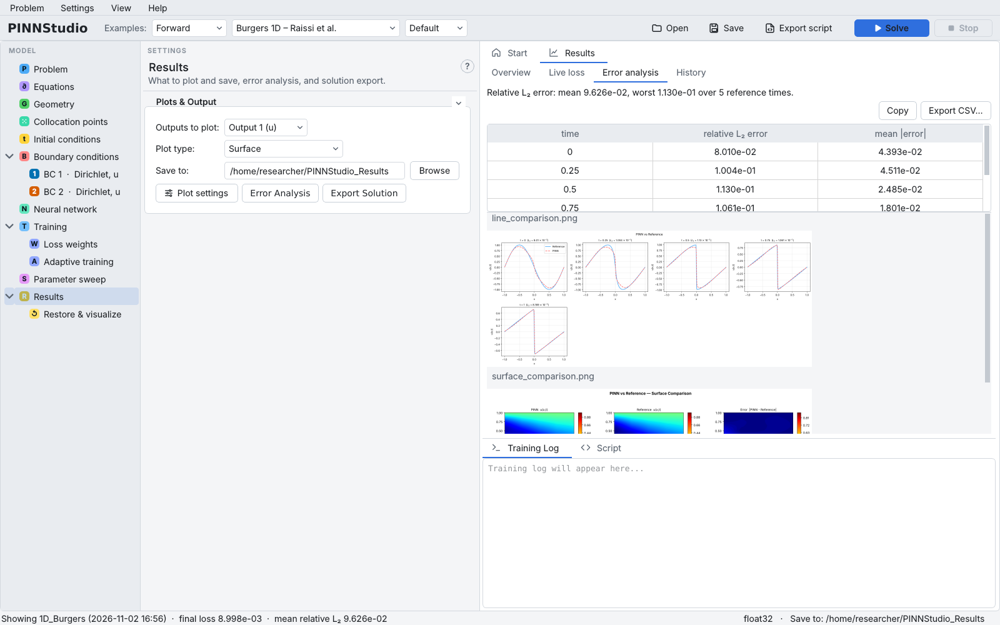

# Error Analysis

Error Analysis compares the trained network with a reference solution — data files or an exact
formula — and reports the error. Set it up once with the **Error Analysis** button on the
[Results](results.md) page; it then runs at the end of every **Solve**, and also when a model is
restored on the [Restore & visualize](restore.md) page.

Examples that ship with reference data set it up when they are loaded (the Training Log then says
*Error analysis auto-configured*).

{ .screenshot loading=lazy }

Background: [Error metrics](../reference/metrics.md), [Error measures](../theory/metrics.md).

## Set it up with reference files

1. Click **Error Analysis** on the Results page.
2. Under **Plot Types**, choose the figures: **Line comparison (PINN vs reference at each time)** and
   **Surface comparison (PINN | Reference | Error)**.
3. Under **Error Metrics to Compute**, choose **L2 Relative**, **MSE** and/or **Max Error**.
4. Leave **Reference:** at **Reference files**, and add one file per time snapshot: **Browse** for it, or
   **Add another file** for more rows. Each file is plain text, one point per line: the coordinates,
   the time (for a time-dependent problem) and the value — `x t u` in 1D — separated by commas,
   semicolons or spaces. Header and comment lines are skipped, and so are rows with a missing value
   (NaN, for example a point outside the shape) or a different number of columns. The time is
   read from the file and shown next to it (*t = 0.2500*, or *steady* for a stationary problem).
5. With more than one output, choose for each file which output it holds, or
   **Custom expression...** for an expression of the outputs (with an optional label).
6. Click **Run Error Analysis**. This stores the setup; the Training Log says it will run after training.

## Set it up with an exact formula

When the exact solution is known, choose **Reference: Exact solution formula** and type one formula per
output in `x`, `y`, `z`, `t`, for example `exp(-t)*sin(pi*x)` (functions: `sin`, `cos`, `exp`, `log`,
`sqrt`, `tanh`, `erf`, `norm_cdf`, `pi`; named constants can be used). Leave an output blank to skip it.
**Compare at times:** lists the times (blank: 5 evenly spaced), **Grid:** the number of points per axis
of the comparison grid (**auto** by default). No files are needed. A run with a formula writes the
reference values it used into its folder, so Restore & visualize can compare against them later.

## Read the results

After the run, the **Error analysis** tab of the Results area shows a table of the relative L₂ error and
the mean absolute error at each reference time, a summary line (mean and worst relative L₂ error), and
the comparison figures. The status bar shows the mean relative L₂ error too.

{ .screenshot loading=lazy }

The run folder's `error_analysis/` folder holds the figures (`line_comparison.png`,
`surface_comparison.png`) and the numbers (`error_metrics.txt`, one file per output when there are several).
Error Analysis also gives the relative L₂ error over all reference times together (every reference point at every
time), in the Training Log and in `error_spacetime.txt`. A 3D problem on a box also gets a 3D view,
`view3d_comparison.png`: the PINN's surface where the field has a given value, and the error on the box with a
corner cut away. The value is set in **Plot settings**, **Surface** tab, **3D view surface level** (blank: the
middle of the reference's range).

The tab's table shows the relative L₂ and mean absolute error only; **MSE** and **Max Error**, when ticked,
are in the `error_metrics` files and the Training Log. The table has no output column: with several outputs (an
ODE system, for example) it lists each output's rows one after the other, in output order, and its summary line
counts each output's row as a reference time. `error_spacetime.txt` is written for time-dependent PDEs only.
With a reference file that names no output (`t_<time>.txt`) on a problem with several outputs, the log names the
field it compares (the one the Results page plots).

## How Error Analysis connects to other features

- **Parameter sweep, Bayesian search:** minimising the **L2 error** needs Error Analysis to be set up
  ([Parameter sweeps](sweeps.md)). Each sweep run reports its error in the Training Log and in
  `sweep_summary.csv`.
- **History:** the relative L₂ error of every saved run is listed in the History tab.
- **Export script:** the exported script contains the same Error Analysis.
- **RAR:** with reference data, each RAR round's solution is also compared with it.

## Settings in this dialog

| GUI label | Meaning | Default | Saved as |
|---|---|---|---|
| **Line comparison (PINN vs reference at each time)** | Line figure | on | `ea_do_line` |
| **Surface comparison (PINN &#124; Reference &#124; Error)** | Surface figure | on | `ea_do_surface` |
| **L2 Relative** / **MSE** / **Max Error** | Metrics | on / off / off | `ea_metric_l2`, `ea_metric_mse`, `ea_metric_max` |
| **Reference:** | Reference files or Exact solution formula | Reference files | `ea_ref_mode` (`files`, `formula`) |
| (file rows) | Reference files, their times and outputs | none (examples: their files) | `ea_files` |
| *name* **=** | Exact formula per output | blank | `ea_ref_formula` (separated by a vertical bar) |
| **Compare at times:** | Times for the formula | blank (5 evenly spaced) | `ea_ref_times` |
| **Grid:** | Points per axis for the formula (0 = auto, up to 2001) | auto | `ea_ref_grid` |
