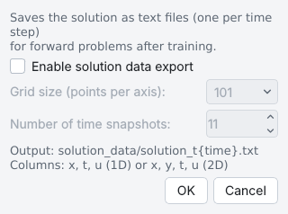

# Exporting a script

**Export script** writes the current problem as a standalone Python script that uses DeepXDE, PyTorch
and matplotlib directly. You can read it to see exactly what your settings mean in DeepXDE code, edit it,
and run it without PINNStudio. This page also covers **Export Solution**, which saves the trained
solution as data files.

Saving the problem itself (`.pinn.json`) is described in
[Save, reopen and export](../getting-started/save-and-export.md).

Background: [Generated scripts](../reference/scripts.md),
[Export equivalence](../reproducibility/export-equivalence.md).

## Export the script

1. Click **Export script** in the toolbar (or **Problem › Export as DeepXDE Script...**, Ctrl+E, or
   **Export…** on the **Script** tab).
2. Choose a file name; the default is the example's or problem's name with `.py`.
3. Run it with the Python environment PINNStudio uses: `python problem.py`.

The **Script** tab below the graphics shows the same script while you edit the problem, so you can see
how a setting changes the code before exporting.

The exported script contains only the features the problem uses; an option that is off (RAR, IC
pre-training, callbacks, weight decay, inverse parameters, time windows, Error Analysis, transforms) is
left out entirely rather than hidden behind a condition. It saves the plots, the model and the losses in
a run folder, as Solve does.

## How the exported script relates to Solve

**Solve** runs PINNStudio's own full script (the *Solve script*), which handles every option at run
time. **Export script** writes a shorter script for the same settings. For most problems the two train
the same model; PINNStudio's [export-equivalence check](../reproducibility/export-equivalence.md)
compares them.

| Situation | What Export writes |
|---|---|
| Most problems | The short, readable script |
| Time windows with backward compatibility (bc-PINN), a growing time range, IC-guided learning or resampling rounds | The Solve script itself, with a note at the top saying so (it trains exactly the model Solve trains) |
| **Export Solution** enabled | The short script, with a note that only Solve writes the solution data files |
| A parameter sweep enabled | One run with the settings in the window; the sweep itself is not part of the script |

With time windows the exported script starts the first window from the same random weights as Solve. The
exported script sets the **GPU device index** and **Max GPU memory to reserve** of
**Settings › GPU / Hardware...** when they differ from the defaults.

## Export the solution as data

**Export Solution** on the Results page opens **Export Solution Data**. Tick
**Enable solution data export** to have **Solve** write the trained solution as text files after a
forward run, one file per time snapshot, in `solution_data/solution_t{time}.txt` in the run folder.
The columns are the coordinates, the time and the outputs (`x, t, u` in 1D, `x, y, t, u` in 2D).

{ .screenshot loading=lazy }

| GUI label | Meaning | Default | Saved as |
|---|---|---|---|
| **Enable solution data export** | Write the solution data after a forward Solve | off | `export_enabled` |
| **Grid size (points per axis):** | Points per space axis (101, 51, 21, 11, or typed) | 101 | `export_grid_size` |
| **Number of time snapshots:** | Number of time files (2–50) | 11 | `export_t_steps` |

To evaluate a trained model on your own points later, use [Restore & visualize](restore.md) or load the
saved `.pt` model in the exported script.
