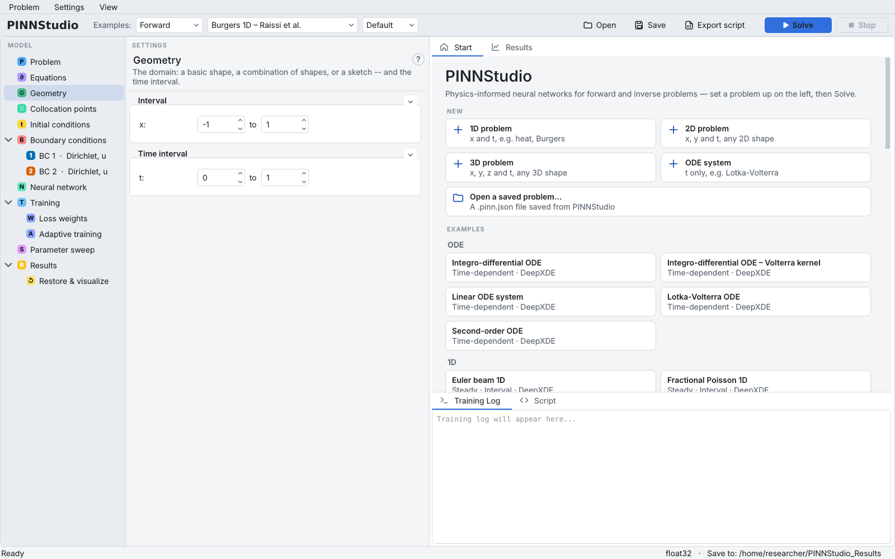
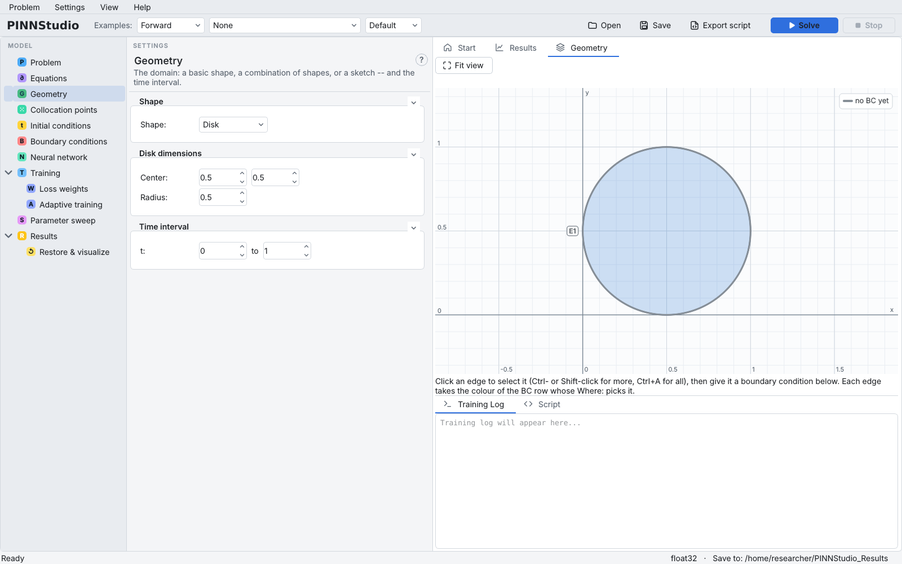
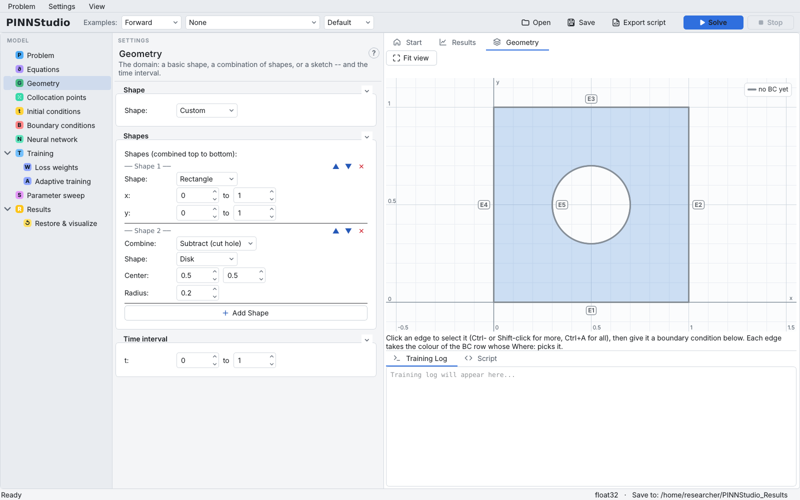
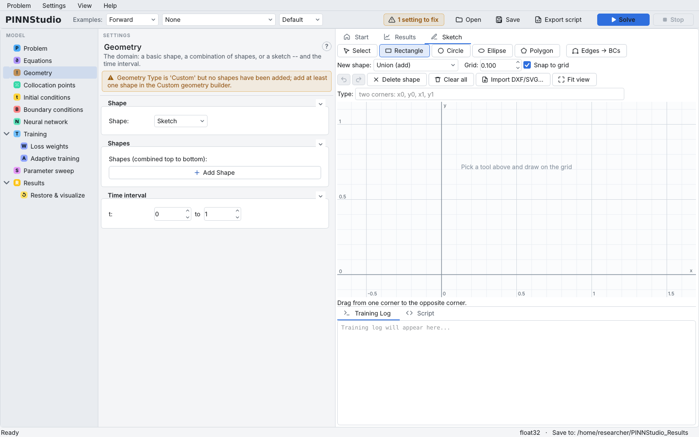

# Geometry and domain

The **Geometry** page defines the spatial domain and, for a time-dependent problem, the time interval.
Its boxes depend on the dimension chosen on the [Problem](problem.md) page:

| Dimension | Boxes on the page |
|---|---|
| **ODE  (t)** | **Time interval** only |
| **1D  (x)** | **Interval** (`x` from … to …) and **Time interval** |
| **2D  (x, y)** | **Shape**, the shape's own box (**Rectangle dimensions**, **Disk dimensions**, …, or **Shapes**) and **Time interval** |
| **3D  (x, y, z)** | the same, with 3D shapes |

A stationary problem has no **Time interval** box.

{ .screenshot loading=lazy }

Background: [Geometry](../reference/geometry.md).

## Type the limits

Every limit field accepts a number or a simple multiple of π: type `pi`, `pi/2`, `2*pi` or `π/2`;
the field then shows `π/2`. Values are kept to 10 decimals, so \( [0, \pi/2] \) is stored exactly
enough. Each lower limit must be smaller than its upper limit, or **Solve** refuses to start.

The limits also define the side names used by boundary conditions: *left* and *right* are
`x = x_min` and `x = x_max`, *bottom* and *top* are `y_min` and `y_max`, *front* and *back* are
`z_min` and `z_max`. These names belong to the box shapes (Interval, Rectangle, Cuboid). A disk,
ellipse, polygon or combined shape has no x/y limit fields on the page, and its curved or slanted edges
do not lie on such a line, so pick its boundary with **Whole boundary**, by clicking edges in the
Geometry tab, or with a custom expression (see [Boundary conditions](boundary-conditions.md)).

## Choose a 2D or 3D shape

**Shape** offers, in 2D: **Rectangle**, **Disk**, **Ellipse**, **Triangle**, **Polygon**, **Custom**,
**Sketch**; in 3D: **Cuboid**, **Sphere**, **Custom**, **Sketch**. The box below **Shape** changes with
the choice:

| Shape | Its settings |
|---|---|
| Rectangle, Cuboid | `x`, `y` (and `z`) from … to … |
| Disk | **Center:** (x, y), **Radius:** |
| Ellipse | **Center:**, **Semi-axes:** (semi-major, semi-minor), **Angle (rad):** (positive turns the major axis clockwise, DeepXDE's convention) |
| Triangle | **Vertices:** three `x,y` pairs separated by `;`, e.g. `0,0; 1,0; 0,1` |
| Polygon | **Vertices:** three or more `x,y` pairs in order around the boundary |
| Sphere | **Center:** (x, y, z), **Radius:** |

For 2D and 3D problems the **Geometry** tab of the graphics area draws the domain to scale and
numbers its edges (E1, E2, … in 2D) or faces (F1, … in 3D). Each edge takes the colour of the
boundary-condition row that picks it; *no BC yet* means none does.

{ .screenshot loading=lazy }

## Combine shapes (Custom)

**Custom** builds a domain from several basic shapes, combined from top to bottom:

1. Choose **Shape: Custom**. A first shape (a rectangle) is added for you.
2. Set the first shape's type and numbers.
3. Click **Add Shape**, choose how it is combined with everything above it in **Combine:**
   (**Union (add)**, **Subtract (cut hole)** or **Intersect**), its type and its numbers.
4. Reorder shapes with ▲ and ▼; remove one with ✕.

For example, a plate with a hole is a rectangle followed by a disk with **Subtract (cut hole)**. In
2D the shapes are Rectangle, Disk, Ellipse, Triangle and Polygon; in 3D Cuboid and Sphere.

{ .screenshot loading=lazy }

## Draw the domain (Sketch)

**Sketch** opens the **Sketch** tab, where you draw the domain with the mouse instead of typing it. Pick
**Rectangle**, **Circle**, **Ellipse** or **Polygon**, choose under **New shape:** whether the next shape
is added, subtracted or intersected, and drag on the grid (**Grid:** sets the spacing, **Snap to grid**
rounds to it). The **Type:** field takes the shape's numbers instead (for a rectangle, two corners
`x0, y0, x1, y1`). **Select** moves and resizes shapes, **Delete shape** and **Clear all** remove them,
the arrows undo and redo, **Import DXF/SVG…** reads the closed outlines of a 2D drawing, and
**Fit view** zooms to the domain. A sketched domain is stored and trained as a Custom shape list, so its
shapes also appear in the **Shapes** box on the page.

{ .screenshot loading=lazy }

Right-clicking **Geometry** in the tree offers **Sketch the domain** as a shortcut.

## Pick boundary edges in the graphics

In the Geometry or Sketch tab you can assign boundary conditions by clicking:

1. Select **Boundary conditions** in the tree (the Sketch switches to its **Edges → BCs** tool).
2. Click an edge to select it; Ctrl- or Shift-click adds more; Ctrl+A selects all.
3. In the **Edges picked in the sketch** box at the top of the Boundary conditions page, click
   **＋ New BC on selected** (a new Dirichlet row with value 0 whose **Where** picks these edges),
   **Add to** an existing row, or **Remove from BC**. **Select edges without a BC** finds the edges that
   no row picks yet.

With a single boundary-condition entry (**BC 1**, …) selected in the tree, clicking an edge adds it to
that row or takes it out. See [Boundary conditions](boundary-conditions.md).

## Set the time interval

**Time interval** `t:` from … to … is the time range of a time-dependent problem. The initial
conditions hold at its start, `t_min`. Time-adaptive training splits this range into windows
([Adaptive training](adaptive.md)).

## Settings on this page

| GUI label | Meaning | Default (new problem) | Saved as |
|---|---|---|---|
| **x:** … **to** … | x limits (Interval, Rectangle, Cuboid) | 0 to 1 | `x_min`, `x_max` |
| **y:** … **to** … | y limits (Rectangle, Cuboid) | 0 to 1 | `y_min`, `y_max` |
| **z:** … **to** … | z limits (Cuboid) | 0 to 1 | `z_min`, `z_max` |
| **t:** … **to** … | Time interval | 0 to 1 | `t_min`, `t_max` |
| **Shape:** | Domain shape (2D/3D) | Rectangle (2D), Cuboid (3D) | `geometry_type` (`"Custom"` for Custom and Sketch), `geom_sketch` |
| **Center:** | Disk, ellipse or sphere centre | 0.5, 0.5 (, 0.5) | `geom_center_x`, `geom_center_y`, `geom_center_z` |
| **Radius:** | Disk or sphere radius | 0.5 | `geom_radius` |
| **Semi-axes:** | Ellipse semi-major, semi-minor axis | 0.5, 0.3 | `geom_semi_major`, `geom_semi_minor` |
| **Angle (rad):** | Ellipse rotation | 0 | `geom_angle` |
| **Vertices:** (Triangle) | Three vertices | `0,0;1,0;0,1` | `geom_triangle_vertices` |
| **Vertices:** (Polygon) | Vertices in order | `0,0;1,0;1,0.6;0.5,1;0,0.6` | `geom_polygon_vertices` |
| **Shapes (combined top to bottom):** | Custom or sketched shape list, each with **Combine:** and **Shape:** | one rectangle 0–1 | `geom_custom_shapes_json` |
