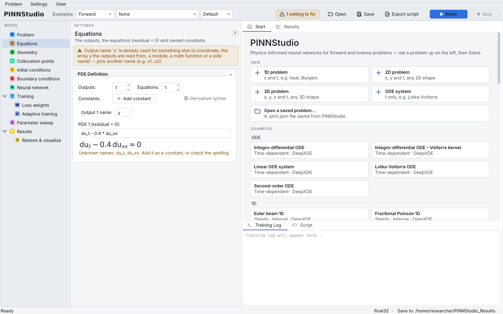
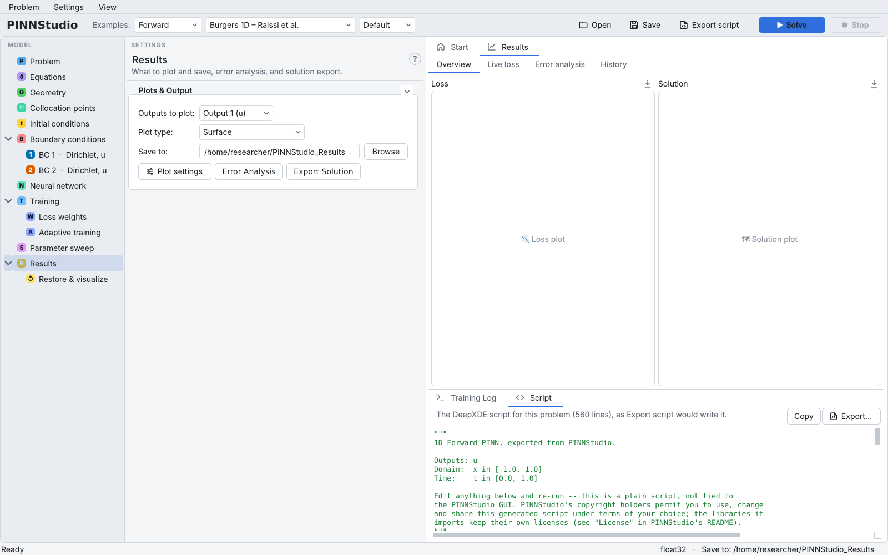

# The interface

The PINNStudio window has four parts: the **toolbar** at the top, the **model tree** on the left, the
**settings** of the selected tree entry in the middle, and the **graphics** area on the right, above the
**Training Log**. A status bar runs along the bottom.

{ .screenshot loading=lazy }

## Toolbar

From left to right:

- **Examples:** three lists. The first chooses **Forward** or **Inverse** examples; the second is the
  example itself (**None** for your own problem); the third chooses the example's **Default** or
  **Tuned** settings (see [Problem](problem.md#start-from-an-example)).
- **N settings to fix** — only shown when some setting would stop **Solve**; click it to go to the first one.
- **Open**, **Save**, **Export script** — open a saved problem (`.pinn.json`), save the current one, write
  a standalone DeepXDE script ([Exporting a script](export.md)). In a narrow window these show as icons only.
- **Solve** and **Stop** — start and stop a training run ([Solve and the training log](solve.md)). With a
  parameter sweep switched on, **Solve** reads **Run Sweep**.

## Menus

| Menu | Item | Shortcut | What it does |
|---|---|---|---|
| **Problem** | **New** › **1D problem**, **2D problem**, **3D problem**, **ODE system** | | A new problem with PINNStudio's starting settings, in that dimension (the Save to folder, GPU and plot preferences are kept) |
| | **Open Saved Problem...** | Ctrl+O | Open a `.pinn.json` file |
| | **Open Recent** | | The problems opened or saved recently |
| | **Save Problem** / **Save Problem As...** | Ctrl+S / Ctrl+Shift+S | Save the whole problem as `.pinn.json` |
| | **Export as DeepXDE Script...** | Ctrl+E | Same as **Export script** in the toolbar |
| | **Solve** / **Stop** | Ctrl+Enter or F5 / Shift+F5 | Same as the toolbar buttons |
| **Settings** | **L-BFGS Options**, **Float Precision...**, **Optimizer Settings...**, **GPU / Hardware...**, **Random Seed...**, **Plot Settings...**, **Display Settings...** | | See [Settings menu](settings.md) |
| **View** | **Reset Layout** | | Put the column widths back to their defaults |
| **Help** | **Documentation**, **About PINNStudio**, **About Qt** | | Open this website; show PINNStudio's version, license and the libraries it is built on; show Qt's version and license notice (on macOS the two *About* items are in the application menu) |

When you start a new problem, open another one or close the window with unsaved changes, PINNStudio
asks whether to save them first.

## Model tree

Each tree entry is one page of settings (see the [guide overview](index.md#the-pages-of-the-model-tree)).
Some entries appear only when they apply: **Inverse problem** only for an inverse problem, and one
child entry **BC 1**, **BC 2**, … under **Boundary conditions** for each boundary-condition row,
labelled with its type and output (for example *BC 2 · Neumann, u*).

Right-click a tree entry for its shortcuts: **Add boundary condition**, **Duplicate** and **Delete** on
boundary conditions; **Sketch the domain** on Geometry (2D and 3D); **Add training phase** on
Training; **Add parameter** on Inverse problem; **Add constant** on Equations; **New 1D problem** … on
Problem; **Open a saved problem…** on Results and Restore & visualize.

## Settings column

The top of the settings column names the page and says in one line what it is for. The **?** button
at its top right opens the page of this user guide that describes it (a boundary-condition row opens
[Boundary conditions](boundary-conditions.md)). Each box on a page can be folded with the arrow at its top right.

Many boxes have small toggles with an information icon, such as **Derivative syntax**,
**About boundary conditions** or **About automatic weighting**. Clicking one shows or hides a short
explanation inside the page.

### Settings that would stop Solve

Every 1.5 seconds PINNStudio checks the current settings the same way **Solve** does (the
`validate()` of the configuration). A setting that would stop **Solve** is marked on its tree entry
with a warning icon, the page shows the message at its top, and the toolbar shows
**N settings to fix**.

{ .screenshot loading=lazy }

## Graphics area

The tabs above the Training Log are:

- **Start** — buttons for a new 1D, 2D, 3D or ODE problem, **Open a saved problem...**, the recently
  used problems (**RECENT**) and the gallery of examples (**EXAMPLES**), grouped by dimension. Clicking
  an example loads it in its forward form.
- **Results** — four tabs: **Overview** (the loss and solution figures of the last run), **Live loss**
  (the loss while a run trains), **Error analysis** (the errors of the last run) and **History** (every
  run saved in the Save to folder). See [Results and plots](results.md).
- **Geometry** — 2D and 3D problems with a basic or combined shape: the domain drawn to scale, its
  edges (2D) or faces (3D) numbered and coloured by the boundary condition that picks them
  ([Geometry and domain](geometry.md)).
- **Sketch** — only when **Shape** is **Sketch**: draw the domain with the mouse.

Selecting **Geometry**, **Collocation points**, **Initial conditions** or **Boundary conditions** in the
tree brings up the Geometry (or Sketch) tab of a 2D or 3D problem; selecting **Results** or
**Restore & visualize** brings up the Results tab.

Below the graphics are two more tabs:

- **Training Log** — everything PINNStudio and the training script print: loaded examples, settings
  checks, the training progress and the final errors.
- **Script** — the DeepXDE script for the current problem, as **Export script** would write it, kept up
  to date while you edit. **Copy** puts it on the clipboard; **Export…** saves it.

{ .screenshot loading=lazy }

## Status bar

The left part of the status bar says what PINNStudio is doing: **Ready**, or during a run the phase,
the iteration, the current loss, the time elapsed and an estimate of the time left. When a run ends it
shows the total time, the final loss and the mean relative L₂ error (if Error Analysis was set up).
The right part shows the floating-point precision chosen in **Settings › Float Precision...** and the
**Save to** folder.

## Layout

Drag the dividers between the columns, and between the graphics and the Training Log, to resize them.
PINNStudio remembers the layout; **View › Reset Layout** puts it back. The look of the window (theme,
fonts, text sizes) is set in **Settings › Display Settings...**: three themes are built in, **Studio Light**
(the default), **Studio Dark** and **Solarized Dark**, with an accent colour and a UI scale.

In the **Sketch** tab, Ctrl+Z undoes the last change to the drawing and Ctrl+Y (or Ctrl+Shift+Z) redoes it.
