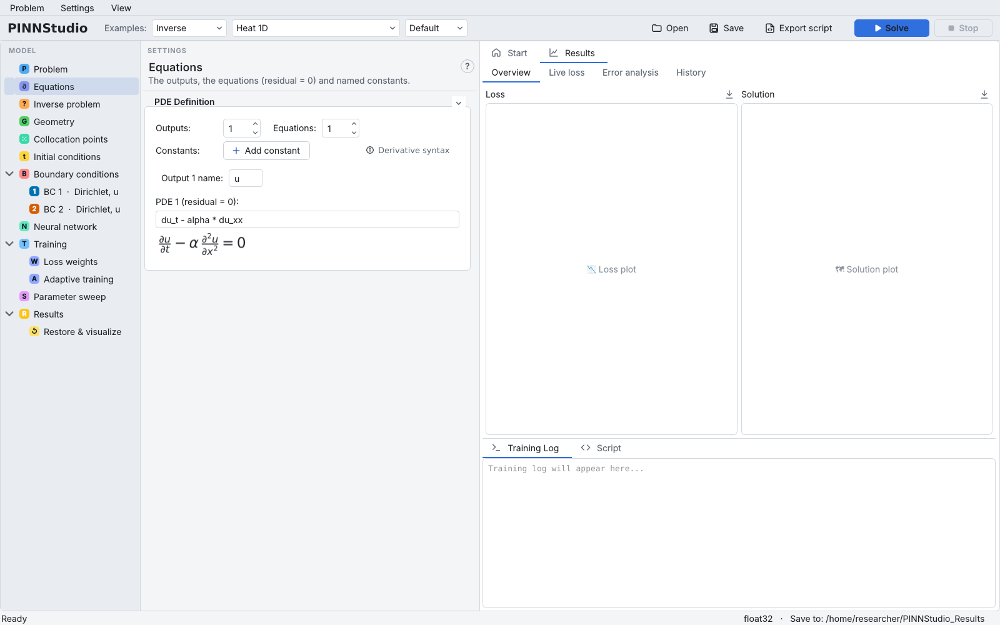

# Inverse problems and measured data

In an inverse problem some coefficients of the equations are unknown and are learned, together with
the solution, from measured data. Choose **Inverse** on the [Problem](problem.md) page; the model tree
then shows an **Inverse problem** entry with two boxes: **Unknown parameters** and **Measured data**.

{ .screenshot loading=lazy }

Background: [Inverse problems](../reference/inverse.md), [Observational data](../reference/observations.md).

## Name the unknown parameters

Each row of **Unknown parameters** is one value the network learns:

- **Name** — a valid Python name, for example `D`, `k` or `alpha`. Write the same name in the equations
  on the [Equations](equations.md) page where the quantity belongs, for example `du_t - alpha*du_xx`.
- **Initial guess** — its value when training starts.
- **True value** — optional. When you know the answer (the examples fill it in), it is drawn as a dashed
  line on the parameter-convergence plot. It never affects training.

**Add parameter** adds a row; ✕ removes it (the first row always stays). With more than one parameter
the page reminds you to write each added name into the equations yourself. Loading a PINNStudio
template in inverse form writes its parameter names into the equations for you.

{ .screenshot loading=lazy }

## Add the measured data

Each block of **Measured data** is one file and one data loss term:

1. **File:** browse for a text file with one point per line: the inputs (`x`, `y`, `z`, `t` as the
   problem has them), then the measured value.
2. **Measures:** the output the values are (**Output 1 (u)**, …), or **Custom...** with an expression of
   the outputs, for example `sqrt(u**2+v**2)` for a measured magnitude.
3. **Loss weight:** the weight of this file's data term (default 100).

**Add data file** adds another file; each is its own loss term with its own weight. The data weights are
set here, not on the Loss weights page; with per-phase weights, every phase uses them.

## Control how much data is used

Every measured point is used at every training step, so a large file makes training slow:

- **Check the equation at the measured points too (anchors)** — on by default: each measured point is
  also a training point where the equation is checked. Off, the points are only in the data loss: much
  faster with many points, and usually about as accurate unless there are only a few points.
- **Use:** — **All points**, **Grid: points per axis** (N evenly spaced values along each space axis,
  edges kept; a file that is not a grid gives \( N^{\text{axes}} \) random points), or
  **Random points** (N points chosen with the run's random seed). It applies to every data file and
  leaves the files unchanged. The line below says what the files hold and how many points are kept.

When the kept data has 20,000 points or more, the Training Log says so when you press **Solve**.

## What else changes in inverse mode

- The plot types **Parameter Convergence** and **Parameter Convergence (GIF)** appear on the Results page,
  and **Parameter Convergence** is selected. **Save parameters:** (default **Every 100 iters**; any
  number of iterations can be typed) sets how often the unknowns are recorded in
  `<name>_convergence.txt` in the run folder ([Results and plots](results.md)).
- **Time Adaptive Training** is not offered (its time windows do not train the unknown parameters); RAR is.
- The [parameter sweep](sweeps.md) can vary each parameter's initial guess, each file's data weight, the
  amount of data used and, for some examples, the measurement times.

## Settings on this page

| GUI label | Meaning | Default | Saved as |
|---|---|---|---|
| **Name** | Parameter name used in the equations | `trainable_variable_1` (new problem) | `inverse_variables_json` (`name`); first row also `inverse_param_name` |
| **Initial guess** | Starting value | 1.0 | `inverse_variables_json` (`init`); first row also `inverse_param_init` |
| **True value** | Known answer, for the plot only | blank | `inverse_variables_json` (`true`) |
| **File:** | Measured-data file | blank | `inverse_obs_files_json` (`path`); first file also `inverse_data_file` |
| **Measures:** | Output measured, or Custom... | Output 1 | `inverse_obs_files_json` (`output_idx`, `custom_expr`) |
| **Loss weight:** | Weight of the file's data term | 100 | `inverse_obs_files_json` (`weight`); first file also `loss_weight_obs` |
| **Check the equation at the measured points too (anchors)** | Measured points are also collocation points | on | `inverse_obs_anchors` |
| **Use:** | All points, Grid: points per axis, Random points | All points | `inverse_obs_reduce` (`all`, `grid`, `random`) |
| (grid number) | Points per space axis | 51 | `inverse_obs_grid_n` |
| (random number) | Points kept per file | 1000 | `inverse_obs_random_n` |
| **Save parameters:** (Results page) | How often the unknowns are recorded | Every 100 iters | `inv_param_save` |
