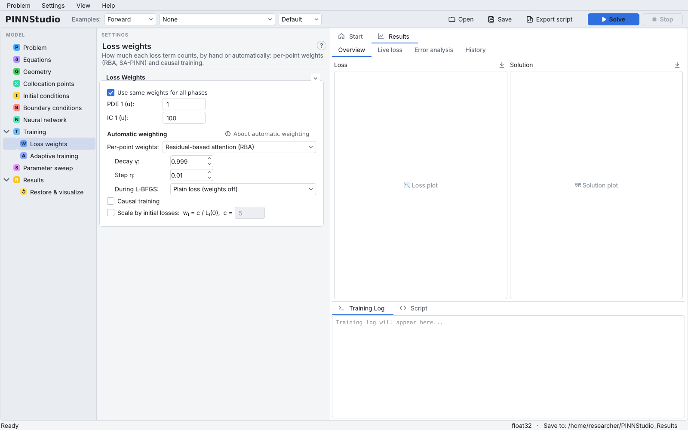

# Loss weights

The training loss is a weighted sum of terms: one per equation, one per boundary-condition row, one per
initial condition and, in an inverse problem, one per measured-data file. The **Loss weights** page (under
**Training** in the tree) sets these weights by hand, and offers automatic weighting: per-point weights,
causal training, and scaling by the initial losses.

{ .screenshot loading=lazy }

Background: [Loss weights](../reference/loss-weights.md), [RBA and SA-PINN](../reference/point-weights.md),
[Causal training](../reference/causal.md).

## Which rows the page shows

The rows follow the other pages, in this order:

| Row | One per… | Comes from | Default |
|---|---|---|---|
| **PDE N (name):** | equation | **Equations** on the Equations page (rows read **PDE N:** when equations and outputs differ in number) | 1 |
| **BC N (type, output):** | boundary-condition row | the Boundary conditions page; the label follows the row's type and output | 1 |
| **IC N (name):** | output with **IC for …** ticked (or loaded from a file) | the Initial conditions page; none for a stationary problem or an exact IC | 100 |

The data weights of an inverse problem are set on the [Inverse problem](inverse.md) page (**Loss weight**,
default 100) and are added after these terms.

Weights you have typed are kept when the page is rebuilt (for example when you add a boundary condition
or a phase).

## Different weights per training phase

Untick **Use same weights for all phases** to give each phase of the [Training](training.md) page its own
weights. The page then shows a block **Phase N weights** per phase, with rows such as **PDE 1 (u) P1:**.
A typical use: a large initial-condition weight during Adam, equal weights during L-BFGS.

{ .screenshot loading=lazy }

## Automatic weighting

Click **About automatic weighting** for a short summary. The options are:

### Per-point weights

**Per-point weights:** gives each training point's residual its own weight, which grows where the
residual stays large (usually at sharp fronts):

- **Residual-based attention (RBA)** — **Decay γ:** (how much of a weight is kept each step; the weights
  level off near η/(1−γ)) and **Step η:** (how much the normalised residual adds each step). Cheap.
- **Self-adaptive (SA-PINN)** — the weights are trained by gradient ascent: **Weights' learning rate:**
  and **Keep the mean weight at 1** (rescale after each step).
- **During L-BFGS:** — **Plain loss (weights off)** (the default: L-BFGS refines the ordinary loss) or
  **Keep the weights** (L-BFGS goes on with the weights Adam ended with).

Only the training points are weighted; the test loss stays the plain one. On a problem a plain PINN
already solves well, per-point weights can make the result worse: compare with a run without them.

{ .screenshot loading=lazy }

Per-point weights belong to fixed training points. They cannot be combined with the **Point Resampling**
callback, a **Point Set** condition with a batch size, or resampling rounds of time-adaptive training;
**Solve** refuses such a combination with an explanation.

### Causal training

**Causal training** splits the time interval into **Time chunks:** and weights each chunk's residual by
\( \exp(-\varepsilon \cdot \text{the residual loss of all earlier chunks}) \), so later times only count
once earlier times fit. **Raise ε step by step (0.01 → 100)** (on by default) moves ε through 0.01, 0.1,
1, 10, 100 as the weights settle; untick it to use **Fixed ε:**. The weights are held fixed during L-BFGS.
It needs a time-dependent problem with space (not an ODE). A note appears if you combine it with
per-point weights: both reweight the same residuals, and together they did worse than either alone in
PINNStudio's benchmarks.

### Scale by initial losses

**Scale by initial losses: wᵢ = c / Lᵢ(0), c =** evaluates every loss term once before training and sets
its weight to c divided by its initial value, so all terms start at the same size. The manual weights
above are then greyed out and ignored, in every phase. It is not available with time-adaptive training.
The initial losses are measured with the first training phase's loss function, and with IC pre-training they
are measured after pre-training, in both the Solve and the exported script.

## Weights and time windows

With time-adaptive training, the first window has the terms above. From the second window on, each
output's initial condition is replaced by a term that holds it to the previous window's solution.
The equation and boundary weights are used as set in every window, and each output's previous-solution term
takes that output's initial-condition weight (1 for an output without an initial condition).

## Settings on this page

| GUI label | Meaning | Default | Saved as |
|---|---|---|---|
| **Use same weights for all phases** | One set of weights for every phase | on | `scheduler_same_weights` |
| **PDE N …**, **BC N …**, **IC N …** | Term weights | 1, 1, 100 | `loss_weights_multi` (comma-separated, order PDE, BC, IC) and each phase's `weights` in `scheduler_phases` |
| **Per-point weights:** | None, Residual-based attention (RBA), Self-adaptive (SA-PINN) | None | `point_weights` (`None`, `RBA`, `SA-PINN`) |
| **Decay γ:** | RBA memory (0–1, exclusive) | 0.999 | `rba_gamma` |
| **Step η:** | RBA step | 0.01 | `rba_eta` |
| **Weights' learning rate:** | SA-PINN weight learning rate | 0.005 | `sa_lr` |
| **Keep the mean weight at 1** | SA-PINN normalisation | off | `sa_normalize` |
| **During L-BFGS:** | Plain loss (weights off) / Keep the weights | Plain loss | `point_weights_lbfgs` (`plain`, `keep`) |
| **Causal training** | Causal weighting in time | off | `causal_training` |
| **Time chunks:** | Number of chunks (2–1000) | 32 | `causal_chunks` |
| **Raise ε step by step (0.01 → 100)** | ε schedule | on | `causal_anneal` |
| **Fixed ε:** | ε when the schedule is off | 1.0 | `causal_eps` |
| **Scale by initial losses: …, c =** | Automatic weights c / Lᵢ(0) | off, c = 5 | `loss_weights_from_initial` (0 = off, else c) |
