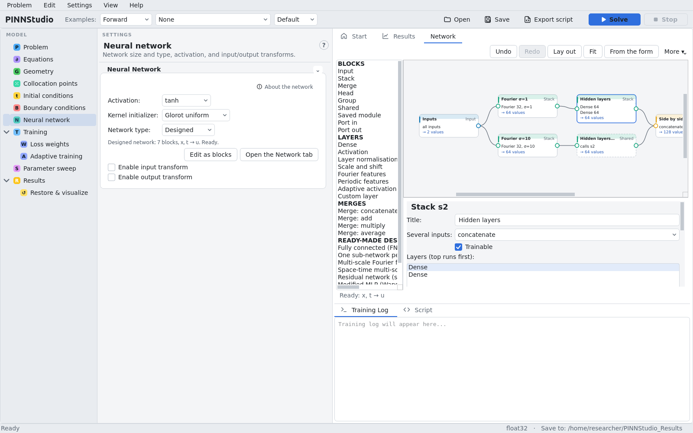

# Network designer

The **Network** tab designs the neural network as blocks on a canvas: inputs, stacks of layers, merges and
heads, joined by connections. It can draw every network the **Neural network** page's form makes (FNN,
PFNN, MsFFN, STMsFFN) and many it cannot: separate branches for space and time, skip connections, gated
layers, Fourier or periodic features on some inputs only, the same layers called twice, or a layer in
your own PyTorch code.

To use it, set **Network type:** to **Designed** on the **Neural network** page. The **Network** tab
then opens beside **Geometry**. **Edit as blocks** on the page starts the design from the network the form
describes, so it computes exactly what Solve trained before; from there, change what you want.

{ .screenshot loading=lazy }

Background: [Networks and Fourier features](../reference/networks.md).

## What the network sees and gives

The network's **inputs** are what the problem feeds it: the coordinates (`x`, `y`, `z`, `t` as the problem
has them; `t` alone for an ODE), or, with an input-feature formula or exact periodicity, one input per
feature, named by its formula. Its **outputs** are the **Outputs** of the [Equations](equations.md) page.
The input and output transforms of the **Neural network** page, exact initial conditions and exact
periodicity apply to a designed network as to any other.

## Blocks

| Block | What it does |
|---|---|
| **Input** | Reads network inputs by name: `@all` (every input, in order) or some of them, for example `t` alone. A design can have several, for example one for space and one for time. |
| **Stack** | Runs its layers in order, top first (see *Layers*). **Trainable** off freezes its weights. |
| **Merge** | Combines what reaches it: **concatenate** (side by side), **add**, **multiply** or **average** (these three need inputs of one width). |
| **Head** | Gives outputs by name (`@all`, or some of them): a linear layer to that many values. With **Values as they come**, what reaches it is the output as it is, and must have that width. Every output is given by exactly one head. |
| **Group** | A design of its own used as one block: double-click it to open it, **Up** to go back. Inside, **Port in** blocks are the group's inputs (one in-port each, by name) and one **Port out** is its output. |
| **Shared** | Calls a stack, group or saved module again with the same weights: select the original, then add **Shared**. It must take what the original takes. It is drawn dashed. |
| **Saved module** | A TorchScript module from a `.pt` file (`torch.jit.save`), frozen or fine-tuned (**Fine-tune**). Set the widths it takes and gives. |

Several connections into one in-port are combined by the block's **Several inputs:** setting
(concatenate by default).

## Layers

| Layer | Settings | Gives |
|---|---|---|
| Dense | units, activation, bias, initializer | *units* values: \( \sigma(xW + b) \) |
| Activation | activation | as many as it takes |
| Layer normalisation | | as many: each sample's values to mean 0 and spread 1, then a learned scale and shift |
| Scale and shift | scale, shift | as many: \( x \cdot \text{scale} + \text{shift} \); −1 and 1 give \( 1 - z \) |
| Fourier features | features *m*, σ, trainable | 2*m*: \( [\cos(xB), \sin(xB)] \), \( B \sim N(0, σ^2) \) |
| Periodic features | harmonics *K*, period *L* | 2*K* per input: \( \cos(2\pi k x/L), \sin(2\pi k x/L) \), \( k = 1..K \) |
| Adaptive activation | activation, scale *n*, starting slope *a₀* | as many: \( \sigma(n\,a\,x) \) with a learned slope *a* (Jagtap et al. 2020) |
| Custom layer | class, keyword arguments (JSON), output width | your own `torch.nn.Module`, from the design's code |

An activation of **inherit** (and an initializer of **inherit**) uses the **Neural network** page's choice,
so changing it there changes every such layer. **linear** is no activation. Fixed Fourier matrices are
saved with the trained weights, so a restored model computes what was trained.

## Connections

Drag from a block's right port (its output) to another block's left port (an input). While you drag, the
port under the cursor turns green when the connection is allowed, or red with the reason when it is not:
a block cannot take its own output, an Input takes nothing, a Head gives nothing, a connection cannot close a
loop, and it cannot give any block anywhere in the design an input it cannot take (an add of two
different widths, a shared block whose input no longer matches its original). Problems the design
already had do not block other connections.

Each block shows the width it gives (`→ 64 values`), worked out from the problem's inputs and outputs. A
block that cannot run is outlined in red with the reason; the status line under the canvas and the
inspector (with nothing selected) list every problem. **Solve** refuses a design with a problem and says
which block and why.

| Key (on the canvas) | Action |
|---|---|
| Delete or Backspace | Delete the selected block (with its connections) or connection |
| Ctrl+D | Duplicate the selected block (a group with its inside) |
| Ctrl+L | Lay out: inputs on the left, heads on the right |
| F | Fit the design in view |
| Ctrl+Z, Ctrl+Y | Undo and redo the last change to the design |
| Double-click a group | Open it |
| Wheel, drag on empty space | Zoom, pan |

Every edit is one step of Undo. Moving a block changes nothing in the network.

## The inspector

Select a block to set its title and settings; a stack lists its layers, with **Add layer…**, ▲, ▼ and ✕,
and the selected layer's settings below. A value a setting does not take is refused with the reason, and
nothing changes. With nothing selected, the inspector lists the design's problems and holds the design's
own code.

## Ready-made designs

The palette's **Ready-made designs** put a whole design in place of the current one (Undo brings it back),
sized from the **Neural network** page's widths:

| Design | What it is |
|---|---|
| Fully connected (FNN) | DeepXDE's FNN; identical numbers with the same weights |
| One sub-network per output (PFNN) | a separate branch and head for each output |
| Multi-scale Fourier features (MsFFN) | Fourier features at each σ of **Fourier scales**, the same hidden stack for every scale (shared), side by side, a linear output; identical to PINNStudio's MsFFN with the same weights |
| Space-time multi-scale Fourier features (STMsFFN) | space and time features apart, every (space, time) pair multiplied |
| Residual network | a lifting layer, then blocks of two Dense layers added to their input |
| Modified MLP | Wang, Teng & Perdikaris (2021): \( U, V \), and per layer \( Z = \sigma(HW) \), \( H \leftarrow (1-Z) \odot U + Z \odot V \) |

**From the form** (on the tab) and **Edit as blocks** (on the page) make the design the form's settings
describe.

## Your own code

A **Custom layer** runs a class from the design's code: select nothing, type the class in the inspector's
code box and click **Apply code**. A class is a `torch.nn.Module`; `torch`, `dde`, `np` and `json` are at hand:

```python
class Gaussian(torch.nn.Module):
    def __init__(self, width=1.0):
        super().__init__()
        self.width = width

    def forward(self, x):
        return torch.exp(-(x / self.width) ** 2)
```

In the layer, **Class** names it, **Keyword arguments** (JSON, for example `{"width": 0.5}`) go to its
constructor, and **Output width** declares what it gives (`same`, or a number), so the canvas can work out the
widths after it.

## Code and files from elsewhere

The design's code and a saved module's file run with your rights when the network is built. PINNStudio
asks before it runs either: **Solve** (or **More › Trust the design's code and files…**) shows the code, and
each file's name, size and SHA-256. **Trust and use** remembers the decision for exactly this code and these
files (in `~/.pinnstudio/trusted.json`); one changed character or byte asks again. **Keep inactive** runs
nothing. A saved module whose file changed after it was added to the design is refused. Trust is a
decision, not a sandbox.

## Library, files and export

- **More › Save block…** writes the selected block (a group with its inside, and the code its custom layers
  use) to a `.pinn-block.json` file; saved in `~/.pinnstudio/blocks` it shows under **My blocks** in the
  palette, to drag in like any block (with fresh ids; a clashing class name becomes `Name_2`).
- **More › Save design…** and **Load block or design…** write and read a whole design
  (`.pinn-design.json`).
- **More › Export network as Python code…** writes a module with the network, `build_net()` and
  `load_trained(path)`, which loads the weights a PINNStudio run saved (`model-<step>.pt`). It needs PyTorch and
  DeepXDE, not PINNStudio.

The design is saved with the problem (`network_design` in the `.pinn.json` file), written into every
script Solve and **Export script** make, and recorded in each run's `model_config.json`, so **Restore &
visualize** rebuilds the same network.

## Sweeps

With a designed network, the [Parameter sweep](sweeps.md) and Bayesian search can vary the units of each
Dense layer (*Designed: <block> units*) and the σ of each Fourier layer (*Designed: <block> σ*). **Hidden
layers** and **Neurons per layer** do not apply to a designed network.

## Settings

| Setting | Saved as |
|---|---|
| **Network type:** Designed | `network_type` = `"Designed"` |
| The design | `network_design` (JSON) |
