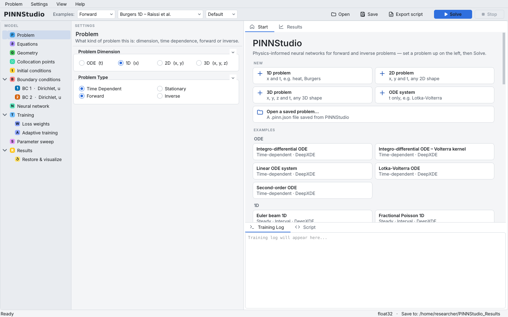

# Problem

The **Problem** page says what kind of problem you are solving: its dimension, whether it depends on
time, and whether it is a forward problem (find the solution) or an inverse problem (find the solution
and unknown parameters from measured data). These three choices decide what the other pages offer, so
set them first.

{ .screenshot loading=lazy }

Background: [Forward problems](../reference/forward.md), [Inverse problems](../reference/inverse.md),
[ODEs and PDEs](../reference/equations.md).

## Start from an example

The quickest way to a working setup is an example that is close to your problem:

1. In the toolbar, choose **Forward** or **Inverse** in the first **Examples:** list. **Inverse** lists
   the inverse examples (DeepXDE's and PINNStudio's) and the inverse forms of many forward examples.
2. Pick the example in the second list (or click its card on the **Start** tab).
3. In the third list, choose **Default** or **Tuned**:
    - **Default** — a DeepXDE example with DeepXDE's own settings; a template taken from a paper with that
      paper's network, points and training (forward mode; in inverse mode, the template's own settings); PINNStudio's own templates as they are.
    - **Tuned** — PINNStudio's best settings for that example from its benchmarks: the most accurate run,
      and among runs about as accurate, the fastest. The Training Log says what these settings change.

Loading an example sets every page: dimension, equations, domain, conditions, network, training and,
where reference data ships with the example, Error Analysis. Everything stays editable. When you then
change a setting of a DeepXDE example, the Training Log lists what you changed when you press **Solve**.

To start from nothing instead, use **Problem › New** (or the **Start** tab) and pick the dimension.

## Choose the dimension

**Problem Dimension** has four choices. The coordinates in brackets are the ones your expressions can
use, together with `t` for a time-dependent problem:

| Choice | Coordinates | Typical use |
|---|---|---|
| **ODE  (t)** | `t` only | Ordinary differential equations and systems, integro-differential equations |
| **1D  (x)** | `x`, `t` | Heat, Burgers, Allen–Cahn in one space dimension |
| **2D  (x, y)** | `x`, `y`, `t` | Any 2D shape, including combined shapes and sketches |
| **3D  (x, y, z)** | `x`, `y`, `z`, `t` | Boxes, spheres and combinations of them |

The dimension changes:

- the **Shape** list on the Geometry page (none in 1D and ODE; Rectangle, Disk, … in 2D; Cuboid,
  Sphere, … in 3D);
- the **Where** choices of boundary conditions (left/right; also bottom/top in 2D; also front/back in 3D;
  start/end of the time interval for an ODE);
- the number of network inputs and the **Derivative syntax** help on the Equations page;
- the plot types on the Results page.

!!! warning "Changing the dimension by hand clears the boundary conditions"
    Boundary-condition rows are written in the coordinates of their dimension (a row with `z` in it means
    nothing in 2D), so choosing another dimension removes every row, removes the shapes of a combined
    geometry, and sets **Examples** back to **None**. Set the dimension before you add conditions.

**ODE  (t)** always means a time-dependent problem: **Stationary** is greyed out, and the **∫ points**
field appears on the Equations page for `integral(...)` terms.

## Time dependent or stationary

- **Time Dependent** (default): the problem has a time interval (Geometry page), initial conditions,
  and the network takes `t` as its last input.
- **Stationary**: no time axis, for example a Poisson equation. The time interval, the Initial
  conditions page, IC pre-training and **Time Adaptive Training** (Adaptive training page) are not
  available; RAR still is. Initial points are not used.

## Forward or inverse

- **Forward** (default): the coefficients of the equations are known; the network learns the solution.
- **Inverse**: some coefficients are unknown. Switching to **Inverse**
    - shows the **Inverse problem** page, where you name the unknown parameters and add the measured
      data ([Inverse problems and measured data](inverse.md));
    - adds one data loss term per measured-data file;
    - adds **Parameter Convergence** and **Parameter Convergence (GIF)** to the plot types and shows
      **Save parameters:** on the Results page;
    - removes **Time Adaptive Training** from the Adaptive training methods (the time windows do not
      train the unknown parameters).

For a PINNStudio template, switching to **Inverse** also writes the parameter names into the
equations in place of the known values, and fills in the template's measured data. An example loaded with
**Default** or **Tuned** settings and not changed since is loaded again with that mode's own settings when you
switch between **Forward** and **Inverse**.

## Settings on this page

| GUI label | Meaning | Default | Saved as |
|---|---|---|---|
| **Examples:** (first list) | Which examples the second list offers: **Forward** or **Inverse** | Forward | — |
| **Examples:** (second list) | The example loaded; **None** for your own problem | None | `template_type` and the example's origin |
| **Examples:** (third list) | **Default** or **Tuned** settings for the next example loaded | Default | — |
| **ODE  (t)** / **1D  (x)** / **2D  (x, y)** / **3D  (x, y, z)** | Problem dimension | 1D | `problem_dim` (`"ODE"`, `"1D"`, `"2D"`, `"3D"`) |
| **Time Dependent** / **Stationary** | Whether the problem has a time axis | Time Dependent | `steady_state` |
| **Forward** / **Inverse** | Whether unknown parameters are learned from data | Forward | `problem_type` |
