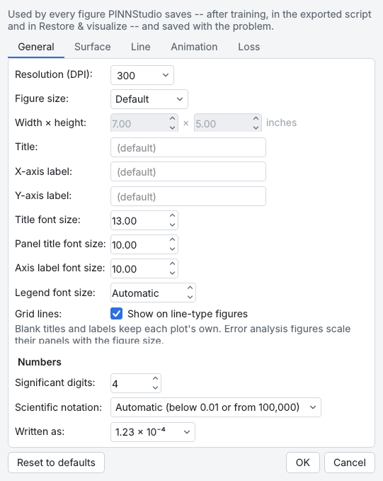
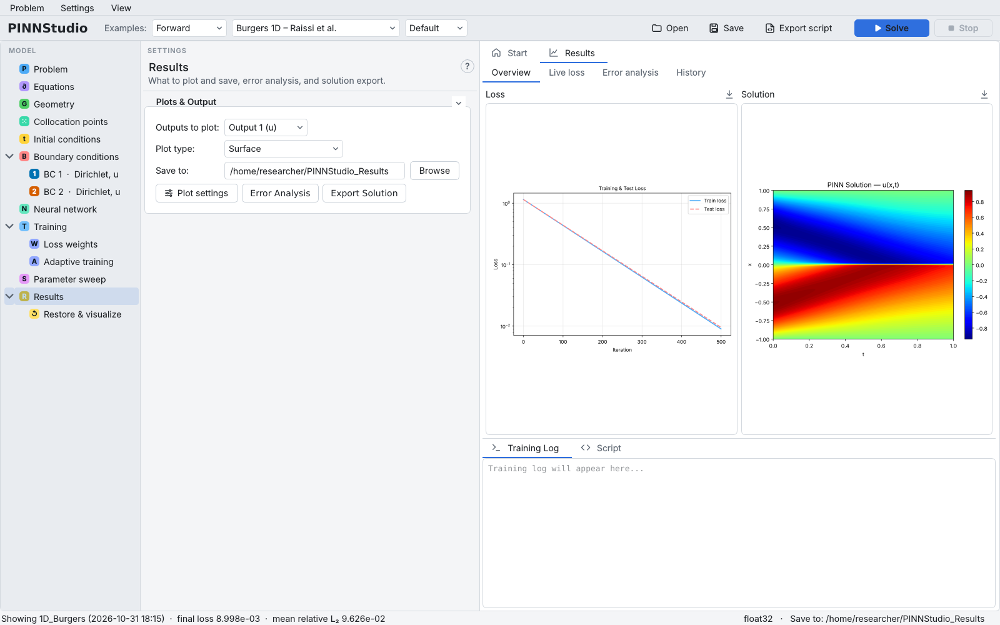
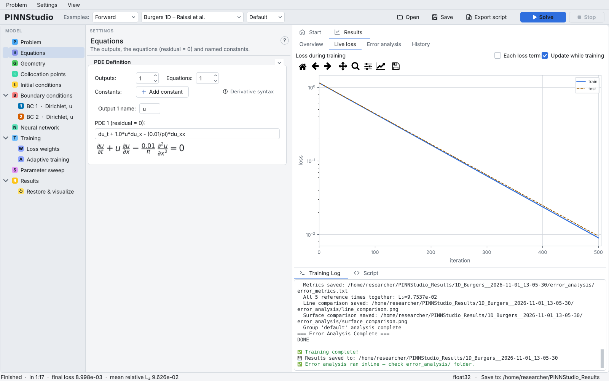
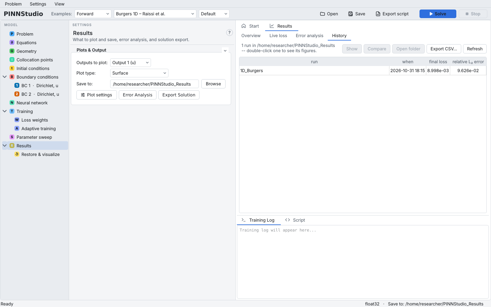

# Results and plots

The **Results** entry of the model tree holds the **Plots & Output** box: what is plotted after a run,
where runs are saved, and the buttons for Error Analysis and solution export. The **Results** tab of the
graphics area shows the figures and numbers of the runs.

{ .screenshot loading=lazy }

Background: [Plots and data export](../reference/plots.md), [Error metrics](../reference/metrics.md).

## Choose what is plotted

**Outputs to plot:** lists the outputs by name (**Output 1 (u)**, …). With more than one output it
starts with **All outputs**: a plot of every output (`solution_plot_<name>.png`), the first one also as
`solution_plot.png`. **Custom...** plots an expression of the outputs and their derivatives instead,
for example `sqrt(u**2+v**2)` or `du_x`, with an optional label for the colour bar or axis.

**Plot type:** offers what the problem can show:

| Problem | Plot types |
|---|---|
| ODE, or stationary 1D | Line |
| time-dependent 1D | Surface, Line (time steps), Line Animation (GIF) |
| stationary 2D/3D | Surface, Line (time steps) |
| time-dependent 2D/3D | Surface, Line (time steps), Line Animation (GIF), Surface Animation (GIF) |
| inverse (in addition) | Parameter Convergence, Parameter Convergence (GIF) |

In inverse mode **Parameter Convergence** is selected, and **Save parameters:** sets how often the
unknown parameters are recorded (**No**, **Every 100 iters**, **Every 1000 iters**, or any number typed in).

## Choose where runs are saved

**Save to:** is the folder in which every run gets its own subfolder (see
[Solve and the training log](solve.md#where-the-results-go)). It defaults to `PINNStudio_Results` in your
home folder, and PINNStudio remembers the folder you used last. Restore & visualize and parameter
sweeps save into the same folder.

## Change how figures look

**Plot settings** opens the **Plot Settings** dialog. Its settings are used by every figure PINNStudio
saves (after training, in the exported script and in Restore & visualize) and are saved with the problem.
Its tabs are **General** (resolution, figure size, titles, font sizes, number format), **Surface** (colour
maps, contour levels, grid resolution, colour range), **Line** (time steps, line width, the cut through a
2D/3D domain, reference line style and colours, Error Analysis panels per row), **Animation** (frames,
frame rate, resolution) and **Loss** (which losses, line width, logarithmic axis and **Record every**: how
often the loss is recorded and printed). Tabs that do not apply to the problem are hidden;
**Reset to defaults** resets the open tab. The same dialog is **Settings › Plot Settings...**.

{ .screenshot loading=lazy }

## Read the Results tab

The Results tab of the graphics area has four tabs.

### Overview

The **Loss** and **Solution** figures of the last run (or of a run picked in History). Double-click a
figure to open it at full size, with zoom and pan; right-click it to copy or save it; the download icon
above it saves it too. When the run had Training Monitors, a third box shows their plots, one at a time
(◀ ▶).

{ .screenshot loading=lazy }

### Live loss

The loss while a run trains, redrawn as it goes. **Each loss term** draws one line per term (PDE, each
BC, IC, …) instead of the totals; untick **Update while training** to draw it only at the end, which
saves work on a slow computer. For time-adaptive training the title shows the current time step. The
toolbar above the plot zooms, pans and saves it.

{ .screenshot loading=lazy }

### Error analysis

The errors of the last run against its reference data: a table of the relative L₂ error and the mean
absolute error at each reference time, a one-line summary (mean and worst relative L₂ error), and the
comparison figures. **Copy** and **Export CSV…** take the table. See [Error Analysis](error-analysis.md).

### Look at earlier runs

**History** lists every run folder in **Save to**: its name, when it ran, its final loss and its relative
L₂ error. **Show** (or a double-click) puts a run's figures back in Overview and its errors in Error
analysis; **Compare** draws the loss and error of two or more selected runs on one plot; **Open folder**
opens the run folder; **Export CSV…** saves the list; **Refresh** reads the folder again.

{ .screenshot loading=lazy }

## Settings on this page

| GUI label | Meaning | Default | Saved as |
|---|---|---|---|
| **Outputs to plot:** | All outputs, one output, or Custom... | All outputs (several outputs), else Output 1 | `plot_output_idx`, `plot_all_outputs` |
| (Custom expression, label) | Expression and label for Custom... | blank | `plot_custom_expr`, `plot_custom_label` |
| **Plot type:** | See the table above | Surface (Line for ODE/stationary 1D; Parameter Convergence when inverse) | `plot_type` |
| **Save parameters:** | Recording period of the unknowns (inverse) | Every 100 iters | `inv_param_save` |
| **Save to:** | Folder for the run folders | `~/PINNStudio_Results` | `save_dir` (the run's own folder) |
| **Plot settings** | Figure style dialog | | `plot_*`, `loss_plot_mode`, `loss_display_every`, `loss_plot_linewidth`, `loss_plot_log_y`, … |
| **Error Analysis** | Reference data and metrics | not set (examples: set) | `ea_*` ([Error Analysis](error-analysis.md)) |
| **Export Solution** | Solution data files | off | `export_*` ([Exporting a script](export.md#export-the-solution-as-data)) |
