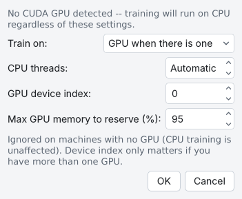
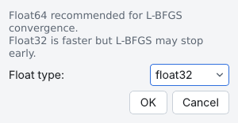
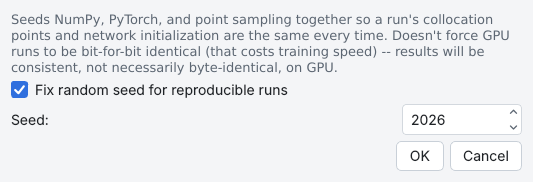

# Settings menu

The **Settings** menu holds settings that apply to the whole run rather than to one page of the model
tree: hardware, precision, random seed, optimizer extras, and the look of figures and of the window.
Each item opens a small dialog; **OK** applies it and **Cancel** leaves things as they were. Changes to
the hardware, precision and seed are confirmed in the Training Log.

Background: [Seeds, precision and hardware](../reproducibility/environment.md).

## GPU / Hardware

**Settings › GPU / Hardware...** says at the top whether a CUDA GPU was found (and which), and sets:

- **Train on:** — **GPU when there is one** (default) or **CPU**. A small problem (1D, few points, a
  narrow network) often trains faster on the CPU, because each GPU step waits on Python more than it
  computes; the Training Log gives a tip when such a problem trains on the GPU.
- **CPU threads:** — the threads PyTorch uses on the CPU. **Automatic** (0) uses half the
  logical processors, at most 8 (about one per performance core on most processors); `OMP_NUM_THREADS`, when set,
  decides instead. More threads than fast cores is usually slower.
- **GPU device index:** — which GPU, when there is more than one.
- **Max GPU memory to reserve (%):** — the share of that GPU's memory the run reserves.

**Train on: CPU** also works on Windows with an NVIDIA GPU. The exported script applies the GPU device index and
the memory share.

{ .screenshot loading=lazy }

## Float Precision

**Settings › Float Precision...** sets **Float type:** to **float32** (default; faster) or **float64**
(L-BFGS converges further and is less likely to stop early). It is the same setting as **Precision:** on
the [Training](training.md#l-bfgs-options-and-precision) page: **OK** here also sets that box, and changing
that box changes this one. The status bar shows the current value.

{ .screenshot loading=lazy }

## Random Seed

**Settings › Random Seed...** seeds NumPy, PyTorch and the point sampling together, so a run's
collocation points and initial network are the same every time. **Fix random seed for reproducible runs**
is on by default with **Seed:** 2026. It does not force GPU runs to be bit-for-bit identical (that would
cost speed): results are consistent, not necessarily identical, on a GPU. Untick it for a different
random start every run. To repeat a setup with several seeds, sweep **Random seed**
([Parameter sweeps](sweeps.md)).

{ .screenshot loading=lazy }

## Optimizer Settings

**Settings › Optimizer Settings...** sets **Weight decay (L2):** (default 0), an L2 regularization of the
network weights for the whole run. It cannot be used with an L-BFGS or NNCG phase (or RAR's L-BFGS
step), nor with a PFNN, MsFFN or STMsFFN network, and an **AdamW** phase needs it to be above 0; **Solve** refuses these
combinations with an explanation.

## L-BFGS Options

**Settings › L-BFGS Options** opens **L-BFGS Settings**: **Use recommended L-BFGS settings** (on: DeepXDE's
defaults) or, unticked, **maxcor:**, **ftol:**, **gtol:**, **maxfun:** and **maxls:**. The number of
L-BFGS iterations is each L-BFGS phase's **Iterations** on the Training page.

## Plot Settings

**Settings › Plot Settings...** opens the same **Plot Settings** dialog as the button on the Results page
([Results and plots](results.md#change-how-figures-look)).

## Display Settings

**Settings › Display Settings...** changes the window's look, not the figures: the **Theme** tab (theme,
accent colour, UI scale, panel borders) and the **Text Styles** tab (font, size, weight and colour of the
title, section headers, field labels, hints, buttons and the log). These preferences are kept in
`~/.pinnstudio/display_settings.json`, not in the problem.

## Settings in these dialogs

| Dialog | GUI label | Default | Range | Saved as |
|---|---|---|---|---|
| GPU / Hardware | **Train on:** | GPU when there is one | GPU when there is one, CPU | `train_device` (`auto`, `cpu`) |
| | **CPU threads:** | Automatic | 0 (Automatic) – number of CPUs | `cpu_threads` |
| | **GPU device index:** | 0 | 0–31 | `gpu_device_index` |
| | **Max GPU memory to reserve (%):** | 95 | 1–100 | `gpu_memory_fraction` (0.95) |
| Float Precision | **Float type:** | float32 | float32, float64 | `float_type` (and `lbfgs_float_type`, the Training page's **Precision:**) |
| Random Seed | **Fix random seed for reproducible runs** | on | | `use_random_seed` |
| | **Seed:** | 2026 | 0–2,147,483,647 | `random_seed` |
| Optimizer Settings | **Weight decay (L2):** | 0 | ≥ 0 | `weight_decay` |
| L-BFGS Settings | **Use recommended L-BFGS settings** and the options | on | | `lbfgs_use_default`, `lbfgs_maxcor`, … ([Training](training.md#settings-on-this-page)) |

The hardware, precision, seed and optimizer settings are saved with a problem and restored when it is
opened. A new problem, or a loaded DeepXDE example, keeps the current hardware and seed settings.
