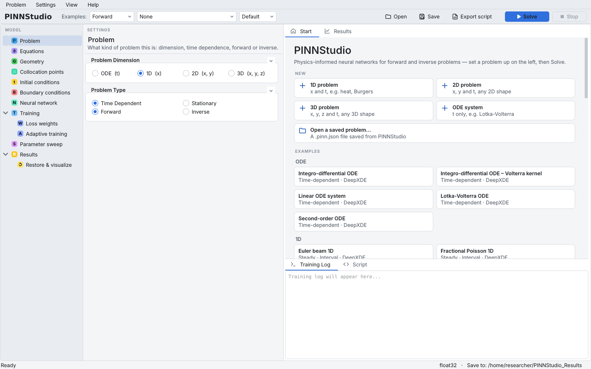
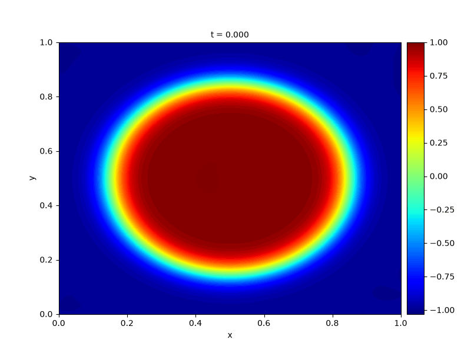
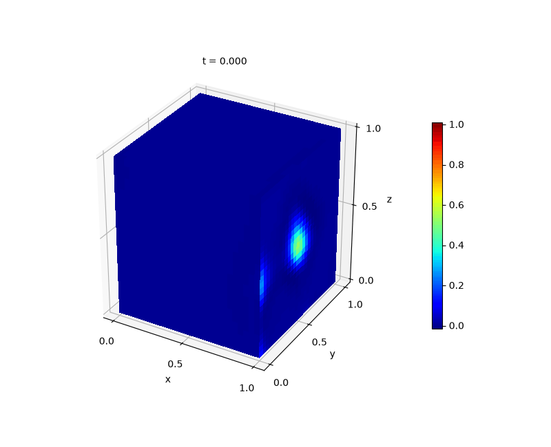

---
hide:
  - navigation
  - toc
---

# PINNStudio

A graphical platform for forward and inverse physics-informed neural networks

PINNStudio is a desktop application for setting up, training and evaluating physics-informed neural networks
(PINNs) without writing code. You describe a problem through the interface: its equations, domain, initial and
boundary conditions, the network, and how it should be trained. PINNStudio then generates a training script
for [DeepXDE](https://github.com/lululxvi/deepxde) and PyTorch, runs it while you watch the losses, and returns
the solution, its error against reference data, plots and animations, and the trained model. The same script can
be exported and run on its own.

[Get started](getting-started/index.md){ .md-button .md-button--primary }
[Install](getting-started/installation.md){ .md-button }
[Tutorials](tutorials/index.md){ .md-button }
[Examples](examples/index.md){ .md-button }

{ .screenshot loading=lazy }

## What PINNStudio does

-   :material-function-variant: **Forward and inverse problems**

    ---

    Solve a known equation, or recover unknown coefficients from measured data as trainable parameters, with
    the observation misfit as an additional loss term.

    [:octicons-arrow-right-24: Forward](reference/forward.md) · [Inverse](reference/inverse.md)

-   :material-sigma: **ODEs, PDEs and coupled systems**

    ---

    ODEs and PDEs in one, two and three space dimensions, steady or time-dependent, with several outputs and
    equations, typed in a readable form such as `du_t + u*du_x - 0.01/pi*du_xx`.

    [:octicons-arrow-right-24: Equations](reference/equations.md) · [Coupled systems](reference/coupled.md)

-   :material-shape-outline: **Domains and conditions**

    ---

    Intervals, rectangles, disks, polygons, cuboids, spheres and combinations of shapes, with Dirichlet,
    Neumann, Robin, periodic and point-data conditions, or conditions built exactly into the network.

    [:octicons-arrow-right-24: Geometry](reference/geometry.md) · [Boundary conditions](reference/boundary-conditions.md)

-   :material-chart-bell-curve-cumulative: **Training methods**

    ---

    Multi-phase training (for example Adam then L-BFGS), residual-based adaptive refinement, RBA and SA-PINN
    per-point weights, causal training, time windows with transfer learning and bc-PINN, and IC pre-training.

    [:octicons-arrow-right-24: Training](reference/optimizers.md) · [Adaptive methods](reference/rar.md)

-   :material-tune-variant: **Configured in the interface**

    ---

    Every setting lives in a page of the model tree. The problem is checked before each run, and the settings
    to fix are marked in the tree.

    [:octicons-arrow-right-24: User guide](guide/index.md)

-   :material-language-python: **Standalone Python scripts**

    ---

    Each problem can be exported as a plain DeepXDE script that trains the same model outside the
    application, for inspection, sharing or running on a cluster.

    [:octicons-arrow-right-24: Generated scripts](reference/scripts.md)

-   :material-chart-line: **Analysis and visualization**

    ---

    A live loss plot and training log; line, surface and animated solution plots; Error Analysis against
    reference files or an exact formula (relative \(L_2\), MSE, maximum error); restoring saved models.

    [:octicons-arrow-right-24: Results](guide/results.md) · [Error Analysis](guide/error-analysis.md)

-   :material-flask-outline: **Examples and benchmarks**

    ---

    Ready-to-run examples, from simple ODEs to phase-field and Navier–Stokes problems, including published
    PINN benchmarks and DeepXDE's examples. Most come with reference data or an exact solution.

    [:octicons-arrow-right-24: Example gallery](examples/index.md) · [Reproducibility](reproducibility/index.md)

## A first look

<figure markdown>
{ loading=lazy }
<figcaption>2D Allen–Cahn (Wight & Zhao): PINN solution over time, from PINNStudio's animated surface plot.</figcaption>
</figure>

<figure markdown>
{ loading=lazy }
<figcaption>3D heat equation: solution on slices of the cube, animated over time.</figcaption>
</figure>

## Where to start

| If you want to… | Read |
|---|---|
| find a reading order for your background (new to PINNs, experienced, developer) | [Where should I start?](getting-started/learning-path.md) |
| install PINNStudio and run an example | [Installation](getting-started/installation.md), then [First run](getting-started/first-run.md) |
| understand each part of the window | [User guide](guide/interface.md) |
| solve your own problem step by step | [Tutorials](tutorials/index.md), starting with [a first forward ODE](tutorials/01-ode.md) |
| look up what a setting does, and its mathematics | [Feature reference](reference/index.md), [All settings](reference/settings-index.md) and [Theory](theory/index.md) |
| know what PINNStudio can and cannot establish | [Scope and limitations](theory/limitations.md) |
| reproduce the benchmark results | [Reproducibility](reproducibility/index.md) |
| fix a problem, or understand a poor result | [Troubleshooting](help/troubleshooting.md), [Diagnosing poor results](help/troubleshooting.md#diagnosing-poor-results) and [FAQ](help/faq.md) |

!!! note "What PINNStudio does not do"
    PINNStudio makes it easier to build, train and evaluate PINNs, and it checks that a problem is set up
    consistently. It does not guarantee that training converges, or that the trained network is an accurate or
    physically valid solution of an arbitrary problem. Compare results with reference data, an exact solution or
    a conventional solver whenever you can. See [Scope and limitations](theory/limitations.md).

## Citing and license

If PINNStudio is useful in your work, please [cite it](about/cite.md). A paper describing PINNStudio is in
preparation. PINNStudio is released under the MIT License ([License](about/license.md)).
PINNStudio is built on [DeepXDE](https://github.com/lululxvi/deepxde) (Lu et al., 2021), PyTorch and Qt for Python (PySide6); it
is an independent project and is not affiliated with or endorsed by the DeepXDE developers.

Developed in the Computational Materials Design Lab, Boise State University, under the supervision of
Prof. Mahmood Mamivand.
