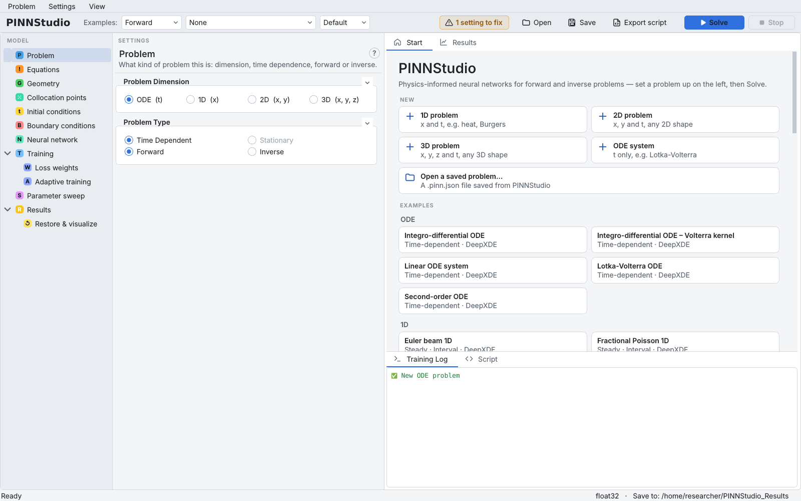
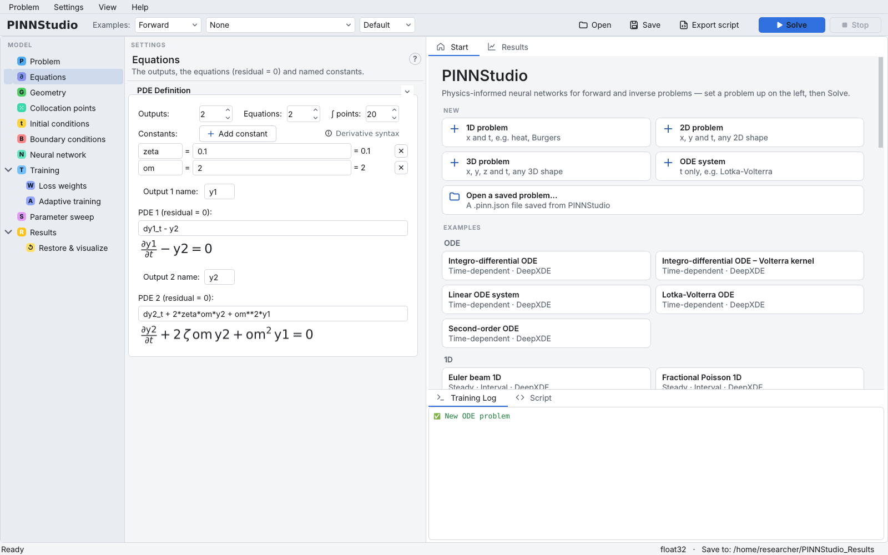
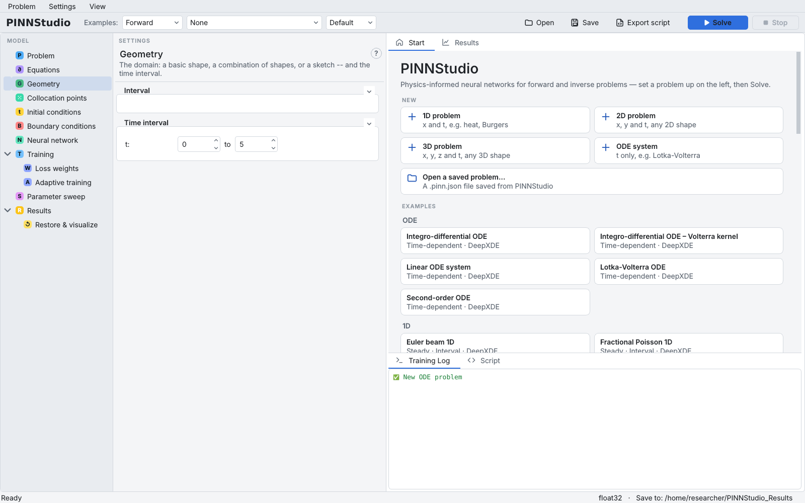
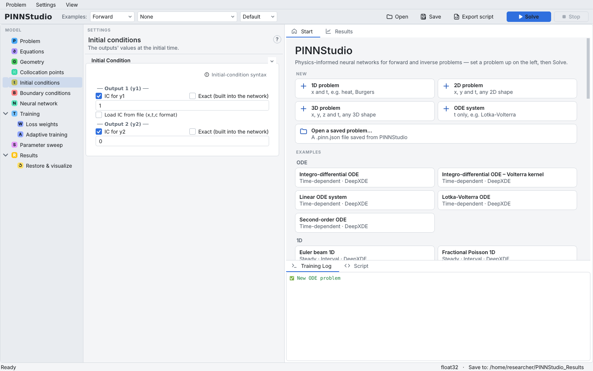
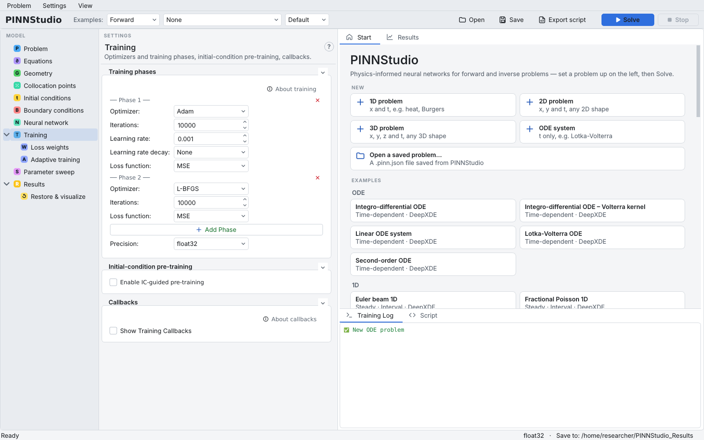
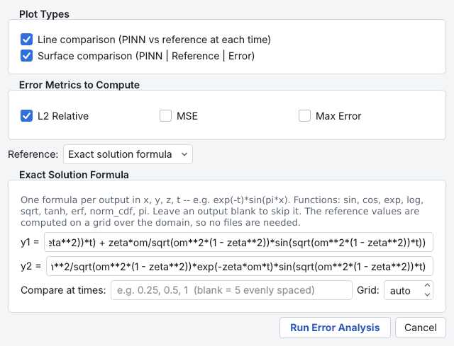
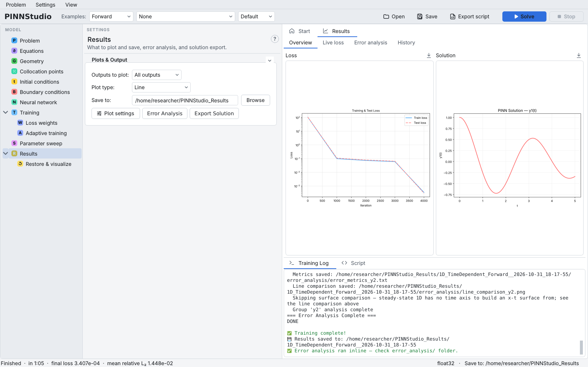
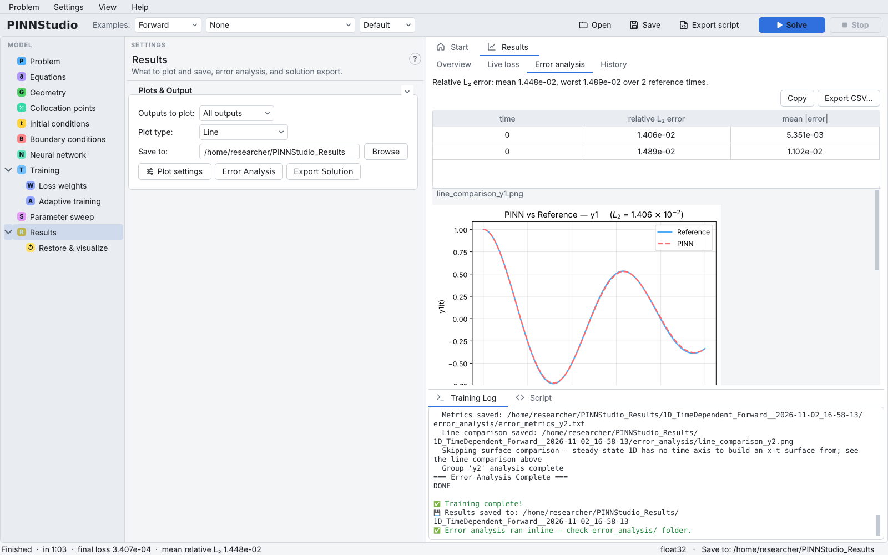
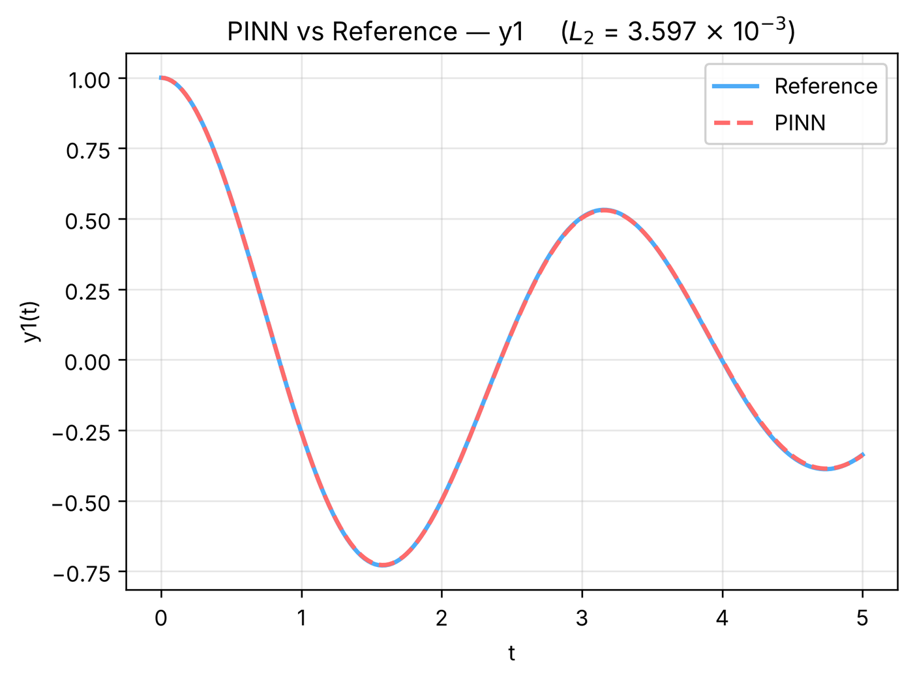

# 1. First forward ODE

In this tutorial you set up a small system of ordinary differential equations from a blank problem, train a
PINN on it, and compare the result with the exact solution. It is the shortest complete path through
PINNStudio and introduces the editors that every later tutorial uses.

**What you will learn**

- start a new problem from the **Start** tab and choose the problem dimension;
- name outputs, write equations in PINNStudio's expression syntax and define named constants;
- set initial conditions and training phases;
- give an exact solution to **Error Analysis** and read the error it reports.

**The problem.** A damped harmonic oscillator, written as a first-order system:

\[
y_1' = y_2, \qquad y_2' = -2\zeta\omega\, y_2 - \omega^2 y_1, \qquad y_1(0) = 1,\; y_2(0) = 0,
\]

with \( \zeta = 0.1 \), \( \omega = 2 \) and \( t \in [0, 5] \). Its exact solution is
\( y_1 = e^{-\zeta\omega t}\left(\cos\omega_d t + \tfrac{\zeta\omega}{\omega_d}\sin\omega_d t\right) \),
\( y_2 = -\tfrac{\omega^2}{\omega_d} e^{-\zeta\omega t}\sin\omega_d t \), with
\( \omega_d = \omega\sqrt{1-\zeta^2} \).

## Prerequisites

- PINNStudio installed and starting (see [Installation](../getting-started/installation.md) and
  [First run](../getting-started/first-run.md)).
- No files are needed. Training takes a few minutes on a laptop CPU.

## Steps

### Create the problem

1. On the **Start** tab (right side of the window), under **NEW**, click **ODE system**.
   The same action is in the menu **Problem › New › ODE system**.
   PINNStudio resets every setting to its defaults, selects **ODE (t)** on the **Problem** page and opens
   the **Equations** page. The **Training Log** shows `New ODE problem`.

    { .screenshot loading=lazy }

### Outputs, constants and equations

2. On the **Equations** page, set **Outputs:** to `2`. Two name boxes and two equation boxes appear; the
   **Equations:** count follows the number of outputs.
3. Type `y1` in **Output 1 name:** and `y2` in **Output 2 name:**.
4. Click **Add constant** twice. In the first row type the name `zeta` and the value `0.1`; in the second,
   `om` and `2`. Constants can be used by name in equations, initial and boundary conditions, transforms
   and the exact-solution formula.
5. Type the two residuals (each box holds an expression that should equal zero):

    | Box | Expression |
    |---|---|
    | **PDE 1 (residual = 0):** | `dy1_t - y2` |
    | **PDE 2 (residual = 0):** | `dy2_t + 2*zeta*om*y2 + om**2*y1` |

    A derivative is written `d` + output name + `_` + variable, so `dy1_t` is \( dy_1/dt \).
    The rendered equation below each box shows how PINNStudio read your text; check it before going on.
    **Derivative syntax** on the same page opens a short reference.

    { .screenshot loading=lazy }

!!! warning "Output and constant names"
    Use names that are not coordinates or reserved words: `x`, `y`, `z` and `t` are coordinates, and names
    such as `np`, `dde`, `pi` or `lambda` are rejected. That is why this tutorial uses `y1`, `y2` rather
    than `x`, `v`. PINNStudio lists an invalid name as a setting to fix and will not start training with it.

### Time interval and initial conditions

6. Open the **Geometry** page. Under **Time interval**, set **t:** from `0` to `5`.
   (The **Interval** group above it is empty for an ODE: there is no space coordinate.)

    { .screenshot loading=lazy }

7. Open the **Initial conditions** page. Under **Output 1 (y1)** type `1`; under **Output 2 (y2)** type `0`.
   Leave **IC for y1** and **IC for y2** ticked, so both conditions are loss terms.

    { .screenshot loading=lazy }

8. An ODE has no **Boundary conditions** to set here. Leave **Collocation points** and **Neural network** at
   their defaults (2000 domain points; 3 hidden layers of 64 neurons, `tanh`).

### Training

9. Open the **Training** page. A new problem has two phases under **Training phases**:
   **Phase 1** with **Optimizer:** Adam, **Iterations:** 10000, **Learning rate:** 0.001, and **Phase 2** with
   L-BFGS, 10000 iterations. Keep these values. Adam does most of the early work; L-BFGS then refines the
   solution and usually stops by itself when the loss no longer decreases.

    { .screenshot loading=lazy }

10. Open **Loss weights** (under **Training**) and look at the weights: one for each equation and one for
    each initial condition. A new problem gives the initial conditions a weight of `100` and the equations
    `1`. Keep them.

### Reference for the error

11. Open the **Results** page and click **Error Analysis**. In the dialog set **Reference:** to
    **Exact solution formula** and type one formula per output (constants may be used):

    ```text
    y1 = exp(-zeta*om*t)*(cos(sqrt(om**2*(1 - zeta**2))*t) + zeta*om/sqrt(om**2*(1 - zeta**2))*sin(sqrt(om**2*(1 - zeta**2))*t))
    y2 = -om**2/sqrt(om**2*(1 - zeta**2))*exp(-zeta*om*t)*sin(sqrt(om**2*(1 - zeta**2))*t)
    ```

    Leave **L2 Relative** ticked and click **Run Error Analysis**. This only stores the settings: the
    log says `Error Analysis configured — exact-solution formula, will run after training.`

    { .screenshot loading=lazy }

### Solve

12. Check **Save to:** on the **Results** page (default `~/PINNStudio_Results`), then click **Solve** in the
    toolbar. The right side switches to **Results**; the **Training Log** shows the loss table every 1000
    steps, and **Live loss** follows the loss during training. **Stop** ends a run early.
13. When training ends, the **Overview** tab shows the loss curve and the solution, and the status bar summarizes
    the run (time, final loss, mean relative L2 error). The **Error analysis** tab lists the errors and shows the
    comparison plots.

    { .screenshot loading=lazy }

    { .screenshot loading=lazy }

    These two screenshots come from a GUI run shortened to 3000 Adam + 1000 L-BFGS iterations.
    In the table each output is one row; both rows show time 0 because an ODE is compared over its whole interval at
    once.

## Expected results

The loss falls during the Adam phase and drops by several orders of magnitude in the L-BFGS phase. The
PINN curves for \( y_1 \) and \( y_2 \) lie on top of the exact ones.

In our test run on a CPU, with the iterations shortened to 5000 Adam + 2000 L-BFGS (L-BFGS stopped by itself
at step 6717), the final loss was 8.5 × 10⁻⁵ and the relative L2 errors were 3.6 × 10⁻³ for `y1` and
3.9 × 10⁻³ for `y2`. With the recommended 10000 + 10000 iterations you can expect errors of that order or
lower; results vary with hardware and random seed.

<figure markdown>
{ loading=lazy width=560 }
<figcaption>Error Analysis line comparison for y1, from a short verification run (5000 Adam + 2000 L-BFGS iterations).</figcaption>
</figure>

The run folder (a timestamped folder under **Save to:**) contains:

| Folder | Contents |
|---|---|
| `solution_results/` | `loss_plot.png`, `solution_plot.png`, `solution_plot_y1.png`, `solution_plot_y2.png`, `training_log.txt`, a model file per phase (`model_adam-phase1-….pt`, `model_lbfgs-phase2-….pt`) and `model_config.json` |
| `error_analysis/` | `line_comparison_y1.png`, `line_comparison_y2.png`, `error_metrics_y1.txt`, `error_metrics_y2.txt` |
| `reference_from_formula/` | the reference values computed from your formulas |

!!! note
    For an ODE the error-metrics file and the log label the comparison `t=0.0000`, although the comparison
    covers the whole interval \( [0, 5] \).

Save the problem with **Save** (or **Problem › Save Problem**) as `oscillator.pinn.json`: Tutorials
[13](13-compare.md), [14](14-bayesian.md) and [16](16-scripts.md) start from it.

## Troubleshooting

| Symptom | What to check |
|---|---|
| **Solve** does nothing and the toolbar shows **1 setting to fix** | Click it; it opens the page with the problem (an invalid output name, an empty equation, an unknown symbol, a derivative name PINNStudio does not support). |
| The rendered equation does not match what you meant | Check the derivative names (`dy1_t`, not `dy1/dt`) and use `**` for powers. |
| The error is large and the solution is flat | Check the initial conditions and the time interval; try more Adam iterations. A PINN is not guaranteed to converge for every problem and setting. |
| `Error Analysis: enter an exact-solution formula for at least one output.` | The formula boxes were empty when you clicked **Run Error Analysis**. |

## Next steps

- [Tutorial 2](02-burgers.md): a time-dependent PDE from a shipped example.
- [Equations, outputs and constants](../guide/equations.md), [Initial conditions](../guide/initial-conditions.md),
  [Training phases](../guide/training.md) and [Error Analysis](../guide/error-analysis.md) in the user guide.
- [ODEs and PDEs](../reference/equations.md) in the feature reference.
