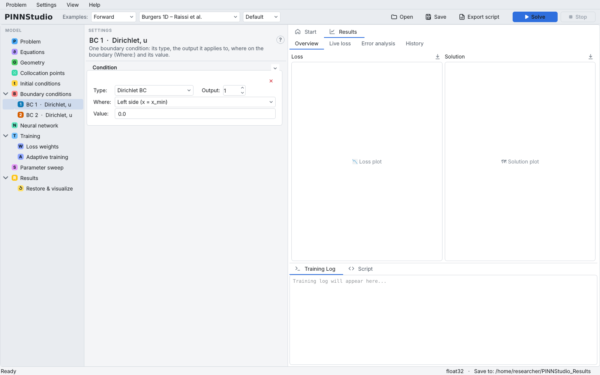
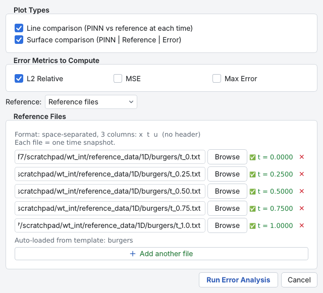
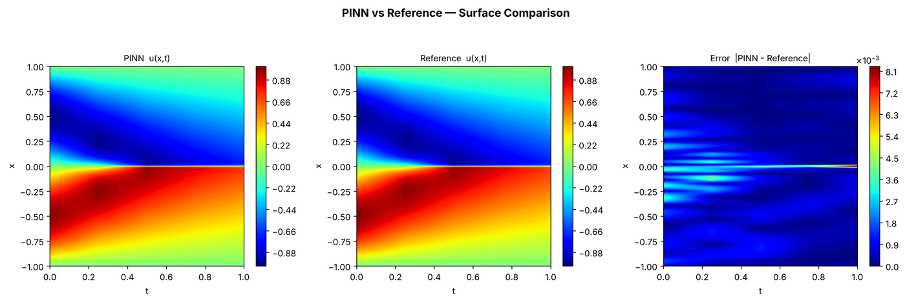
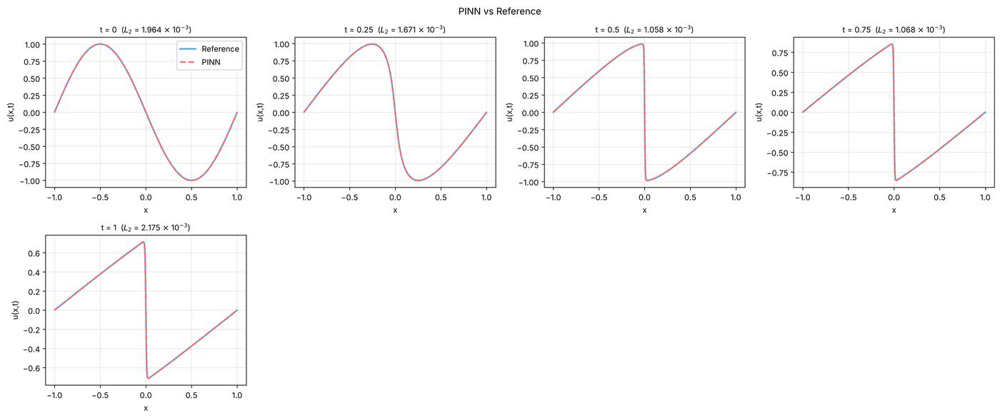

# 2. 1D Burgers equation

This tutorial solves the viscous Burgers equation, the standard first test for PINNs, starting from the
shipped example. You will look at how a time-dependent PDE is laid out across the model tree, train it,
and read the comparison with the reference solution that comes with the example.

**What you will learn**

- load a shipped example from the **Examples** list and choose **Default** or **Tuned** settings;
- read a time-dependent problem in the model tree: domain, initial condition, boundary-condition rows;
- train with a single L-BFGS phase;
- read the line and surface comparisons that **Error Analysis** writes.

**The problem.** On \( x \in [-1, 1] \), \( t \in [0, 1] \):

\[
u_t + u\,u_x = \frac{0.01}{\pi}\,u_{xx}, \qquad u(x, 0) = -\sin(\pi x), \qquad u(-1, t) = u(1, t) = 0 .
\]

A steep front forms near \( x = 0 \). The example uses the settings of
Raissi et al. (2019) (see [references](../about/references.md)).

## Prerequisites

- [Tutorial 1](01-ode.md) (or familiarity with the model tree and **Solve**).
- No files are needed: the reference data ship with PINNStudio.

## Steps

### Load the example

1. In the toolbar, leave the first **Examples:** box at **Forward**, choose **Burgers 1D – Raissi et al.** in
   the second box, and leave the third box at **Default**. (The same example is listed under **1D** on the
   **Start** tab.)
2. The **Training Log** confirms what was loaded:

    ```text
    ✅ Error analysis auto-configured — 5 ground truth files from template
    ✅ Template loaded: Burgers 1D – Raissi et al.
    ℹ️ Default settings: 1D Burgers solved as in its paper (Raissi et al. 2019).
    ```

    { .screenshot loading=lazy }

### Walk through the model tree

3. **Problem**: **1D (x)**, **Time Dependent**, **Forward**.
4. **Equations**: one output `u` and the residual `du_t + 1.0*u*du_x - (0.01/pi)*du_xx`.
5. **Geometry**: **x:** from `-1` to `1`; **t:** from `0` to `1`.

    { .screenshot loading=lazy }

6. **Collocation points**: **Domain points:** 10000, **Boundary points:** 50, **Initial points:** 50.
7. **Initial conditions**: `-sin(pi*x)`.
8. **Boundary conditions**: two rows, **BC 1 · Dirichlet, u** and **BC 2 · Dirichlet, u**. Click **BC 1** in the
   tree to see its **Type:** (Dirichlet BC), **Output:** (1), **Where:** (Left side (x = x_min)) and **Value:**
   (0.0). BC 2 is the same on the right side.

    { .screenshot loading=lazy }

9. **Neural network**: 8 hidden layers of 20 neurons, `tanh`.
10. **Training**: a single phase, **L-BFGS** with 50000 iterations, and **Use recommended L-BFGS settings**
    ticked (DeepXDE's default L-BFGS options).

    { .screenshot loading=lazy }

11. **Results** › **Error Analysis**: the dialog already lists five reference files (\( t = 0, 0.25, 0.5, 0.75, 1 \))
    under **Reference files**. Click **Cancel** to keep them as they are.

    { .screenshot loading=lazy }

### Solve

12. Click **Solve**. L-BFGS prints the loss every 1000 steps; the four columns are the PDE residual, the two
    boundary conditions and the initial condition. L-BFGS may stop before 50000 iterations when the loss no
    longer changes.

## Expected results

The solution plot shows the sine profile steepening into a sharp front at \( x = 0 \). The error is largest
around the front.

In our test run on a CPU, shortened to 3000 L-BFGS iterations (about 5 minutes), the final loss was
2.1 × 10⁻⁵ and the relative L2 error was between 1.1 × 10⁻³ and 2.2 × 10⁻³ at the five reference times
(1.6 × 10⁻³ over all five together). The full 50000 iterations take longer; L-BFGS usually stops earlier.

<figure markdown>
{ loading=lazy }
<figcaption>Surface comparison written by Error Analysis after a short verification run (3000 L-BFGS iterations).</figcaption>
</figure>

<figure markdown>
{ loading=lazy }
<figcaption>Line comparison at the five reference times, same run.</figcaption>
</figure>

`error_analysis/error_metrics.txt` in the run folder lists the error at every reference time.

## Variations to try

- Switch the third **Examples** box to **Tuned**. For this example the log says
  `Tuned settings: Raissi et al.'s settings`: the paper's settings are already PINNStudio's best here, so
  nothing changes. Other examples do change; see [Tutorial 13](13-compare.md).
- On **Results**, set **Plot type:** to **Line (time steps)** to get \( u(x) \) curves at several times instead of
  a surface.
- Add an Adam phase before L-BFGS (**Add Phase**, then set the first phase's **Optimizer:** to Adam). This is
  needed for per-point weights ([Tutorial 11](11-point-weights.md)).

## Troubleshooting

| Symptom | What to check |
|---|---|
| The run takes very long | 10000 domain points with L-BFGS is heavy on a CPU. Lower **Iterations:** for a first try, or reduce **Domain points:**. |
| `Error Analysis: no valid reference files loaded.` | The reference-file paths no longer exist (for example after moving the installation). Reload the example. |
| The front is smeared | Typical of too few iterations or points near the front; see RAR ([Tutorial 10](10-rar.md)) and point weights ([Tutorial 11](11-point-weights.md)). |

## Next steps

- [Tutorial 3](03-heat-2d.md): a 2D problem with mixed boundary conditions.
- [Boundary conditions](../guide/boundary-conditions.md) and [Results and plots](../guide/results.md) in the
  user guide; [Optimizers and training phases](../reference/optimizers.md) in the reference.
