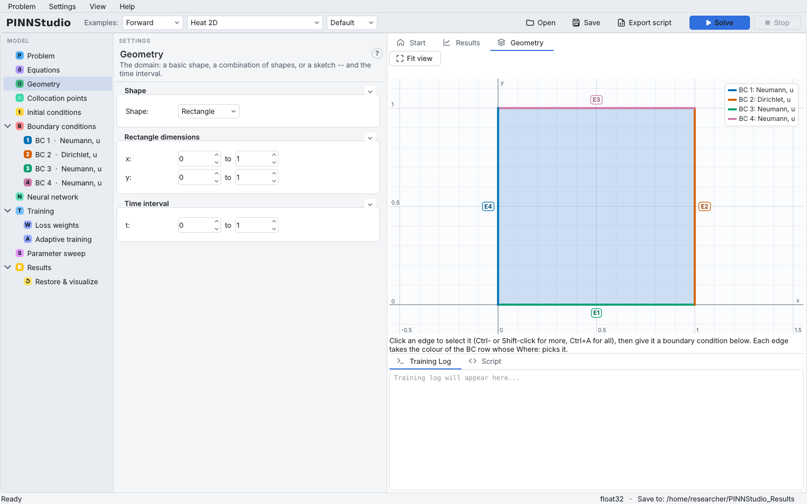
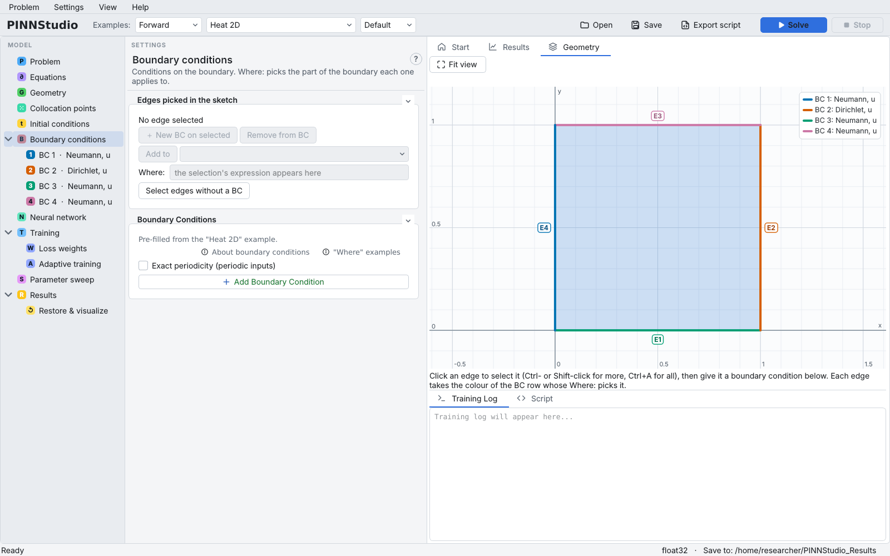
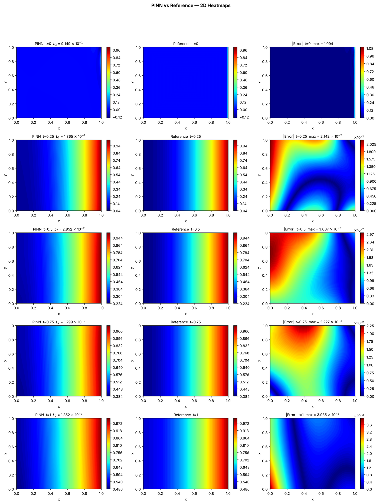

# 3. 2D heat equation

This tutorial moves to two space dimensions: heat diffusing into a square plate through one heated edge, with the
other edges insulated. It shows how a 2D domain is defined and displayed, and how Dirichlet and Neumann conditions
are assigned to different sides.

**What you will learn**

- the **Geometry** page and the geometry view for a 2D rectangle;
- assign boundary conditions to sides with **Where:** and check them in the view;
- read 2D error-analysis heat maps, and why a relative error can be large where the reference is nearly zero.

**The problem.** On the unit square \( (x, y) \in [0, 1]^2 \), \( t \in [0, 1] \):

\[
u_t = 0.4\,(u_{xx} + u_{yy}), \qquad u(x, y, 0) = 0,
\]

with \( u = 1 \) on the right edge \( x = 1 \) and zero normal derivative (insulated) on the other three edges.

## Prerequisites

- [Tutorial 2](02-burgers.md).
- The default settings train for a long time on a CPU (see below); a GPU helps.

## Steps

1. In the **Examples** bar choose **Forward**, **Heat 2D**, **Default**. The log says
   `Error analysis auto-configured — 5 ground truth files from template`.
2. **Problem**: **2D (x, y)**, **Time Dependent**, **Forward**.
3. **Equations**: one output `u`, residual `du_t - 0.4*(du_xx + du_yy)`.
4. **Geometry**: **Shape:** **Rectangle** with **x:** and **y:** from 0 to 1 under **Rectangle dimensions**, and **t:** from 0 to 1. The **Geometry** tab on the
   right draws the domain and labels its edges **E1**–**E4**.

    { .screenshot loading=lazy }

5. **Initial conditions**: `0.0`.
6. **Boundary conditions**: four rows, one per side:

    | Row | Type | Where | Value |
    |---|---|---|---|
    | BC 1 | Neumann BC | Left side (x = x_min) | 0.0 |
    | BC 2 | Dirichlet BC | Right side (x = x_max) | 1.0 |
    | BC 3 | Neumann BC | Bottom side (y = y_min) | 0.0 |
    | BC 4 | Neumann BC | Top side (y = y_max) | 0.0 |

    In the geometry view each edge takes the colour of the row that covers it, with a legend. Click an edge to select it;
    **Select edges without a BC** highlights edges that no row covers.

    { .screenshot loading=lazy }

7. **Collocation points**: 10000 domain, 400 boundary, 400 initial. **Neural network**: 4 hidden layers of 64 neurons.
   **Training**: Adam 20000 iterations, then L-BFGS 10000.
8. Click **Solve**.

## Expected results

Heat enters through the right edge and spreads to the left; because the top and bottom edges are insulated, the
solution depends on \( x \) and \( t \) only (vertical stripes). By \( t = 1 \) the left edge has warmed to about 0.5.

In our test run on a CPU, shortened to 2000 Adam + 500 L-BFGS iterations (about 12 minutes; the full default settings
take many times longer), the relative L2 errors were 1.9 × 10⁻², 2.9 × 10⁻², 1.8 × 10⁻² and 1.4 × 10⁻² at
\( t = 0.25, 0.5, 0.75, 1 \), with absolute errors below 0.04.

At \( t = 0 \) the same run reported a relative L2 error of 0.91. This is not a failure of training: the initial
temperature is 0 everywhere except at the heated edge, where the condition \( u = 1 \) jumps in. The reference is
almost zero, so the relative error divides by a very small norm, and the absolute error is confined to a thin strip
at \( x = 1 \). Look at the absolute error map in such cases.

<figure markdown>
{ loading=lazy }
<figcaption>Surface comparison from a short verification run (2000 Adam + 500 L-BFGS iterations).</figcaption>
</figure>

## Variations to try

- Try the other **Plot type:** options on the **Results** page (the list depends on the problem's dimension).
- Change BC 2's **Value:** to `sin(pi*y)` for a non-uniform heated edge (the solution then depends on \( y \) too).
  The shipped reference files no longer apply; remove them in **Error Analysis**.
- Heat 2D also has an **Inverse** mode (choose **Inverse** in the first **Examples** box); inverse problems are the subject of [Tutorial 6](06-inverse.md).

## Troubleshooting

| Symptom | What to check |
|---|---|
| Training is very slow | 10000 domain points in 2D+time is heavy for a CPU; reduce **Domain points:** and the iterations for a first try. |
| An edge is drawn without colour | No row covers it; it has no boundary loss. Add a row or change a **Where:**. |
| Large relative error at one time only | Check whether the reference is near zero there (as at \( t = 0 \) above). |

## Next steps

- [Tutorial 8](08-geometry.md): a non-rectangular domain.
- [Geometry and domain](../guide/geometry.md) and [Boundary conditions](../guide/boundary-conditions.md) in the user guide.
