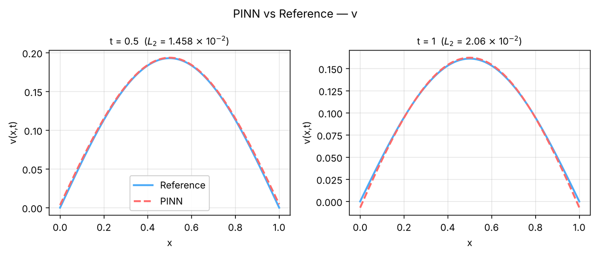

# 4. Coupled PDE system

This tutorial builds a system of two coupled reaction–diffusion equations from a blank 1D problem. One
network predicts both fields; each equation, initial condition and boundary condition becomes its own loss
term.

**What you will learn**

- set up a problem with two outputs and two equations;
- give each output its own initial condition and boundary-condition row (the **Output:** field);
- see how the loss weights list one entry per term;
- compare several outputs with an exact solution in **Error Analysis**.

**The problem.** On \( x \in [0, 1] \), \( t \in [0, 1] \), with \( D = 0.1 \):

\[
u_t = D u_{xx} - u + v, \qquad v_t = D v_{xx} + u - v,
\]
\[
u(x, 0) = \sin(\pi x),\quad v(x, 0) = 0, \qquad u = v = 0 \text{ at } x = 0, 1 .
\]

The sum \( s = u + v \) and the difference \( d = u - v \) decouple:
\( s = e^{-D\pi^2 t}\sin\pi x \), \( d = e^{-(D\pi^2 + 2)t}\sin\pi x \), so
\( u = (s + d)/2 \) and \( v = (s - d)/2 \). The exchange terms move material from \( u \) into \( v \),
which starts at zero, grows, and then decays.

## Prerequisites

- [Tutorial 1](01-ode.md) (equations, constants, **Error Analysis** with a formula).
- About 5–10 minutes of CPU time for a short run.

## Steps

### Create the problem

1. On the **Start** tab click **1D problem** (or **Problem › New › 1D problem**). The **Equations** page opens.
2. On **Geometry**, check that **x:** runs from `0` to `1` and **t:** from `0` to `1` (the defaults of a new
   1D problem).

### Two outputs, two equations

3. On **Equations**, set **Outputs:** to `2`. Name them `u` and `v`.
4. Click **Add constant** and enter `D` = `0.1`.
5. Type the residuals:

    | Box | Expression |
    |---|---|
    | **PDE 1 (residual = 0):** | `du_t - D*du_xx + u - v` |
    | **PDE 2 (residual = 0):** | `dv_t - D*dv_xx - u + v` |

    { .screenshot loading=lazy }

!!! note "Outputs and equations"
    **Equations:** normally equals **Outputs:**, but they can differ (for example an extra constraint
    equation). Each equation may use any output and its derivatives.

### Initial conditions

6. On **Initial conditions**, type `sin(pi*x)` under **Output 1 (u)** and `0` under **Output 2 (v)**. Keep both
   **IC for …** boxes ticked.

    { .screenshot loading=lazy }

### Boundary conditions: one row per output

7. Open **Boundary conditions** and click **Add Boundary Condition**. A row **BC 1** appears in the tree.
   Click it and set **Type:** Dirichlet BC, **Output:** `1`, **Where:** Whole boundary, **Value:** `0`.
8. Click **Add Boundary Condition** again. In **BC 2** set **Type:** Dirichlet BC, **Output:** `2`,
   **Where:** Whole boundary, **Value:** `0`. The tree now shows **BC 1 · Dirichlet, u** and
   **BC 2 · Dirichlet, v**.

    { .screenshot loading=lazy }

    A boundary-condition row applies to one output only. A problem with two outputs and conditions on both
    therefore needs at least two rows.

### Loss weights

9. Open **Loss weights**. There is one weight per term, in the order the loss is printed during training:
   **PDE 1 (u)**, **PDE 2 (v)**, **BC 1 (Dirichlet, u)**, **BC 2 (Dirichlet, v)**, **IC 1 (u)**, **IC 2 (v)**.
   The defaults are 1 for the equations and boundary conditions and 100 for the initial conditions. Keep them.

    { .screenshot loading=lazy }

### Training and reference

10. Keep the default **Training phases** (Adam 10000, then L-BFGS 10000) and the default points
    (2000 domain, 200 boundary, 200 initial).
11. On **Results**, set **Outputs to plot:** to all outputs if it is not already, click **Error Analysis**,
    choose **Exact solution formula**, and enter:

    ```text
    u = 0.5*(exp(-D*pi**2*t)*sin(pi*x) + exp(-(D*pi**2 + 2)*t)*sin(pi*x))
    v = 0.5*(exp(-D*pi**2*t)*sin(pi*x) - exp(-(D*pi**2 + 2)*t)*sin(pi*x))
    ```

    Type `0.5, 1` in **Compare at times:** and click **Run Error Analysis**.
12. Click **Solve**.

## Expected results

The loss table has six columns, one per term in the order above. After training, `u` decays from the
initial sine, and `v` rises from zero to a smaller sine-shaped profile (its maximum is about 0.19 at
\( t = 0.5 \)).

In our test run on a CPU, shortened to 3000 Adam + 1000 L-BFGS iterations (about 5 minutes), the relative L2
errors were:

| Output | \( t = 0.5 \) | \( t = 1 \) |
|---|---|---|
| `u` | 3.0 × 10⁻³ | 1.2 × 10⁻² |
| `v` | 1.5 × 10⁻² | 2.1 × 10⁻² |

The relative error of `v` is larger because `v` itself is small; the absolute errors of the two outputs are
of the same size (maximum about 6 × 10⁻³ and 7 × 10⁻³ at \( t = 1 \)). The recommended 10000 + 10000 iterations
reduce both.

<figure markdown>
{ loading=lazy }
<figcaption>Error Analysis line comparison for v, from a short verification run (3000 Adam + 1000 L-BFGS iterations).</figcaption>
</figure>

Error Analysis writes one set of files per output: `line_comparison_u.png`, `line_comparison_v.png`,
`surface_comparison_u.png`, `surface_comparison_v.png`, and `error_metrics_u.txt`, `error_metrics_v.txt`.

## Troubleshooting

| Symptom | What to check |
|---|---|
| `v` stays zero | Check the signs of the exchange terms in both residuals, and that BC 2 has **Output:** `2`. |
| A boundary condition acts on the wrong field | Each row's **Output:** is numbered as on the **Equations** page (1 = first output). |
| One output is much less accurate | Compare absolute, not only relative, errors; raise that output's weights on **Loss weights**, or train longer. |

## Next steps

- [Tutorial 5](05-phase-field.md): a stiff phase-field equation.
- [Coupled systems](../reference/coupled.md) and [Boundary conditions](../reference/boundary-conditions.md) in the
  feature reference; [Loss weights](../guide/loss-weights.md) in the user guide.
