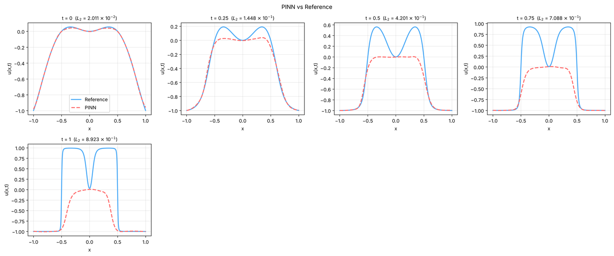

# 5. Forward phase-field problem (Allen–Cahn)

Phase-field equations describe the evolution of interfaces between phases, for example in alloys during
decomposition. They are stiff: a small interface-width parameter makes the solution switch sharply between two
values, and plain PINN training often converges to a wrong solution. This tutorial runs the 1D Allen–Cahn benchmark of
Wight & Zhao (2021) (see [references](../about/references.md)) from the shipped example and explains its settings.

**What you will learn**

- the settings a stiff phase-field problem needs (periodic boundary, wide network, many iterations);
- a periodic boundary condition row;
- how to judge a phase-field result against reference data.

**The problem.** On \( x \in [-1, 1] \), \( t \in [0, 1] \):

\[
u_t = 10^{-4}\,u_{xx} - 5u^3 + 5u, \qquad u(x, 0) = x^2\cos(\pi x),
\]

with periodic boundary conditions. The cubic term drives \( u \) towards the two phases \( u = \pm 1 \); the small
diffusion coefficient makes the interfaces between them thin.

## Prerequisites

- [Tutorial 2](02-burgers.md).
- Time: the default settings take long on a CPU. The verification run below was shortened.

## Steps

1. In the **Examples** bar choose **Forward**, **Allen-Cahn 1D – Wight & Zhao**, **Default**. The log says
   `Default settings: 1D Allen-Cahn (whole interval) solved as in its paper (Wight & Zhao 2021).` and that five
   reference files were loaded for Error Analysis.
2. **Equations**: one output `u`, residual `du_t - 0.0001*du_xx + 5*u**3 - 5*u`.

    { .screenshot loading=lazy }

3. **Geometry**: **x:** from `-1` to `1`, **t:** from `0` to `1`.
4. **Initial conditions**: `x**2*cos(pi*x)`.
5. **Boundary conditions**: a single row, **BC 1 · Periodic, u**, with **Periodic in:** `x` (left ↔ right) and
   **Derivative order:** `0`. A periodic row has no **Where:** or **Value:**; it ties the values at the two ends together.

    { .screenshot loading=lazy }

6. **Neural network**: 4 hidden layers of 128 neurons, `tanh`. A wider network than in the earlier tutorials, to
   represent the sharp interfaces.

    { .screenshot loading=lazy }

7. **Collocation points**: 2000 domain, 200 boundary, 200 initial. **Training**: Adam 20000 iterations, then L-BFGS
   10000. **Loss weights**: 1 for the equation and the periodic condition, 100 for the initial condition.
8. **Training › Adaptive training**: **Method:** is **Residual-based Adaptive Refinement (RAR)**, as in Wight & Zhao's
   approach: after the training phases, 6 rounds each add the 200 points with the largest residual (out of 20000
   candidates) and train again with 5000 Adam and 5000 L-BFGS iterations. RAR is explained in
   [Tutorial 10](10-rar.md). These rounds make up most of the run time.

    { .screenshot loading=lazy }

9. Click **Solve**.

## Expected results

With enough training the solution develops two plateaus near \( u = 1 \) around \( x = \pm 0.4 \), separated by sharp
interfaces from regions at \( u = -1 \), with a narrow dip at \( x = 0 \) (see the reference curves below). During the RAR
rounds the log prints `--- RAR Cycle k/6 ---` with the maximum and mean residual.

Our test run on a CPU was far too short for this problem, on purpose, to keep it to 5 minutes: 1500 Adam + 300 L-BFGS
iterations and 2 RAR rounds of 500 Adam + 200 L-BFGS (instead of 20000 + 10000 and 6 rounds of 5000 + 5000). It shows the
typical failure of an under-trained PINN on Allen–Cahn rather than a solution: the prediction matched the initial
condition (relative L2 error 2 × 10⁻² at \( t = 0 \)), but it stayed near zero in the middle instead of growing to the
\( u = 1 \) plateaus, so the error rose to 0.89 at \( t = 1 \).

<figure markdown>
{ loading=lazy }
<figcaption>Error Analysis line comparison from a deliberately short verification run (1500 Adam + 300 L-BFGS iterations, 2 short RAR rounds). It illustrates an unconverged result, not what the example's settings achieve.</figcaption>
</figure>

Run the example's settings (or the **Tuned** ones) before judging the method; on a CPU this takes a long time, and a
GPU helps. Always compare with the reference at several times: an error that grows with \( t \) is the signature of this
failure mode.

## Variations to try

These are the subject of later tutorials and are the usual remedies for phase-field problems:

- causal training or time windows ([Tutorial 12](12-causal-windows.md));
- per-point weights ([Tutorial 11](11-point-weights.md));
- an exact initial condition and exact periodicity ([Tutorial 9](09-exact.md));
- the **Tuned** settings of this example ([Tutorial 13](13-compare.md)).

## Troubleshooting

| Symptom | What to check |
|---|---|
| The solution stays near the initial profile, or becomes flat | A known failure mode of plain PINNs on Allen–Cahn: train longer, or use the methods above. |
| The interfaces are smeared | Too few iterations or points; increase them, or use RAR ([Tutorial 10](10-rar.md)). |
| The two ends do not match | Check that the periodic row is present and **Periodic in:** is `x`. |

## Next steps

- [Tutorial 6](06-inverse.md): inverse problems.
- [Equations](../reference/equations.md) and [Boundary conditions](../reference/boundary-conditions.md) in the reference;
  [Time-dependent training](../theory/time-dependent.md) in the theory section.
