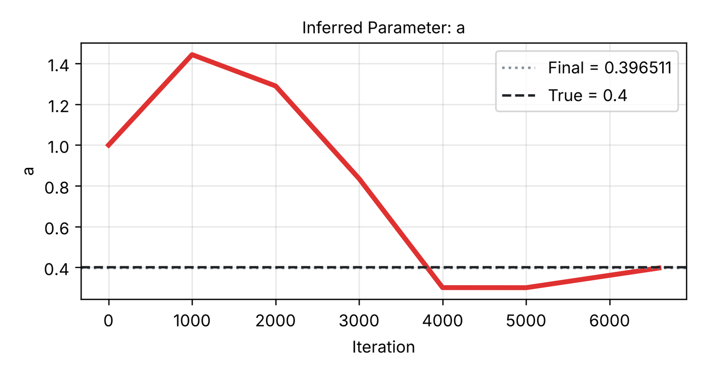

# 6. Inverse parameter estimation

In an inverse problem some coefficient of the equation is unknown, and measured data of the solution are available.
The PINN then learns the unknown coefficient together with the solution, by fitting both the equation and the data.
This tutorial estimates the diffusivity of the 1D heat equation from a measured temperature profile, using a shipped
example.

**What you will learn**

- switch an example to **Inverse** mode;
- the **Inverse problem** page: unknown parameters, initial guess, true value, measured data and its loss weight;
- follow the estimate during training and read the convergence file and plot.

**The problem.** On \( x \in [0, 1] \), \( t \in [0, 1] \):

\[
u_t = a\,u_{xx}, \qquad u(x, 0) = \sin(\pi x), \qquad u(0, t) = u(1, t) = 0,
\]

with the diffusivity \( a \) unknown (true value 0.4). The data are the exact solution
\( u = e^{-a\pi^2 t}\sin\pi x \) at \( t = 1 \).

## Prerequisites

- [Tutorial 2](02-burgers.md).

## Steps

### Load the example in Inverse mode

1. In the **Examples** bar set the first box to **Inverse**, the second to **Heat 1D – Dirichlet** and the third to
   **Default**. The log explains the setup:
   `Inverse mode (PINNStudio's addition): the diffusivity a is unknown (initial guess 1, true 0.4) and learned from u measured at t = 1 …`.
2. On **Problem**, **Inverse** is selected, and the model tree has a new page, **Inverse problem**.

    { .screenshot loading=lazy }

3. On **Equations**, the residual is `du_t - a*du_xx`. The name `a` is not a constant: it is declared on the
   **Inverse problem** page. (The initial condition, `sin(n*pi*x/L)`, uses two constants, `n = 1` and `L = 1`.)

### The Inverse problem page

4. Open **Inverse problem**. Under **Unknown parameters**:

    | Name | Initial guess | True value |
    |---|---|---|
    | `a` | `1.0` | `0.4` |

    **Initial guess** is the value at the start of training. **True value** is optional; when given, the log and the
    convergence plot compare the estimate with it. **Add parameter** adds another unknown (see [Tutorial 7](07-data.md)).

5. Under **Measured data**: **File:** is the shipped file of \( u \) at \( t = 1 \) (`reference_data/1D/heat/t_1.0.txt`),
   **Measures:** **Output 1 (u)**, **Loss weight:** `100`. **Check the equation at the measured points too (anchors)**
   is ticked, and **Use:** is **All points**.

    { .screenshot loading=lazy }

6. **Training**: Adam 20000 iterations, then L-BFGS 15000. **Neural network**: 3 hidden layers of 20 neurons.
7. Click **Solve**. In the loss table the last column is the data (observation) term; at regular intervals the current
   value of `a` is recorded.

## Expected results

At the end the log prints the estimate, for example:

```text
=== a final value: 0.396511 ===
Final inferred a: 0.396511
```

That is the result of our test run on a CPU, shortened to 5000 Adam + 2000 L-BFGS iterations (L-BFGS stopped by itself
after 1590 steps; about 2 minutes): \( a = 0.3965 \) against the true 0.4, a relative error of 0.9 %. The example also
compares the solution with the exact formula through Error Analysis; the relative L2 error over the five reference
times was 4.1 × 10⁻³. The recommended iterations usually bring the estimate closer.

The run folder contains, in addition to the usual `solution_results/` and `error_analysis/`:

| File | Contents |
|---|---|
| `a_convergence.txt` | `iteration,a`, the estimate at regular intervals (every 1000 iterations in this run) |
| `param_plot.png` | the estimate against the iteration, with the true value as a dashed line |

<figure markdown>
{ loading=lazy width=560 }
<figcaption>param_plot.png from a short verification run (5000 Adam + 2000 L-BFGS iterations).</figcaption>
</figure>

The path of the estimate is not monotonic: early on the network has not yet fitted the data, and the parameter moves to
balance the equation against a poor solution. What matters is where it settles. To redraw the plot later, or several
parameters' convergence files together, use **Restore & visualize** ([Tutorial 15](15-restore.md)).

## Troubleshooting

| Symptom | What to check |
|---|---|
| `Inverse mode needs at least one observed-data file …` | No file is selected under **Measured data**. |
| The estimate stays at the initial guess | The parameter's name is not used in the equation, or the data term is too weak: raise **Loss weight:**. |
| The estimate settles at a wrong value | The data may not determine the parameter uniquely; more data (other times), a better initial guess or longer training can help. An inverse problem is not guaranteed to have a unique answer. |

## Next steps

- [Tutorial 7](07-data.md): your own data file and two unknown parameters.
- [Inverse problems and measured data](../guide/inverse.md) in the user guide; [Inverse problems](../reference/inverse.md)
  in the reference; [Forward and inverse problems](../theory/forward-inverse.md) in the theory section.
