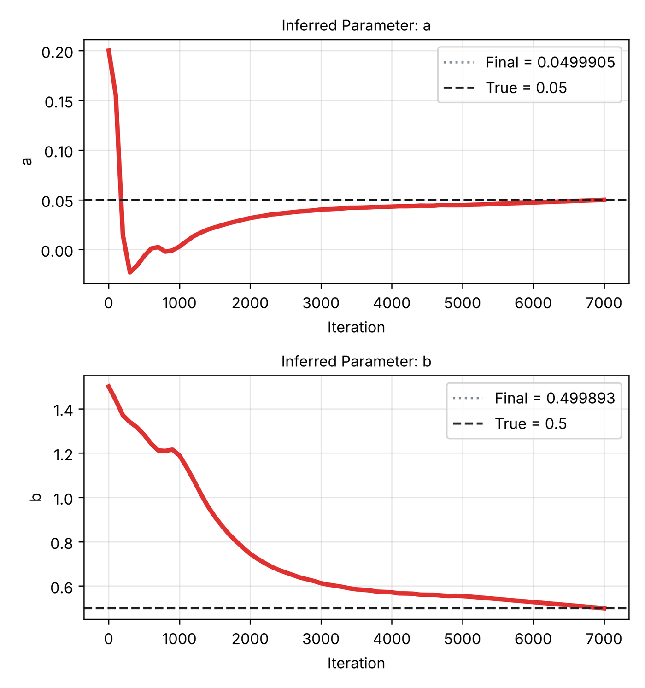

# 7. Importing observational data

In practice the data for an inverse problem come from your own measurements or simulations, not from a shipped
example. This tutorial builds an inverse problem from a blank 1D problem, loads a data file, and identifies two
unknown coefficients at once. It also describes the file format so that you can prepare your own data.

**What you will learn**

- the format of a measured-data file;
- switch a blank problem to **Inverse** and declare several unknown parameters;
- load the file, choose which output it measures and how strongly it counts;
- other places where PINNStudio reads data files.

**The problem.** On \( x \in [0, 1] \), \( t \in [0, 1] \):

\[
u_t = a\,u_{xx} - b\,u, \qquad u(x, 0) = \sin\pi x + 0.5\sin 3\pi x, \qquad u(0, t) = u(1, t) = 0,
\]

with unknown diffusion coefficient \( a \) and decay rate \( b \). The data were generated from the exact solution
with \( a = 0.05 \), \( b = 0.5 \):
\( u = e^{-(a\pi^2 + b)t}\sin\pi x + 0.5\,e^{-(9a\pi^2 + b)t}\sin 3\pi x \).
The two Fourier modes decay at different rates, which is what makes \( a \) and \( b \) separately identifiable.

## Prerequisites

- [Tutorial 6](06-inverse.md).
- The data file [`tut07_observations.txt`](../assets/data/tut07_observations.txt) (300 noise-free samples at random
  \( (x, t) \); download it, e.g. into your Downloads folder).

## The data file format

Plain text, one point per line, numbers separated by spaces (or tabs). The columns are the problem's inputs in the
order `x`, `y`, `z`, `t` (only those the problem has), then the measured value. For this 1D time-dependent problem
that is `x  t  u`:

```text
# x t u  (300 noise-free samples of u_t = a u_xx - b u with a = 0.05, b = 0.5)
6.36961687e-01 8.96801232e-01 3.71224616e-01
2.69786714e-01 5.83320047e-01 4.35725931e-01
...
```

The points may be scattered or on a grid; PINNStudio reports which (`scattered points, 300 points`). Lines starting
with `#` are ignored. A 2D time-dependent problem would use `x  y  t  value`; a stationary one leaves out `t`.

## Steps

### Problem and equation

1. On the **Start** tab click **1D problem**. On **Problem**, select **Inverse**. A new page, **Inverse problem**,
   appears in the model tree.
2. On **Geometry**, keep **x:** and **t:** from 0 to 1.
3. On **Equations**, keep one output `u` and type `du_t - a*du_xx + b*u`. The names `a` and `b` are not defined
   yet; the next steps declare them as unknowns.

    { .screenshot loading=lazy }

4. On **Initial conditions**, type `sin(pi*x) + 0.5*sin(3*pi*x)`.
5. On **Boundary conditions**, click **Add Boundary Condition** and set **Dirichlet BC**, **Output:** 1,
   **Where:** **Whole boundary**, **Value:** `0`.

### Unknown parameters

6. Open **Inverse problem**. Under **Unknown parameters**, the first row is there already: type `a` under **Name**,
   `0.2` under **Initial guess**.
7. Click **Add parameter** and fill the new row with `b` and `1.5`. The page reminds you:
   `Write each added parameter's name into the PDE yourself.` (we did in step 3).
8. Optionally type the **True value** of each (`0.05` and `0.5`). It is only used to report the error of the estimate
   and to draw it in the convergence plot; leave it empty for real data.

### Measured data

9. Under **Measured data**, next to **File:** click **Browse** and choose `tut07_observations.txt`.
10. **Measures:** **Output 1 (u)**: the file's last column is \( u \). (**Custom...** accepts an expression of the
    outputs, for data that measure a derived quantity.)
11. **Loss weight:** `100`: how strongly the data term counts relative to the equation (weight 1).
12. Keep **Check the equation at the measured points too (anchors)** ticked and **Use:** **All points**. Below them
    PINNStudio summarizes the file: `scattered points, 300 points`.

    { .screenshot loading=lazy }

### Train

13. On **Training**, set **Phase 1** to Adam with 15000 iterations and **Phase 2** to L-BFGS with 5000 iterations.
14. Click **Solve**.

## Expected results

The estimates of both parameters move from their initial guesses towards the true values; the log ends with:

```text
Final inferred a: 0.0499905
Final inferred b: 0.499893
```

That is our test run on a CPU, shortened to 5000 Adam + 2000 L-BFGS iterations (about 4 minutes): both
estimates are within 0.03 % of the values used to generate the data (\( a = 0.05 \), \( b = 0.5 \)). With noisy
measurements the estimates are less accurate; PINNStudio does not quantify their uncertainty.

<figure markdown>
{ loading=lazy width=520 }
<figcaption>param_plot.png from a short verification run (5000 Adam + 2000 L-BFGS iterations).</figcaption>
</figure>

The run folder holds one convergence file per parameter (`a_convergence.txt`, `b_convergence.txt`) next to
`param_plot.png`. Note that `a` passed through negative values early in training: PINNStudio does not constrain the sign or range
of an unknown parameter.

## Other data you can import

| What | Where |
|---|---|
| Several data files (e.g. two measured fields) | **Inverse problem** › **Add data file**, each with its own **Measures:** and **Loss weight:** |
| An initial condition given as data | **Initial conditions** › **Load IC from file (x,t,c format)** |
| Extra training points | **Collocation points** › **Extra training points:** **From a file** |
| Data inside a forward problem | a **Point Set BC** row on **Boundary conditions** |
| Reference solutions for errors | **Error Analysis** › **Reference files** ([Tutorial 17](17-error-analysis.md)) |

## Troubleshooting

| Symptom | What to check |
|---|---|
| `Inverse mode needs at least one observed-data file …` | No file is selected under **Measured data**. |
| A parameter does not move from its initial guess | Its name is missing from the equation, or the data do not constrain it (e.g. only one Fourier mode would not separate \( a \) from \( b \)). |
| The estimate oscillates or drifts | Raise the **Loss weight:**, train longer, or start closer to a plausible value. |
| The file is rejected | Check the column count (inputs plus one value column) and that every line has the same number of numbers. |

## Next steps

- [Observational data](../reference/observations.md) and [Inverse problems](../reference/inverse.md) in the reference;
  [Inverse problems and measured data](../guide/inverse.md) in the user guide.
- [Forward and inverse problems](../theory/forward-inverse.md) in the theory section.
