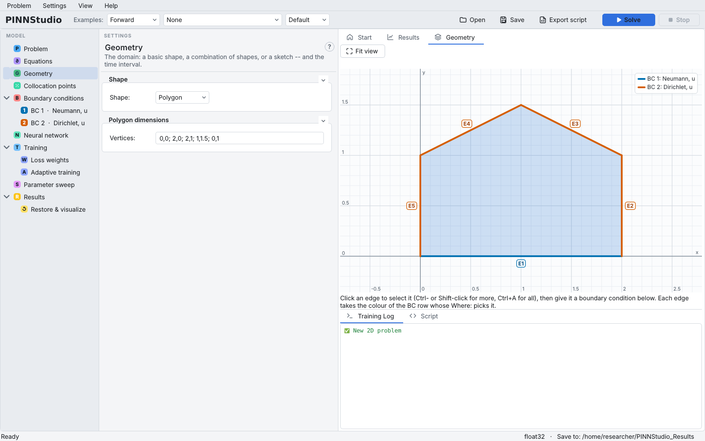
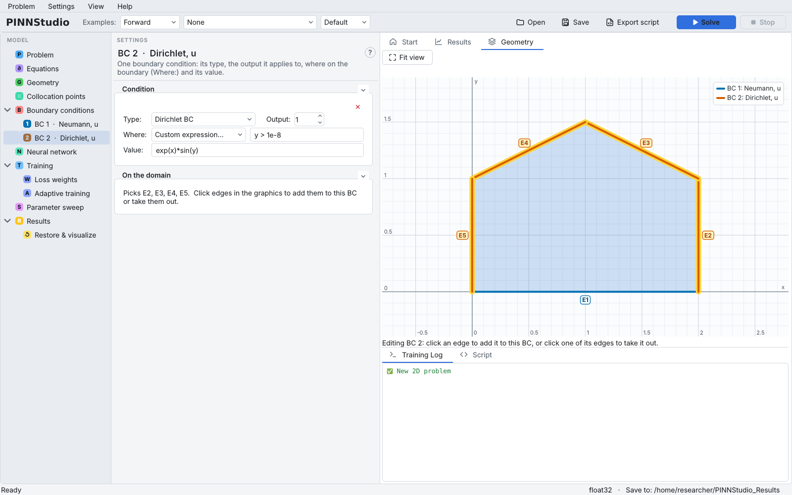
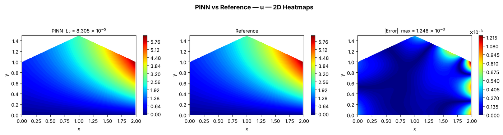

# 8. Custom geometry

Real problems rarely live on a rectangle. This tutorial builds a stationary 2D problem on a five-sided polygon
from a blank problem, and applies different boundary conditions to different edges by choosing a side from
the **Where:** list or by typing a location expression.

**What you will learn**

- choose a domain shape on the **Geometry** page and enter polygon vertices;
- use the geometry view to check the domain and which edges each boundary condition covers;
- select part of the boundary with **Where:** (a named side or a **Custom expression…**);
- set a Neumann condition (a prescribed normal derivative).

**The problem.** Laplace's equation \( u_{xx} + u_{yy} = 0 \) on the polygon with vertices
\( (0,0), (2,0), (2,1), (1,1.5), (0,1) \) (a "house" shape). The exact solution is \( u = e^{x}\sin y \).
On the bottom edge \( y = 0 \) we prescribe the outward normal derivative,
\( \partial u/\partial n = -u_y = -e^{x} \); on the other four edges we prescribe \( u = e^{x}\sin y \).

## Prerequisites

- [Tutorial 1](01-ode.md) and [Tutorial 4](04-coupled.md) (equations, boundary-condition rows).

## Steps

### A stationary 2D problem

1. On the **Start** tab click **2D problem**.
2. On **Problem**, select **Stationary** (the problem has no time).

### The polygon

3. On **Geometry**, set **Shape:** to **Polygon**.
4. In **Vertices:** type `0,0; 2,0; 2,1; 1,1.5; 0,1` (each vertex as `x,y`, vertices separated by `;`, in order
   around the boundary) and press Enter.
5. The **Geometry** tab on the right draws the domain and labels its edges **E1** … **E5**. Use **Fit view** if the
   shape is off-screen.

    { .screenshot loading=lazy }

The other shapes are **Rectangle**, **Disk**, **Ellipse** and **Triangle**; **Custom** combines shapes
(**Union (add)**, **Subtract (cut hole)**, **Intersect**), and **Sketch** lets you draw the domain. See
[Geometry and domain](../guide/geometry.md).

### Equation

6. On **Equations**, keep one output `u` and type `du_xx + du_yy` in **PDE 1 (residual = 0):**.

### Boundary conditions

7. On **Boundary conditions**, click **Add Boundary Condition**. In **BC 1** set **Type:** **Neumann BC**,
   **Output:** `1`, **Where:** **Bottom side (y = y_min)**, **Value:** `-exp(x)`.
   For a Neumann condition the value is the derivative along the outward normal; on the bottom edge the outward
   normal points in the \( -y \) direction.
8. Click **Add Boundary Condition** again. In **BC 2** set **Type:** **Dirichlet BC**, **Output:** `1`, and in
   **Where:** choose **Custom expression…**. A text box opens next to it; type `y > 1e-8`. This selects every
   boundary point that is not on the bottom edge. Set **Value:** to `exp(x)*sin(y)`.
9. With **BC 2** selected, the geometry view highlights the edges it picks (E2–E5), and **On the domain** lists
   them (`Picks E2, E3, E4, E5.`). The legend gives each condition its colour. Check that every edge has
   exactly one condition.

    { .screenshot loading=lazy }

A location expression is any True/False expression in `x`, `y` (and `z`, `t`), for example
`np.isclose(x**2 + y**2, 0.25)` or `x <= x_min`; named constants may be used. Instead of typing, you can also
click edges in the geometry view (Ctrl- or Shift-click for several) and use **New BC on selected** on the
**Boundary conditions** page.

### Points, training, reference

10. On **Collocation points**, keep **Domain points:** 2000 and set **Boundary points:** to `400`.
11. Keep the default training phases.
12. On **Results** › **Error Analysis**, choose **Exact solution formula**, type `exp(x)*sin(y)`, and click
    **Run Error Analysis**. Then click **Solve**.

## Expected results

The solution grows towards the right, where \( e^{x} \) is largest, and the PINN reproduces the exact solution
closely over the whole polygon. A stationary problem is compared at a single "time"; the log labels it `t=0.0000`.

In our test run on a CPU, shortened to 3000 Adam + 1000 L-BFGS iterations (about 2.5 minutes), the relative L2 error
was 8.3 × 10⁻⁵ and the largest absolute error 1.2 × 10⁻³, near the right edge where \( u \) is largest.

<figure markdown>
{ loading=lazy }
<figcaption>Surface comparison from a short verification run (3000 Adam + 1000 L-BFGS iterations).</figcaption>
</figure>

## Troubleshooting

| Symptom | What to check |
|---|---|
| The polygon is not drawn | Check the vertex syntax: numbers as `x,y`, vertices separated by `;`, at least three vertices, no repeated first vertex needed. |
| An edge has no colour in the geometry view | No condition picks it; its points get no boundary loss. Widen a **Where:** expression or add a row. |
| An edge has two conditions | Two **Where:** expressions overlap; make them exclusive (here, `y > 1e-8` excludes the bottom edge). |
| The Neumann condition seems to have the wrong sign | The value is \( \partial u/\partial n \) along the **outward** normal. |

## Next steps

- [Tutorial 9](09-exact.md): build boundary conditions into the network.
- [Geometry](../reference/geometry.md) and [Boundary conditions](../reference/boundary-conditions.md) in the
  reference; [Geometry and domain](../guide/geometry.md) in the user guide.
