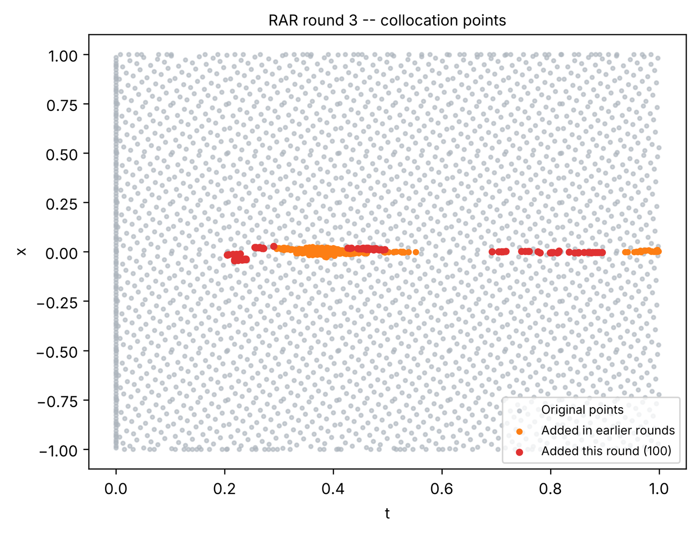

# 10. Residual-based adaptive refinement (RAR)

Collocation points are normally spread evenly over the domain. When the solution has a sharp feature, such as the
front of the Burgers equation, most points sit where the PDE is already satisfied. **RAR** (Lu et al., 2021; see
[references](../about/references.md)) adds training points where the PDE residual is largest and trains again,
round by round. This tutorial runs the shipped RAR example.

**What you will learn**

- switch on RAR on the **Adaptive training** page and what each of its settings means;
- how RAR rounds follow the normal training phases;
- where to see which points were added.

## Prerequisites

- [Tutorial 2](02-burgers.md) (the Burgers equation and its reference files).

## Steps

1. In the **Examples** bar choose **Forward**, **Burgers 1D – RAR**, **Default**. This is DeepXDE's Burgers RAR
   example: 2500 domain points, a network of 3 hidden layers with 20 neurons, Adam 10000 and L-BFGS 15000
   iterations. The Training Log explains how its RAR settings relate to DeepXDE's script.
2. Open **Training › Adaptive training**. **Method:** is **Residual-based Adaptive Refinement (RAR)**, with:

    | Setting | Value | Meaning |
    |---|---|---|
    | **RAR training rounds:** | 3 | how many times points are added |
    | **Residual sampling points:** | 100000 | random candidate points at which the residual is evaluated each round |
    | **Points added per round:** | 100 | the candidates with the largest residual that become training points |
    | **Adam iterations:** | 10000 | training after each round, first Adam … |
    | **L-BFGS iterations:** | 15000 | … then L-BFGS |
    | **Stop below mean residual:** | off | end the rounds early when the mean residual is below this value |
    | **Points from:** | All outputs (combined) | which equation's residual ranks the points (for several equations) |

    { .screenshot loading=lazy }

3. Click **Solve**. The model first trains with the phases on the **Training** page. Then each round prints
   `--- RAR Cycle k/3 ---`, the maximum and mean residual over the candidates, adds the points and trains again.

To apply RAR to your own problem, choose the same **Method:** on its **Adaptive training** page; the settings above
are a reasonable starting point. The total training is the phases plus, per round, the RAR Adam and L-BFGS
iterations, so RAR runs take noticeably longer.

## Expected results

Each round writes a folder `solution_results/rar_rounds/round_0k/` with that round's models, a solution snapshot,
`collocation_points.png` (the original points and the points added so far) and `error_compare.png`. When reference
data are configured, the log also compares each round with the reference at the last time, e.g.
`[RAR round 2] vs Reference t=1: L₂ rel error = 5.2423e-03, MSE = …`.

In our test run on a CPU we kept the example's 3 rounds, 100 000 candidates and 100 points per round, but shortened
the training to 6000 Adam + 3000 L-BFGS iterations before the rounds and 2000 Adam + 2000 L-BFGS per round (about
3 minutes). The added points concentrate along the shock at \( x = 0 \) once it has formed (\( t \gtrsim 0.2 \)). The
error at \( t = 1 \) after rounds 1, 2 and 3 was 4.7 × 10⁻², 5.2 × 10⁻³ and 1.2 × 10⁻²: it does not necessarily fall
with every round. Over all five reference times the final relative L2 error was 7.5 × 10⁻³.

<figure markdown>
{ loading=lazy width=560 }
<figcaption>collocation_points.png of round 3 from a shortened verification run (see text).</figcaption>
</figure>

To judge whether RAR helps for your problem, compare with a run of the same total iterations without RAR
(**Method:** **None**), for example in a parameter sweep ([Tutorial 13](13-compare.md)).

## Troubleshooting

| Symptom | What to check |
|---|---|
| The run takes much longer than expected | Each round trains again: reduce **RAR training rounds:** or the RAR iterations. |
| Rounds stop after the first one | **Stop below mean residual:** is set and the mean residual is already below it. |
| No improvement | Added points help when the error is concentrated; for an error spread over the whole domain, more points everywhere or a larger network may do more. |

## Next steps

- [Tutorial 11](11-point-weights.md): reweight existing points instead of adding new ones.
- [RAR](../reference/rar.md) in the reference; [Adaptive sampling](../theory/adaptive-sampling.md) in the theory.
