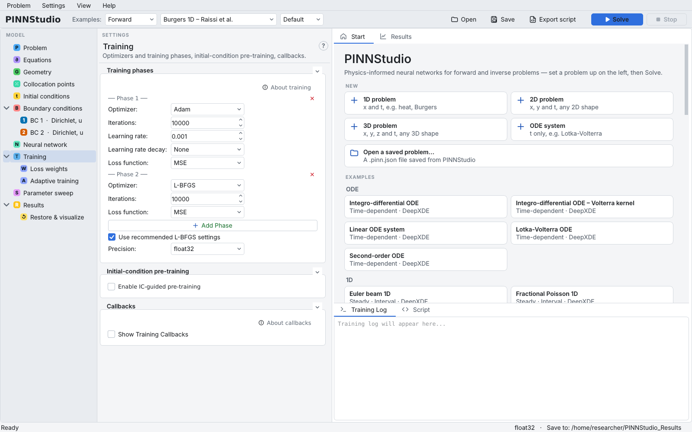
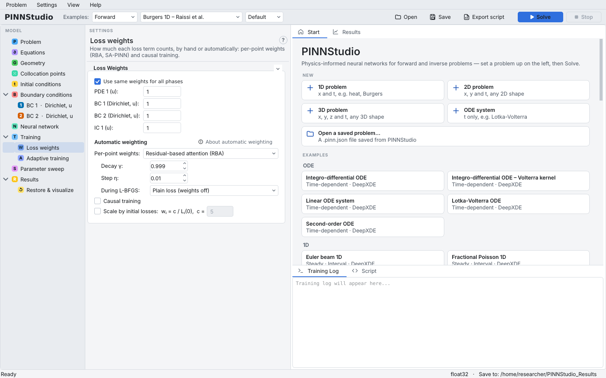
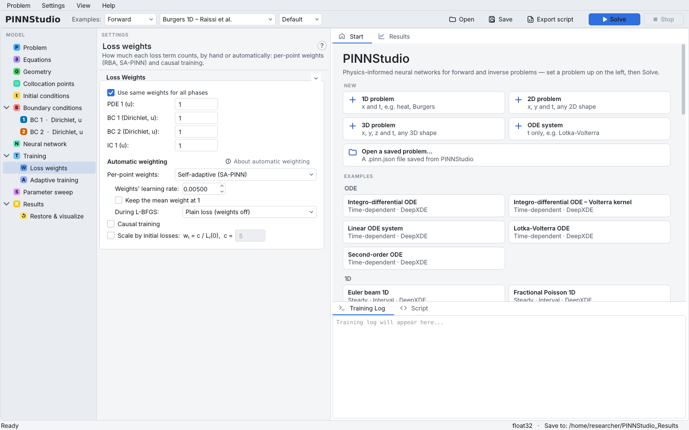

# 11. Per-point weights: RBA and SA-PINN

The loss weights on the **Loss weights** page are one number per loss term. **Per-point weights** go further: every
training point's PDE residual gets its own weight, which grows where the residual stays large, typically at
fronts and interfaces. PINNStudio offers two methods:

- **Residual-based attention (RBA)** (Anagnostopoulos et al., 2024): after every Adam step each weight is
  updated as \( w \leftarrow \gamma w + \eta\,|r|/\max|r| \). Cheap; nothing extra is trained.
- **Self-adaptive (SA-PINN)** (McClenny & Braga-Neto, 2023): the weights are trained by gradient ascent on the
  loss the network minimizes.

See [references](../about/references.md) and [Adaptive loss weighting](../theory/loss-weighting.md). This tutorial
adds both to the Burgers problem of [Tutorial 2](02-burgers.md).

**What you will learn**

- why per-point weights need an Adam phase;
- the RBA and SA-PINN settings and the **During L-BFGS:** choice;
- how to compare a run with and without point weights.

## Prerequisites

- [Tutorial 2](02-burgers.md).

## Steps

### An Adam phase first

The point weights are updated during Adam training. The Burgers example trains with L-BFGS only, so first
add an Adam phase in front of it.

1. Load **Forward › Burgers 1D – Raissi et al. › Default**.
2. On **Training**, in **Phase 1** change **Optimizer:** to **Adam**, **Iterations:** to `10000`,
   **Learning rate:** `0.001`.
3. Click **Add Phase**. In **Phase 2** set **Optimizer:** to **L-BFGS** and **Iterations:** to `10000`.

    { .screenshot loading=lazy }

### RBA

4. Open **Loss weights**. Under **Automatic weighting**, set **Per-point weights:** to
   **Residual-based attention (RBA)**. Its settings appear:
    - **Decay γ:** `0.999` — how much of a weight is kept each step; the weights level off at about
      \( \eta/(1-\gamma) \);
    - **Step η:** `0.01` — how much the normalized residual adds each step;
    - **During L-BFGS:** **Plain loss (weights off)** — Adam trains with the weights, then L-BFGS refines on the
      ordinary loss. **Keep the weights** lets L-BFGS continue with the weights Adam ended with.

    { .screenshot loading=lazy }

5. Click **Solve**.

### SA-PINN

6. Set **Per-point weights:** to **Self-adaptive (SA-PINN)**. Its settings are **Weights' learning rate:** (the
   learning rate of the weights' gradient ascent, default 0.005) and **Keep the mean weight at 1**. For SA-PINN the
   in-app help recommends **During L-BFGS:** **Keep the weights**.

    { .screenshot loading=lazy }

7. Click **Solve** again. Each run gets its own folder, so the results can be compared afterwards; or use a parameter
   sweep ([Tutorial 13](13-compare.md)).

!!! note
    Only the training points are weighted; the test loss in the log stays the plain loss. Per-point weights and
    **Causal training** both reweight the same residuals; the page warns when both are on.

## Expected results

The log confirms the method, e.g. `Per-point weights: RBA (gamma = 0.999, eta = 0.01)` or
`Per-point weights: SA-PINN (learning rate 0.005, gradient ascent)`.

In our test runs on a CPU, both shortened to 2000 Adam + 1000 L-BFGS iterations (about 4 minutes each) with
**During L-BFGS:** **Plain loss (weights off)**, the relative L2 error over the five reference times was:

| Run | Relative L2 error (all times) |
|---|---|
| RBA | 1.5 × 10⁻³ |
| SA-PINN | 5.2 × 10⁻³ |
| For orientation: Tutorial 2's run without point weights (3000 L-BFGS only) | 1.6 × 10⁻³ |

These short runs are not a fair comparison of the methods (the Tutorial 2 run used a different schedule, and one
seed each); they show only that both options run and how to read the results. Make your own comparison with the same
phases for each run, e.g. with a parameter sweep ([Tutorial 13](13-compare.md)).

Whether point weights help depends on the problem. For a problem the plain PINN already solves well they may make
little difference or make it worse; the in-app help notes this for the **Keep the weights** option. Compare with a
run without point weights before adopting them.

## Troubleshooting

| Symptom | What to check |
|---|---|
| The point-weight settings have no effect | There is no Adam or AdamW phase; the weights are only updated during Adam. |
| The loss in the log is much larger than before | The training loss includes the point weights; compare runs by their Error Analysis errors, not by the loss. |
| Training becomes unstable | Lower **Step η:** (RBA) or **Weights' learning rate:** (SA-PINN). |

## Next steps

- [Tutorial 12](12-causal-windows.md): causal training and time windows.
- [RBA and SA-PINN](../reference/point-weights.md) and [Loss weights](../reference/loss-weights.md) in the reference.
