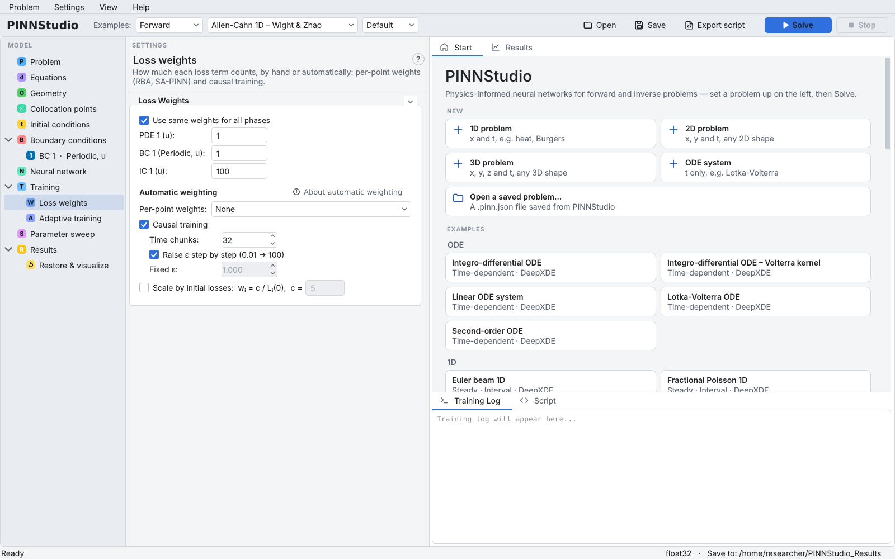
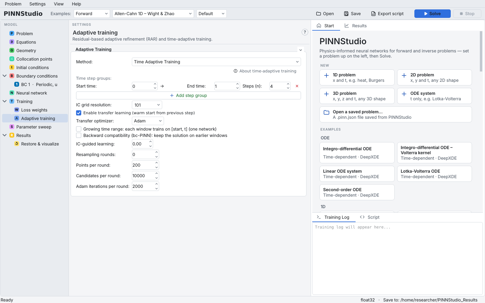

# 12. Causal and time-window training

A PINN trained on the whole time interval at once can fit late times before early times are right, and then
converge to a wrong solution. This matters for stiff, fast-changing problems such as the Allen–Cahn equation of
[Tutorial 5](05-phase-field.md). PINNStudio has two remedies that respect the direction of time:

- **Causal training** (Wang, Sankaran & Perdikaris, 2024): the time interval is split into chunks, and each chunk's
  residual is weighted by \( \exp(-\varepsilon \cdot \) the residual loss of all earlier chunks\( ) \), so later
  times only start to count once earlier times are fitted. One network, one run.
- **Time-adaptive training** (time windows; Wight & Zhao, 2021; Mattey & Ghosh, 2022): the interval is split into
  consecutive windows and one model is trained per window, each starting from the previous window's solution.

See [references](../about/references.md), [Causal training](../reference/causal.md) and
[Time windows and bc-PINN](../reference/time-windows.md).

**What you will learn**

- switch on causal training and choose its settings;
- set up time windows with transfer learning;
- what each method writes and how to judge it.

## Prerequisites

- [Tutorial 5](05-phase-field.md) (the Allen–Cahn example). The runs below take longer than the earlier tutorials.

## Part A: causal training

1. Load **Forward › Allen-Cahn 1D – Wight & Zhao › Default**. To see the effect of causal training on its own, open
   **Training › Adaptive training** and set **Method:** to **None** (the example uses RAR; see [Tutorial 5](05-phase-field.md)).
2. Open **Loss weights**. Under **Automatic weighting**, tick **Causal training**. Its settings appear:
    - **Time chunks:** `32` — the number of equal chunks the time interval is split into;
    - **Raise ε step by step (0.01 → 100)** (ticked) — \( \varepsilon \) starts at 0.01 and is raised to 0.1, 1, 10 and
      100, each time once every chunk weight is above 0.99. Untick it to use a single **Fixed ε:** instead.

    { .screenshot loading=lazy }

3. Leave **Per-point weights:** at **None**: per-point weights and causal training reweight the same residuals, and
   the page warns when both are on.
4. Click **Solve**. The causal weights are used during Adam and held fixed during L-BFGS. The log reports how far in
   time the weights have settled.

## Part B: time windows

5. Reload the example (or untick **Causal training**).
6. Open **Training › Adaptive training** and set **Method:** to **Time Adaptive Training** (this replaces the
   example's RAR).
7. Under **Time step groups:** the single group runs from **Start time:** `0` to **End time:** `1`; set
   **Steps (n):** to `4` for four windows of length 0.25. **Add step group** lets you use different window lengths in
   different parts of the interval.
8. Tick **Enable transfer learning (warm start from previous step)** and leave **Transfer optimizer:** at **Adam**.
   Each window's network then starts from the previous window's weights instead of from scratch.
9. **IC grid resolution:** (`101` here) is how finely the previous window's solution is sampled to form the next
   window's initial condition. Leave the other options (**Growing time range**, **Backward compatibility (bc-PINN)**,
   **IC-guided learning:**, **Resampling rounds:**) at their defaults for now.

    { .screenshot loading=lazy }

10. Click **Solve**. Each window is trained with the phases on the **Training** page, so the total training is
    about four times that of a single run.

!!! warning
    **Exact (built into the network)** initial conditions cannot be combined with time-adaptive training
    ([Tutorial 9](09-exact.md)).

## Expected results

**Causal training.** At the start the log states the schedule, and during training it reports how far the weights
have settled, for example:

```text
Causal training: 32 time chunks, epsilon = [0.01, 0.1, 1.0, 10.0, 100.0] (next one once all weights > 0.99)
  causal weights (epsilon 0.01): min 0.972, settled up to t = 0.187
```

"Settled up to t = 0.187" means that the chunks after about \( t = 0.19 \) still had small weights: the network was
still being trained on early times. This is the intended behaviour, and it means that a causal run needs enough
iterations to work its way to the end of the interval.

**Time windows.** Each window prints `Step k done.` and, with transfer learning, `Transfer learning: … transferred
from step k-1`. The run folder has a `time_adaptive_steps/` folder with one sub-folder per window
(`step_001_t0.0000_to_t0.2500`, …), each with that window's models, plots and `step_config.json`. The training
phases run once per window.

**Our test runs** were deliberately far too short for this problem, to keep them to a few minutes on a CPU: causal
training with 1000 Adam + 300 L-BFGS iterations (2 minutes), and four windows with 500 Adam + 100 L-BFGS iterations
each (4 minutes); the RAR rounds of the example were switched off by the method choice. Both runs completed, and both
were accurate only near \( t = 0 \) (relative L2 error 2 × 10⁻² and 4 × 10⁻² at \( t = 0 \)), with the error growing to
order 1 by \( t = 1 \): the causal weights had settled only up to \( t \approx 0.19 \), and each window started from a
poorly trained predecessor. Use the example's iteration counts (20000 Adam + 10000 L-BFGS) or more for a meaningful
result, and judge it with Error Analysis at several times, since errors in these methods show up first at late times.

## Troubleshooting

| Symptom | What to check |
|---|---|
| Causal weights never reach later chunks | \( \varepsilon \) is too large for the size of the residuals; use the step-by-step schedule, or a smaller **Fixed ε:**. |
| A window's solution drifts from the previous one | Increase **IC grid resolution:**, train longer per window, or try **Backward compatibility (bc-PINN)**. |
| Time-adaptive training takes very long | The phases run once per window; reduce the number of windows or the iterations. |
| A restored window model covers only part of the interval | Expected: each window's model is valid on its window ([Tutorial 15](15-restore.md)). |

## Next steps

- [Time-dependent training](../theory/time-dependent.md) in the theory section.
- [Tutorial 13](13-compare.md) to compare strategies systematically.
