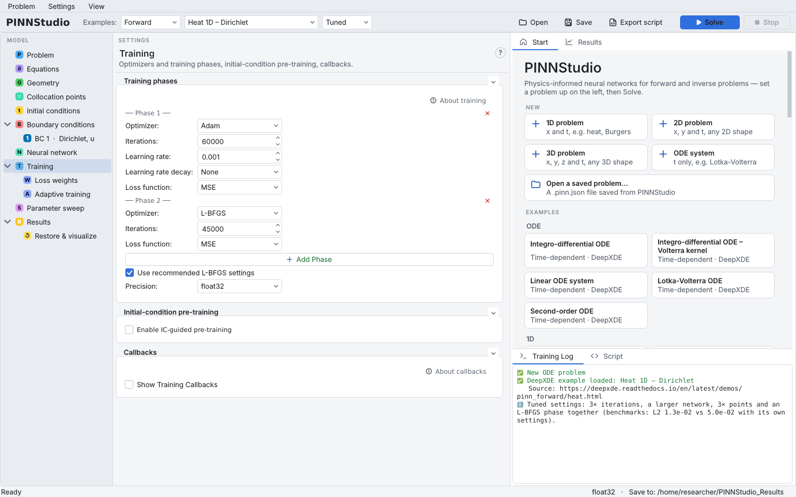
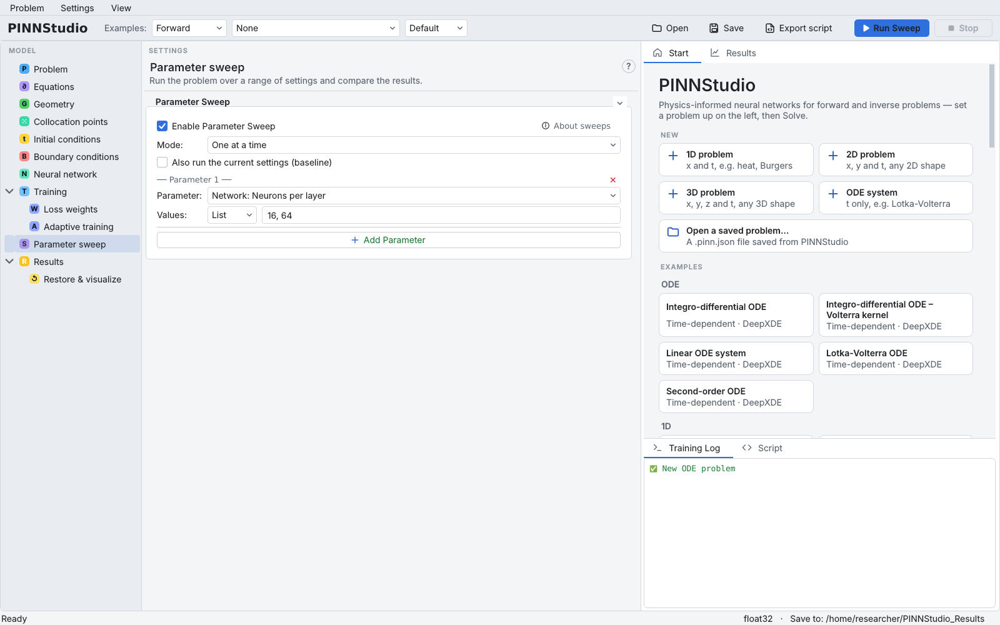
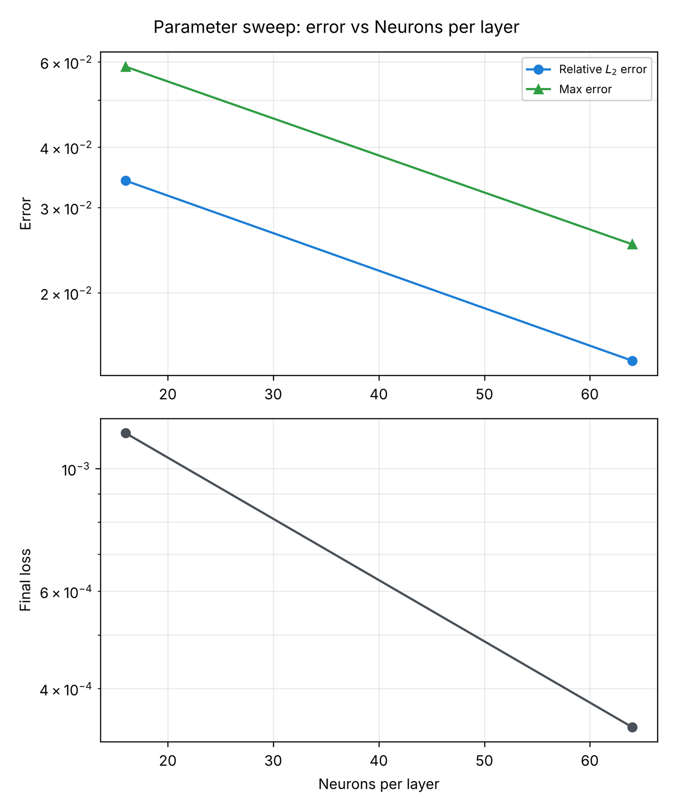

# 13. Comparing training configurations

Two questions come up with every PINN: would other settings give a better result, and how sensitive is the
result to a given setting? PINNStudio answers them in two ways without editing any code: the **Default** and
**Tuned** settings of the shipped examples, and the **Parameter sweep** page, which trains the same problem
several times with one setting changed and collects the results.

**What you will learn**

- load an example with **Default** or **Tuned** settings and see what differs;
- set up a one-at-a-time parameter sweep;
- find and read the sweep's summary files.

## Prerequisites

- [Tutorial 1](01-ode.md), with the problem saved as `oscillator.pinn.json` (including its Error Analysis
  formula, so that each run reports an L2 error).
- [Tutorial 2](02-burgers.md) for the **Examples** list.

## Part A: Default and Tuned settings

1. In the **Examples** bar choose **Forward** and **Heat 1D – Dirichlet** (DeepXDE's heat-equation example).
2. Leave the third box at **Default** and look at the settings: **Neural network** 3 hidden layers of 20 neurons;
   **Collocation points** 2540 domain, 80 boundary, 160 initial; **Training** Adam 20000 then L-BFGS 15000
   iterations. These are DeepXDE's own settings.
3. Switch the third box to **Tuned**. The example reloads; now the network has 4 hidden layers of 40 neurons, the
   point counts are three times larger (7620, 240, 480), and the phases are Adam 60000 and L-BFGS 45000. The
   **Training Log** states what changed and the benchmark result behind the choice
   (`Tuned settings: 3× iterations, a larger network, 3× points …`).

    { .screenshot loading=lazy }

4. Some examples have no separate tuned settings. For **Heat 2D** the log says
   `No Tuned settings for this example: its Default settings are already PINNStudio's best, so it loads with those.`;
   for **Burgers 1D – Raissi et al.** the tuned settings are the paper's own.
5. To compare the two, run **Solve** once with each and compare the errors in the two run folders
   (`error_analysis/error_metrics.txt`). The Tuned settings are the most accurate settings found in PINNStudio's
   benchmarks, preferring the faster one when two are about equally accurate; they often take longer to train than
   Default. See [Benchmark collection](../reproducibility/benchmarks.md).

In our test we checked the settings each choice loads (as listed above); we did not train both versions of this
example.

## Part B: a parameter sweep

The oscillator of Tutorial 1 uses 64 neurons per hidden layer. Does a narrower or wider network change the error?

6. Open `oscillator.pinn.json`.
7. Optional, to make the comparison quick: on **Training**, lower **Phase 1** to 3000 Adam and **Phase 2** to 1000
   L-BFGS iterations. All runs use the same phases, so they stay comparable.
8. Open **Parameter sweep** and tick **Enable Parameter Sweep**. The **Solve** button changes to **Run Sweep**.
9. Leave **Mode:** at **One at a time**. In **Parameter 1** choose **Parameter:** **Network: Neurons per layer**,
   leave **Values:** at **List** and type `16, 64` (you can add more values, e.g. `16, 32, 64, 128`).

    { .screenshot loading=lazy }

10. Click **Run Sweep**. Each value is trained in turn; the **Training Log** shows each run's progress and result.

**Modes.** **One at a time** varies one parameter per run while the others keep their current values;
**All combinations** crosses all values of all parameters; **Paired values** runs the first values of all
parameters together, then the second values, and so on (every parameter needs the same number of values);
**Bayesian search** is the subject of [Tutorial 14](14-bayesian.md). **Also run the current settings (baseline)**
adds a run with the unchanged settings first. Besides the network, the **Parameter:** list offers point counts,
the activation, phase iterations, optimizers and learning rates, loss weights and the named constants of the
equations.

## Expected results

The sweep writes a folder `…_sweep__<date>_<time>` under **Save to:**, with one sub-folder per run (named after the
value, e.g. `run_01__…`) holding that run's usual results, and:

| File | Contents |
|---|---|
| `sweep_summary.csv` | one row per run: the swept value(s), status, final loss and the L2 error |
| `sweep_error_vs_parameter.png` | error and final loss against the swept value |
| `sweep_manifest.json` | the sweep's settings and every run's result |

With more than one output (here `y1` and `y2`) and several reference times, the errors in the summary are averaged
over all of them.

In our test on a CPU (two runs, each 3000 Adam + 1000 L-BFGS iterations, about 3 minutes in total), the summary read:

| Neurons per layer | Final loss | Relative L2 error | Max error |
|---|---|---|---|
| 16 | 1.2 × 10⁻³ | 3.4 × 10⁻² | 5.9 × 10⁻² |
| 64 | 3.4 × 10⁻⁴ | 1.4 × 10⁻² | 2.5 × 10⁻² |

<figure markdown>
{ loading=lazy width=480 }
<figcaption>sweep_error_vs_parameter.png from the verification sweep (two runs, 3000 Adam + 1000 L-BFGS iterations each).</figcaption>
</figure>

For this problem and this short training, the wider network was more accurate. Such a result holds for the settings
it was obtained with; with full training the difference may be smaller or larger.

## Troubleshooting

| Symptom | What to check |
|---|---|
| No L2 error in the summary | Error Analysis was not configured; only the final loss is recorded. |
| `Paired values` refuses to start | Every parameter needs the same number of values. |
| A run has status `invalid` | That combination of settings cannot be used together; it is skipped and recorded. |
| Differences between runs are small and inconsistent | Repeat with another random seed (**Settings › Random Seed...**) before drawing conclusions. |

## Next steps

- [Tutorial 14](14-bayesian.md): let a Bayesian search choose the values.
- [Parameter sweeps](../guide/sweeps.md) in the user guide; [Sweeps and Bayesian optimization](../reference/sweeps.md)
  in the reference.
