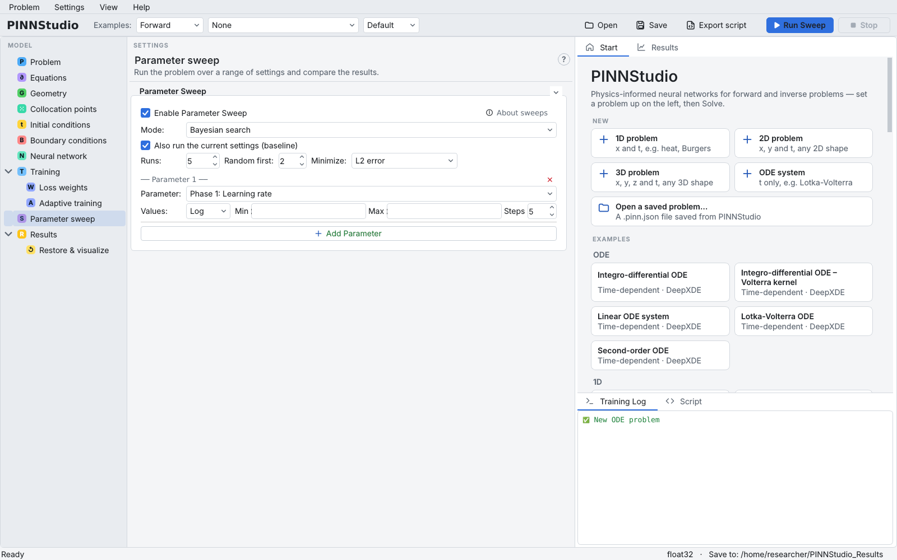
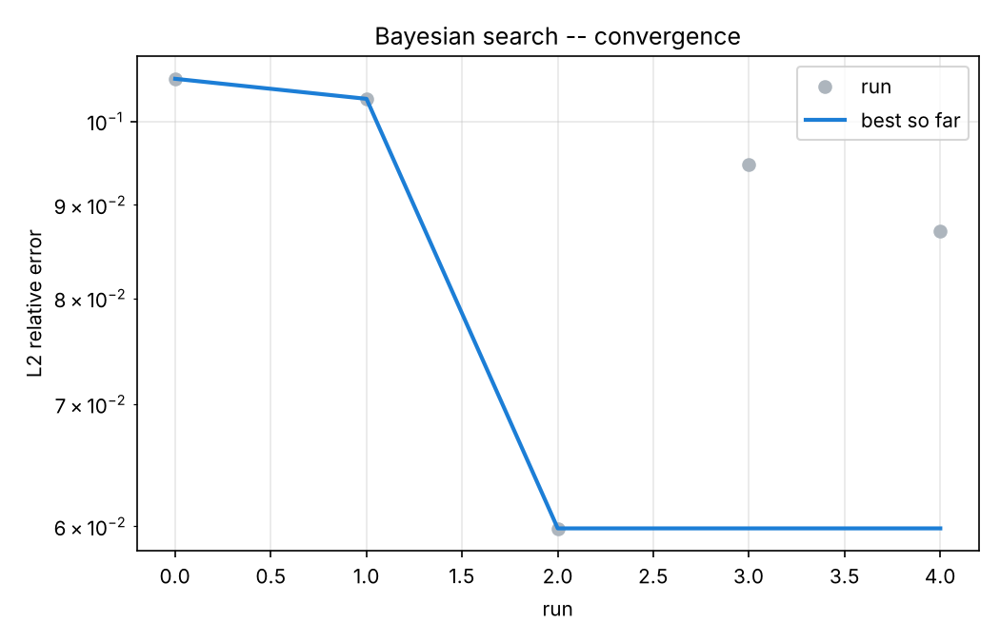

# 14. Bayesian hyperparameter search

A sweep over a grid of values needs many runs when several settings interact. **Bayesian search** chooses each
new run from the results of the runs before it, so it can find good settings with fewer trainings. PINNStudio
implements the search of DeepXDE's Helmholtz hyperparameter-optimization example (a Gaussian-process model with
expected improvement; see [Bayesian optimization](../theory/bayesian.md)). This tutorial searches the Adam learning
rate of the oscillator from [Tutorial 1](01-ode.md).

**What you will learn**

- switch the **Parameter sweep** page to **Bayesian search**;
- give a parameter a continuous search range (linear or log);
- choose what to minimize, including the L2 error against a reference;
- read `bayes_search.csv` and `bayes_convergence.png`.

## Prerequisites

- `oscillator.pinn.json` from [Tutorial 1](01-ode.md), with its Error Analysis formula (needed to minimize the
  L2 error).
- [Tutorial 13](13-compare.md) introduces the **Parameter sweep** page.
- Time: each run is a full training. For a first try, lower the iterations on **Training** (see below).

## Steps

1. Open `oscillator.pinn.json`. Check on **Results** › **Error Analysis** that the exact-solution formulas are
   still there.
2. Optional, to keep the search short: on **Training**, set **Phase 1** to 1500 Adam iterations and **Phase 2**
   to 500 L-BFGS iterations. The search compares runs with each other, so they only need to be trained equally.
3. Open **Parameter sweep** and tick **Enable Parameter Sweep**. The **Solve** button becomes **Run Sweep**.
4. Set **Mode:** to **Bayesian search**. New fields appear:
    - **Runs:** `5` — the total number of trainings, the baseline included;
    - **Random first:** `2` — the runs made before the Gaussian-process model takes over; the baseline run (below)
      counts as one of them, so here one run has random settings;
    - **Minimize:** **L2 error** — the relative L2 error from Error Analysis. **Final loss** and
      **Final loss (unweighted)** need no reference data.
    - **Also run the current settings (baseline)** is ticked by default in this mode: the first run uses the
      current settings unchanged.
5. In **Parameter 1**, choose **Parameter:** **Phase 1: Learning rate**, set **Values:** to **Log**, **Min** to
   `0.0001` and **Max** to `0.01`. In Bayesian search **Min**/**Max** is the search range and **Steps** is not
   used; a **List** gives a set of choices instead.

    { .screenshot loading=lazy }

6. Click **Run Sweep**. Each run's progress streams into the **Training Log**; the log names the sweep folder
   when it starts. **Stop** ends the search; the runs finished so far are still recorded.

## Expected results

The sweep folder (`…_sweep__<date>_<time>` under **Save to:**) contains one folder per run, named after the
value it used, plus:

| File | Contents |
|---|---|
| `bayes_search.csv` | every run: the learning rate, the objective (L2 error) and the best value so far |
| `bayes_convergence.png` | the best objective against the run number |
| `sweep_summary.csv`, `sweep_manifest.json` | the same runs in the format of every sweep |

In our test on a CPU (5 runs of 1500 Adam + 500 L-BFGS iterations, about 4 minutes in total), `bayes_search.csv` read:

| Run | Phase 1: Learning rate | Relative L2 error | Best so far |
|---|---|---|---|
| 0 (baseline) | 0.001 | 0.106 | 0.106 |
| 1 | 0.001879 | 0.103 | 0.103 |
| 2 | 0.002525 | 0.060 | 0.060 |
| 3 | 0.003124 | 0.095 | 0.060 |
| 4 | 0.002455 | 0.087 | 0.060 |

The best run used a learning rate of about 0.0025. The errors are large because each run was trained only briefly,
and they scatter: runs 2 and 4 used almost the same learning rate but gave 0.060 and 0.087. Differences of this size
between single runs are within run-to-run variation, so treat the "best" value as a hint to be confirmed, not a
result.

<figure markdown>
{ loading=lazy width=520 }
<figcaption>bayes_convergence.png from the verification search (5 runs, 1500 Adam + 500 L-BFGS iterations each).</figcaption>
</figure>

!!! note
    A search with so few runs, each trained briefly, only shows how the tool works. The best learning rate for
    short training is not necessarily the best for full training; repeat the search with the iterations you
    intend to use. Results also vary with the random seed (**Settings › Random Seed...**).

## Troubleshooting

| Symptom | What to check |
|---|---|
| **1 setting to fix** with **Minimize:** L2 error | Error Analysis has no reference (files or a formula). Configure it, or minimize **Final loss**. |
| A run is marked invalid | The chosen value cannot be combined with the other settings; the search records it and continues. |
| All runs give similar values | The range is too narrow, or the parameter matters little for this problem; widen **Min**/**Max** or choose another parameter. |

## Next steps

- [Sweeps and Bayesian optimization](../reference/sweeps.md) in the reference and [Parameter sweeps](../guide/sweeps.md)
  in the user guide.
- [Bayesian optimization](../theory/bayesian.md) for the method.
