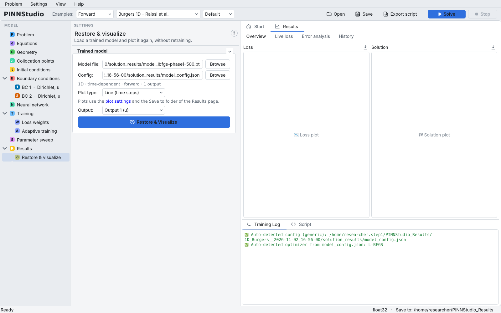
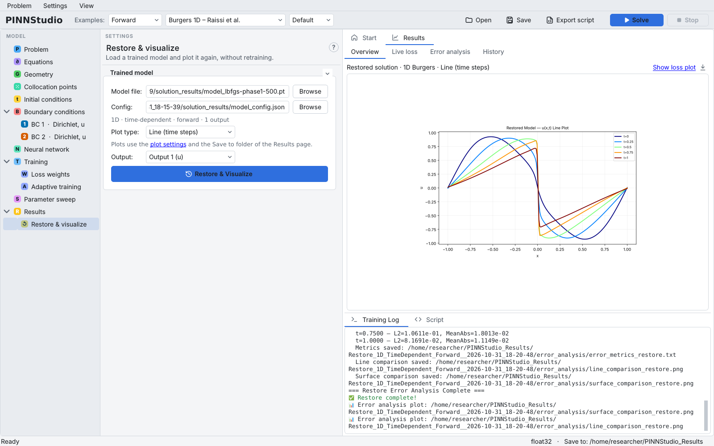
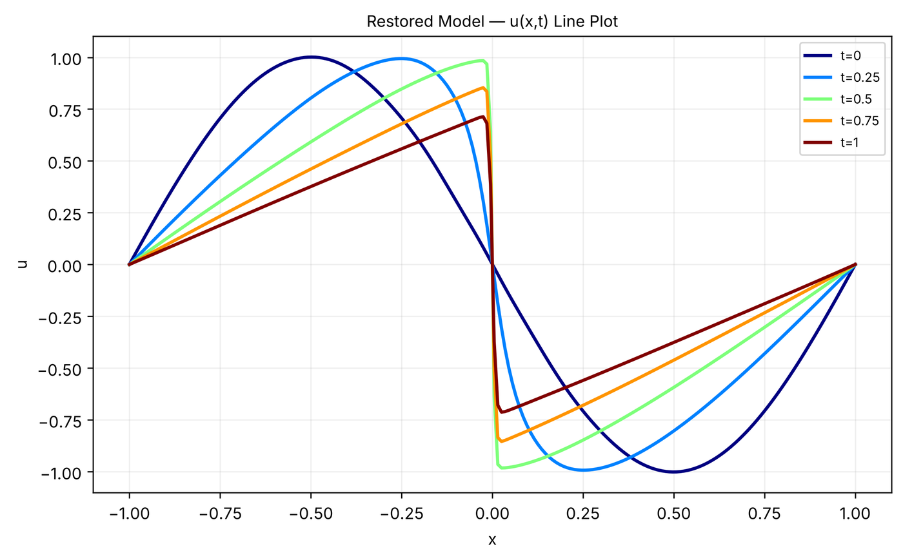

# 15. Restoring a trained model

Every **Solve** saves the trained network. **Restore & visualize** loads such a model again to plot it in
another way, or to compare it with reference data, without training again. This tutorial restores the
Burgers model from [Tutorial 2](02-burgers.md).

**What you will learn**

- which files a run saves and which of them Restore needs;
- how to load a model, choose a plot type and an output, and run **Restore & Visualize**;
- how to get an error analysis of a model you have already trained;
- what Restore cannot do.

!!! warning "Restoring is not continued training"
    PINNStudio cannot continue training from a saved model: **Restore & Visualize** only evaluates and plots
    it. Each **Solve** starts from a newly initialized network. The one exception is initial-condition
    pre-training: on the **Training** page, **Initial-condition pre-training** › **Enable IC-guided
    pre-training** › **Restore from checkpoint** loads a network that was pre-trained on the initial
    condition (an Adam-trained `.pt` file) and starts the main training from it.

## Prerequisites

- A finished run, for example from [Tutorial 2](02-burgers.md). Its run folder contains
  `solution_results/` with a model file per training phase (named after the phase and the last iteration, for example `model_lbfgs-phase1-3000.pt`; the number depends on the run, so the screenshot below shows a different one) and
  `model_config.json`, the settings the model was trained with.

## Steps

1. Load **Burgers 1D – Raissi et al.** from the **Examples** list (as in Tutorial 2). This is only needed for
   step 6: it sets up the Error Analysis reference files. Restore itself reads the model's settings from
   `model_config.json`, not from the window.
2. In the model tree, open **Results › Restore & visualize**.
3. Next to **Model file:** click **Browse** and choose the model file, e.g.
   `…/solution_results/model_lbfgs-phase1-3000.pt`. PINNStudio fills in **Config:** with the
   `model_config.json` next to it and shows a one-line summary of the model under it
   (`1D · time-dependent · forward · 1 output`). The log says `Auto-detected config (generic): …` and
   `Auto-detected optimizer from model_config.json: L-BFGS`.
4. Set **Plot type:** to **Line (time steps)**. The choices depend on the model; for this one they are
   **Surface**, **Line (time steps)** and **Animation Line (GIF)**.
5. Leave **Output:** at **Output 1 (u)**. **Custom...** lets you plot an expression of the outputs instead.

    { .screenshot loading=lazy }

6. Click **Restore & Visualize**. PINNStudio rebuilds the network, loads the weights, and writes the plot
   into a new folder `Restore_…__<date>_<time>` under the **Save to:** folder of the **Results** page (the `…` is
   the run's kind, for example `Restore_1D_TimeDependent_Forward__…`).
   Because Error Analysis is configured (step 1), it also compares the restored model with the reference
   files and writes `error_analysis/line_comparison_restore.png`, `surface_comparison_restore.png` and
   `error_metrics_restore.txt` there.

## Expected results

The **Results** tab shows the restored solution: \( u(x) \) at \( t = 0, 0.25, 0.5, 0.75, 1 \), with the front
at \( x = 0 \) steepening over time. The **Training Log** ends with `Restore complete!` and the paths of the
error-analysis plots.

{ .screenshot loading=lazy }

In our test the restored model gave exactly the same errors as the original run
(relative L2 1.96 × 10⁻³ at \( t = 0 \) to 2.18 × 10⁻³ at \( t = 1 \)), which confirms that the model and its
settings were saved and reloaded consistently.

<figure markdown>
{ loading=lazy width=560 }
<figcaption>restored_plot.png written by Restore & Visualize for the model of the short Tutorial 2 verification run (3000 L-BFGS iterations).</figcaption>
</figure>

## What Restore does and does not do

| You want to … | Use |
|---|---|
| plot a trained model again, another output, another plot type | **Restore & Visualize** |
| compare a trained model with reference **files** | set up **Error Analysis** (reference files), then **Restore & Visualize** |
| train further from a saved model | not supported; change the settings and **Solve** again |
| start the main training from an IC-pre-trained network | **Training** › **Restore from checkpoint** (IC pre-training only) |

!!! note "Error Analysis with a formula after restoring"
    In our test, restoring the ODE model of [Tutorial 1](01-ode.md) with an **Exact solution formula**
    configured did not run the comparison: the log said
    `Error analysis from a formula: the run's reference_from_formula files weren't found`, although the run
    folder contained them. The plot itself was produced. Comparing with reference **files**, as above,
    worked. To get errors against a formula, configure Error Analysis before **Solve**.

## Troubleshooting

| Symptom | What to check |
|---|---|
| `No config found — please browse manually.` | `model_config.json` is not next to the model file. Use the **Browse** button next to **Config:**. |
| The plot covers only part of the time interval | A time-adaptive run saves one model per window; each window's folder has its own `step_config.json`, and the restored model is valid only on that window. |
| `Error Analysis` is skipped | No reference files are configured, or their times lie outside the model's time interval. |

## Next steps

- [Restore & visualize](../guide/restore.md) in the user guide and
  [Checkpoints and restoring](../reference/checkpoints.md) in the reference.
- [IC pre-training and guided learning](../reference/pretraining.md) for the **Restore from checkpoint** option.
- [Tutorial 17](17-error-analysis.md) for reference files and metrics.
