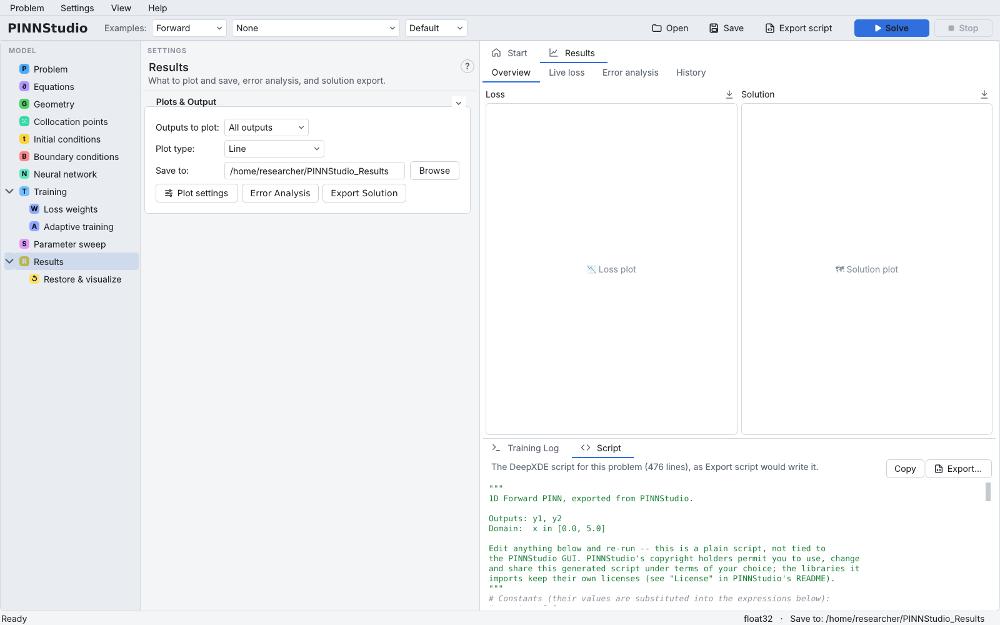

# 16. Exporting and running standalone scripts

Everything you set up in PINNStudio can be written out as a plain DeepXDE/PyTorch script. You can read it to see
exactly what your settings mean in code, run it on a machine without the GUI (a cluster node, a remote
server), keep it with a paper, or use it as a starting point for your own code. This tutorial exports the
oscillator of [Tutorial 1](01-ode.md) and runs the script from a terminal.

**What you will learn**

- preview the script in the **Script** tab;
- save it with **Export script**;
- run it from a terminal and find its results;
- how the exported script relates to what **Solve** runs.

## Prerequisites

- The oscillator problem from [Tutorial 1](01-ode.md), saved as `oscillator.pinn.json`
  (**Open** in the toolbar, or **Problem › Open Saved Problem...**).
- A terminal in the Python environment where PINNStudio is installed (the script needs `deepxde`, `torch`,
  `numpy`, `matplotlib` and `scipy`, which PINNStudio installs).

## Steps

### Preview

1. Open `oscillator.pinn.json`.
2. In the lower right panel, click the **Script** tab (next to **Training Log**). It shows
   `The DeepXDE script for this problem (… lines), as Export script would write it.` and the script itself.
   The script is regenerated when you change a setting. **Copy** copies it to the clipboard.

    { .screenshot loading=lazy }

### Export

3. Click **Export script** in the toolbar (or **Export…** in the Script tab, or **Problem › Export as DeepXDE
   Script...**, Ctrl+E). Choose a file name, e.g. `oscillator.py`, and save. The log says
   `DeepXDE script exported: oscillator.py`.

The script contains only the features your problem uses: an option that is switched off (RAR, IC pre-training,
callbacks, inverse parameters, time-adaptive training, Error Analysis, transforms) is not written at all.
Constants are listed in a comment at the top and substituted into the expressions.

### Run it

4. In a terminal, activate the environment and run:

    ```bash
    python oscillator.py
    ```

    The script prints the same loss table as the **Training Log**, then the Error Analysis lines.
5. Results are written to the folder named in the script's `save_dir = '…'` line: by default a timestamped
   folder under the **Save to:** folder that was set when you exported. To write somewhere else, change that
   line. With a formula reference (as here) the script also writes its reference files to
   `reference_from_formula/` under the export-time folder, a path written out in full further down; to move
   everything, export again with a different **Save to:** folder rather than editing the script.

## Expected results

The exported script trains the same network with the same settings as **Solve**. Its files are laid out more simply:
in our test it wrote `loss_plot.png`, `solution_plot.png`, `solution_plot_y1.png`, `solution_plot_y2.png` and the
model (`model-6717.pt`) directly into its `save_dir`, plus `error_analysis/` and `reference_from_formula/`. It did not
write `solution_results/`, `model_config.json` or `training_log.txt`, so its model cannot be loaded with
**Restore & visualize** without a config file; models from **Solve** can.

In our test on a CPU we generated both scripts from the same settings (phases shortened to 5000 Adam + 2000 L-BFGS
iterations, as in the Tutorial 1 verification) and ran them: the exported script took about 1.5 minutes, and the two
scripts reported the same errors to the printed precision:

| Output | **Solve**'s script | Exported script |
|---|---|---|
| `y1` | L2 = 3.5969 × 10⁻³ | L2 = 3.5969 × 10⁻³ |
| `y2` | L2 = 3.9215 × 10⁻³ | L2 = 3.9215 × 10⁻³ |

!!! info "Solve's script and the exported script"
    **Solve** runs its own internal script (`generate_script` in `pinnstudio/core/codegen.py`), which supports
    the live log, Stop and the Results tabs. **Export script** writes a shorter, readable script
    (`generate_clean_script`). They are generated separately but are meant to train the same model; the
    [Export equivalence](../reproducibility/export-equivalence.md) page describes how this is checked.

## Troubleshooting

| Symptom | What to check |
|---|---|
| `ModuleNotFoundError: No module named 'deepxde'` | Run the script in the environment where PINNStudio is installed. |
| The script writes to a path that does not exist on another computer | Change the `save_dir = '…'` line, or export again with a different **Save to:** folder. |
| Reference files are not found on another computer | Error Analysis and measured-data paths are written as absolute paths; copy the files and adjust the paths, or export on the target machine. |
| Results differ slightly from **Solve** | Floating-point results can differ between hardware and library versions; see [Seeds, precision and hardware](../reproducibility/environment.md). |

## Next steps

- [Exporting a script](../guide/export.md) in the user guide; [Generated scripts](../reference/scripts.md) in the
  reference.
- [Tutorial 15](15-restore.md): load a model saved by **Solve** back into PINNStudio.
