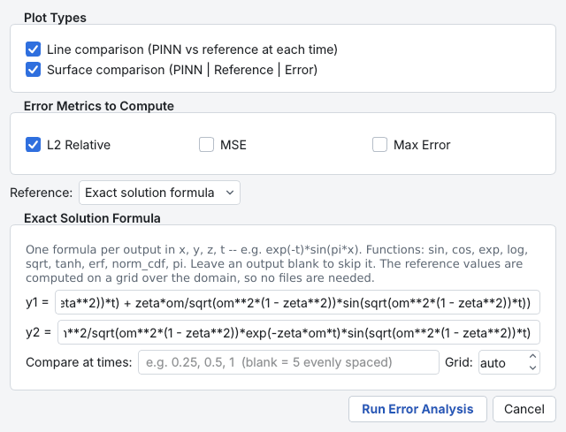
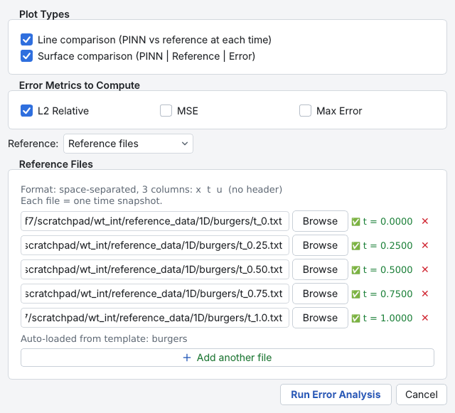
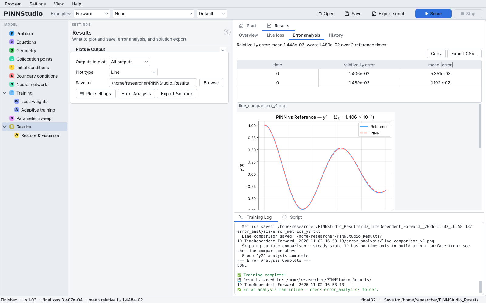

# 17. Error analysis and reference-data comparison

A small loss does not prove that a PINN is accurate. **Error Analysis** compares the trained network with a
reference solution, either an exact formula or data files you provide (from an analytical solution or another
solver), and reports relative L2 and other errors. This tutorial covers both sources, the file format, and the
files Error Analysis writes.

**What you will learn**

- choose between **Exact solution formula** and **Reference files**;
- prepare reference files in the format PINNStudio reads;
- select metrics and plots, and read `error_metrics.txt`;
- run Error Analysis on a model trained earlier.

## Prerequisites

- [Tutorial 1](01-ode.md) (formula reference) and [Tutorial 2](02-burgers.md) (file reference).

## When Error Analysis runs

Error Analysis is configured **before** training: the dialog's **Run Error Analysis** button stores the
settings, and the comparison runs automatically at the end of **Solve** (the log says
`… will run after training.`). For a model that is already trained, use
[Restore & visualize](15-restore.md), which runs the same comparison on the restored model.

## Steps

### A. Reference from an exact formula

1. Set up or open a problem (here, the oscillator of Tutorial 1).
2. On **Results**, click **Error Analysis**.
3. Under **Plot Types**, keep **Line comparison (PINN vs reference at each time)** and
   **Surface comparison (PINN | Reference | Error)** ticked. Under **Error Metrics to Compute**, tick
   **L2 Relative**, and also **MSE** and **Max Error** if you want them.
4. Set **Reference:** to **Exact solution formula**. One box appears per output, labelled with its name.
   Type one formula per output in `x`, `y`, `z`, `t`; constants from the **Equations** page may be used.
   Leave a box empty to skip that output.
5. **Compare at times:** takes a comma-separated list such as `0.25, 0.5, 1`; blank means five evenly spaced
   times. **Grid:** is the number of reference points per axis; **auto** uses 201 in 1D, 101 in 2D and 31 in 3D.
   For a stationary problem or an ODE the times are not used.
6. Click **Run Error Analysis**, then **Solve**.

    { .screenshot loading=lazy }

The generated script evaluates your formulas on the grid, writes them as ordinary reference files into
`reference_from_formula/` in the run folder, and then compares as in part B.

### B. Reference from files

7. On **Results**, click **Error Analysis** and set **Reference:** to **Reference files**.
8. Click **Browse** in a row and choose a file. PINNStudio reads the file's time column and shows it next to
   the row (for example `t = 0.2500`). Click **Add another file** for each further time.
9. With more than one output, each row has a selector for the output the file contains, or
   **Custom expression...** to compare a derived quantity such as `sqrt(u**2+v**2)`.
10. Click **Run Error Analysis**, then **Solve**.

    { .screenshot loading=lazy }

Examples that ship reference data fill this list in automatically when you load them; the log says
`Error analysis auto-configured — 5 ground truth files from template`.

### Reference file format

Plain text, space- or tab-separated numbers, one point per line, **one file per time**. The columns are the
problem's coordinates, then time (for time-dependent problems), then the reference value:

| Problem | Columns |
|---|---|
| 1D, time-dependent | `x  t  u` |
| 2D, time-dependent | `x  y  t  u` |
| 3D, time-dependent | `x  y  z  t  u` |
| stationary | the space coordinates, then the value (no `t`) |
| ODE | `t  value` |

The first lines of the Burgers file for \( t = 0.25 \):

```text
-0.999000	0.2500	1.755254544087e-03
-0.997000	0.2500	5.265751313901e-03
-0.995000	0.2500	8.776211128110e-03
```

!!! note
    The hint in the dialog reads `Format: space-separated, 3 columns: x t u`, which describes the 1D case; for
    2D and 3D problems use the extra coordinate columns as in the table (the shipped 2D reference files have
    four columns).

## Expected results

After training, the **Error analysis** tab of **Results** shows a table of the errors (**Copy** and **Export CSV…**
copy or save it) and the comparison plots, and the status bar reports the mean relative L2 error.

{ .screenshot loading=lazy }

The log lists the errors per time, for example (Tutorial 2, short verification run):

```text
  t=0.0000 — L2=1.9644e-03, MeanAbs=1.0946e-03
  t=0.2500 — L2=1.6714e-03, MeanAbs=8.0357e-04
  ...
  All 5 reference times together: L₂=1.6326e-03
```

The run folder's `error_analysis/` contains:

| File | Contents |
|---|---|
| `error_metrics.txt` (or `error_metrics_<output>.txt`) | one line per time: `t`, `L2_relative`, then `MSE` / `Max_error` if ticked, and `Mean_abs_error` |
| `error_spacetime.txt` | the relative L2 error over all reference times together (time-dependent PDEs only) |
| `line_comparison*.png` | PINN and reference along x at each time (for an ODE, over t) |
| `surface_comparison*.png` | PINN, reference and absolute error over space and time |

The relative L2 error is \( \lVert u_{\text{PINN}} - u_{\text{ref}} \rVert_2 / \lVert u_{\text{ref}} \rVert_2 \) over the
reference points; see [Error measures](../theory/metrics.md). It is large when the reference itself is close to
zero, so look at the absolute errors too (Tutorial 4 shows an example).

In our tests, the values Error Analysis reported matched our own exact solutions in all tutorials where we
supplied one (1, 4, 8, 9), and restoring the Tutorial 2 model reproduced the original errors exactly.

## Troubleshooting

| Symptom | What to check |
|---|---|
| `Error Analysis: no valid reference files loaded.` | The paths do not exist, or no time could be read from a file (check the column count). |
| A file shows no time after **Browse** | The file does not have the problem's coordinate columns plus time plus value. |
| `Error Analysis: please set a save directory first.` | **Save to:** on **Results** is empty. |
| Errors are reported only for some times | Reference times outside the problem's time interval are skipped. |
| An ODE comparison is labelled `t=0.0000` | Expected: the ODE comparison covers the whole interval, and only the label reads `t=0`. |

## Next steps

- [Error Analysis](../guide/error-analysis.md) in the user guide; [Error metrics](../reference/metrics.md) in the
  reference.
- [Reference data](../reproducibility/reference-data.md): how the shipped reference solutions were produced.
