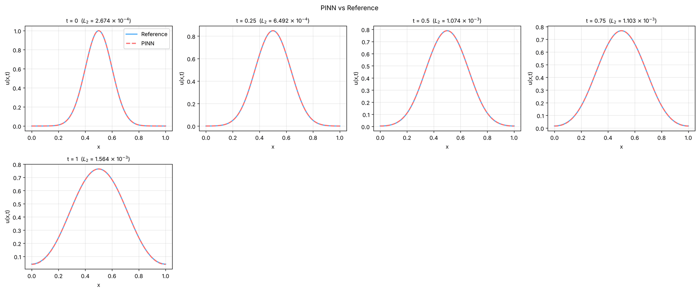

# 18. Your own PDE (Fisher-KPP)

The examples cover 64 specific examples, but every setting in them can be changed, and a problem of your own is
set up the same way. This tutorial goes through a PDE that is not one of the examples, from a blank problem to
an error against a reference solution, to show the general path from "I have an equation" to "I have a trained
PINN".

**What you will learn**

- set up a nonlinear time-dependent PDE from a blank 1D problem, one model-tree page at a time;
- give one boundary-condition row two sides with **Where:**;
- check a problem that has no exact solution against reference files of your own.

**The problem.** The Fisher-KPP equation is a classic reaction-diffusion model of a population (or a
concentration front) that diffuses and grows logistically towards a carrying capacity of 1:

\[
u_t = D\,u_{xx} + r\,u(1 - u), \qquad x \in [0, 1],\ t \in [0, 1],
\]

with \( D = 0.01 \), \( r = 1 \), a localized initial bump \( u(x, 0) = e^{-50(x - 0.5)^2} \) and no flux through
either end (\( u_x = 0 \) at \( x = 0 \) and \( x = 1 \)). None of the examples has a logistic term like this one.

## Prerequisites

- [Tutorials 1 and 2](01-ode.md) (the editors, **Solve**, **Error Analysis** with reference files).
- About 5–10 minutes of training on a CPU with the default settings.

## Steps

1. On the **Start** tab click **1D problem** (or **Problem › New › 1D problem**). Each step below is one page
   of the model tree.
2. **Problem**: leave **1D**, **Time Dependent** and **Forward**.
3. **Equations**: one output `u`. Type the residual, with everything moved to one side:

    ```text
    du_t - 0.01*du_xx - 1.0*u*(1 - u)
    ```

    The box typesets it as you type, so you can check that it reads as intended. `du_t` is \( u_t \), `du_xx`
    is \( u_{xx} \), and the coefficients \( D = 0.01 \) and \( r = 1 \) are written inline (they could also be
    constants, as in [tutorial 1](01-ode.md)).
4. **Geometry**: **x:** from `0` to `1` and **t:** from `0` to `1` (the defaults of a new 1D problem).
5. **Initial conditions**: replace the starting `sin(pi*x)` with the bump

    ```text
    exp(-50*(x-0.5)**2)
    ```

6. **Boundary conditions**: click **Add Boundary Condition** (or right-click **Boundary conditions** ›
   **Add boundary condition**). In the new row set **Type:** **Neumann BC**, **Value:** `0` (no flux) and
   **Where:** **Left and right sides**. One row now covers both ends; two rows, one per side, would do the same.
7. **Neural network**, **Collocation points**, **Training**: keep the defaults of a new problem: 3 hidden layers of
   64 neurons (tanh), 2000 domain points, Adam 10000 iterations then L-BFGS 10000, and the initial condition
   weighted 100 on **Loss weights**.
### Set up the comparison with a reference solution

A problem of your own has no reference data until you add some. For this equation PINNStudio ships a fine
finite-difference solution at \( t \) = 0, 0.25, 0.5, 0.75 and 1 in `reference_data/1D/fisher_kpp/` (three columns
x, t, u, written by `tools/make_exact_reference_data.py`; refining its grid changes \( u \) by less than
\( 3 \times 10^{-7} \)). In a source installation the folder is inside the `PINNStudio` folder; in an installed
copy, `reference_data` sits next to the installed `pinnstudio` package.

8. On **Results** click **Error Analysis**, keep **Reference:** **Reference files**, **Browse** to `t_0.txt`
   in that folder, and add the other four files with **➕ Add another file**. The time of each file is read from
   it and shown next to it.
9. Click **Run Error Analysis**. This stores the comparison; the Training Log says
   `Error Analysis configured — 5 reference files, will run after training.`

### Train

10. Click **Solve**, and follow the loss in **Results › Live loss**. When the run ends, the loss and solution
    figures are under **Overview** and the errors at the five times under **Error analysis**. **Save** (Ctrl+S)
    keeps the set-up.

For a problem of your own, use files from your own solver in the same format (see
[Error Analysis](../guide/error-analysis.md)), or an exact formula if there is one.

## Expected results

Diffusion spreads the bump and lowers its peak, while the logistic term lifts the tails: by \( t = 1 \) the
maximum of the reference solution is about 0.76, and \( u \) at the two ends has grown from almost 0 to about 0.04.
The PINN curves lie on the reference curves at all five times.

In a run of exactly these steps with the PINNStudio 1.6.0 code (seed 2026, CPU, 2 threads, about 6 minutes),
the relative L2 error grew from \( 2.7 \times 10^{-4} \) at \( t = 0 \) to \( 1.6 \times 10^{-3} \) at \( t = 1 \).
Your numbers will differ with hardware, seed and PINNStudio version.

<figure markdown>
{ loading=lazy }
<figcaption>Error Analysis line comparison of the PINN against the reference, from the run described above.</figcaption>
</figure>

On the 1D surface plots time is on the horizontal axis by default; untick **Time on the x-axis**
(**Plot Settings**, **Surface** tab, **1D surface:**) to put \( x \) there instead.

## Troubleshooting

| Symptom | What to check |
|---|---|
| The solution stays near the initial bump, or the error is large | The sign of each term in the residual: the box must read \( u_t - 0.01 u_{xx} - u(1 - u) \). |
| The ends do not flatten | The boundary row is **Neumann BC** with value `0`, and **Where:** covers both sides. |
| `Error Analysis: no valid reference files loaded.` | The paths do not exist, or the files are not the three-column x, t, u format. |
| The error is larger than above | Train longer, or try more layers or points; for harder problems see [Choosing a training strategy](../guide/choosing-a-strategy.md). |

## Next steps

The same steps apply to any PDE that can be written with the derivative syntax of the
[Equations](../guide/equations.md) page: swap in your own residual, domain and conditions.

- [Tutorial 13](13-compare.md): compare settings, for example with a parameter sweep.
- [Choosing a training strategy](../guide/choosing-a-strategy.md), when a plain PINN struggles.
- [Scope and limitations](../theory/limitations.md): what PINNStudio does not guarantee for a new problem.
