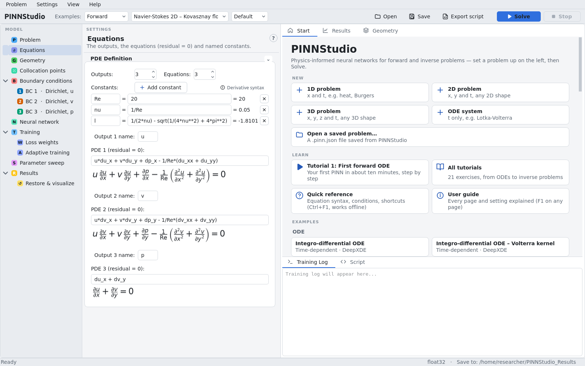
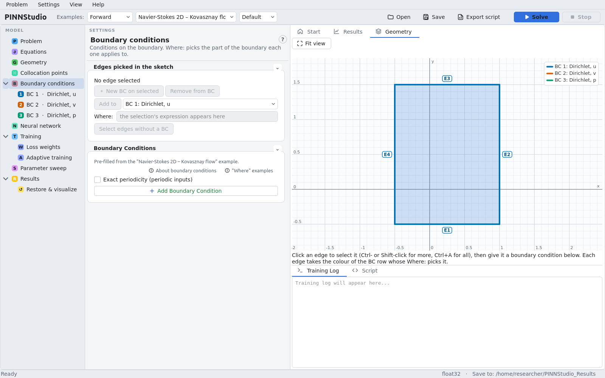
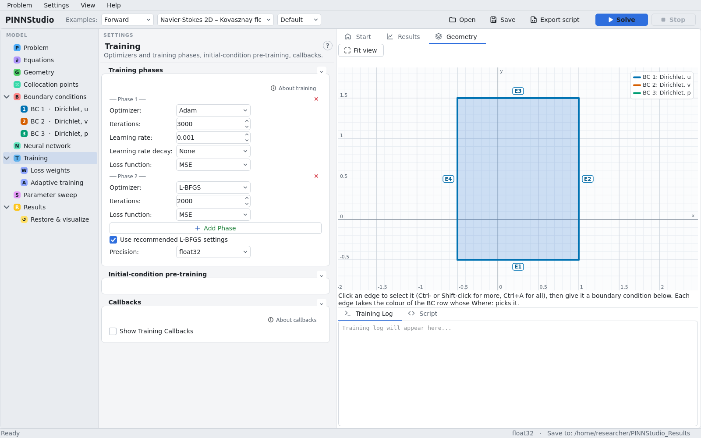
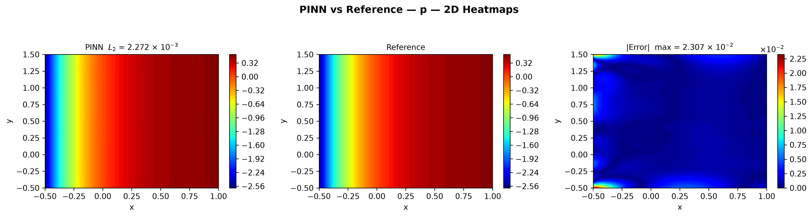
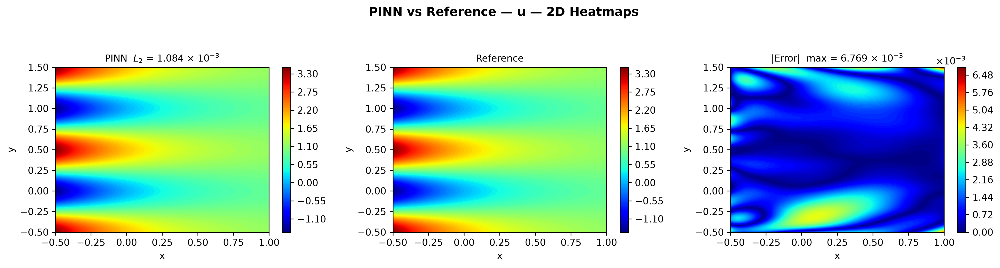

# 19. Steady 2D flow (Kovasznay)

The earlier tutorials solve one field that changes in time. This one solves a steady flow with three coupled
outputs (two velocity components and a pressure), boundary values written with named constants, and a
pressure that is fixed on one side only. It closes with an error check against the exact solution, one
formula per output.

**What you will learn**

- a steady (time-independent) problem: no initial condition, no time axis;
- three outputs and three equations, and how the equations refer to each output by name;
- constants that build on each other, used in the boundary values;
- why the pressure needs a condition on one side only;
- Error Analysis with an exact formula for each output.

**The problem.** Kovasznay flow is the laminar flow behind a row of cylinders, an exact solution of the steady
incompressible Navier-Stokes equations (Kovasznay, 1948):

\[
(\mathbf u \cdot \nabla)\mathbf u + \nabla p = \frac{1}{Re}\nabla^2 \mathbf u, \qquad \nabla \cdot \mathbf u = 0,
\qquad Re = 20,
\]

on \( x \in [-0.5, 1] \), \( y \in [-0.5, 1.5] \). With \( \nu = 1/Re \) and
\( \lambda = \frac{1}{2\nu} - \sqrt{\frac{1}{4\nu^2} + 4\pi^2} \), the solution is

\[
u = 1 - e^{\lambda x}\cos 2\pi y, \qquad v = \frac{\lambda}{2\pi} e^{\lambda x}\sin 2\pi y,
\qquad p = \tfrac12\left(1 - e^{2\lambda x}\right).
\]

## Prerequisites

- [Tutorials 1–3](01-ode.md) (the editors, the geometry view, Error Analysis with a formula).
- About 5 minutes of training on a CPU with the shortened phases below.

## Steps

1. In the **Examples** bar choose **Forward**, **Navier-Stokes 2D – Kovasznay flow**, **Default**.
2. **Problem**: **2D (x, y)** and **Stationary**. A stationary problem has no time: the **Initial conditions**
   page is gone from the model tree and **t** cannot be used in expressions.
3. **Equations**: **Outputs:** `3` and **Equations:** `3`, outputs `u`, `v`, `p`, and three constants, each
   built from the ones above it:

    | Name | Value | Computed |
    |---|---|---|
    | `Re` | `20` | 20 |
    | `nu` | `1/Re` | 0.05 |
    | `l` | `1/(2*nu) - sqrt(1/(4*nu**2) + 4*pi**2)` | −1.8101 |

    The residuals are the two momentum equations and the continuity equation:

    ```text
    u*du_x + v*du_y + dp_x - 1/Re*(du_xx + du_yy)
    u*dv_x + v*dv_y + dp_y - 1/Re*(dv_xx + dv_yy)
    du_x + dv_y
    ```

    Each output's derivatives are named after it (`dv_y`, `dp_x`), and the equations use all three outputs:
    one network predicts \( (u, v, p) \) together and every equation constrains them jointly.

    { .screenshot loading=lazy }

4. **Geometry**: **Shape:** **Rectangle**, **x:** from `-0.5` to `1`, **y:** from `-0.5` to `1.5`.
5. **Boundary conditions**: three rows, one per output:

    | Row | Type | Output | Where | Value |
    |---|---|---|---|---|
    | BC 1 | Dirichlet BC | u | Whole boundary | `1 - exp(l*x)*cos(2*pi*y)` |
    | BC 2 | Dirichlet BC | v | Whole boundary | `l/(2*pi)*exp(l*x)*sin(2*pi*y)` |
    | BC 3 | Dirichlet BC | p | Right side (x = x_max) | `0.5*(1 - exp(2*l*x))` |

    The values use the constant `l`, the same way the equations use `Re`.

    { .screenshot loading=lazy }

    **Why the pressure has one side only.** The pressure enters the equations only through its gradient
    (`dp_x`, `dp_y`), so \( p \) and \( p + C \) satisfy them equally well for any constant \( C \). One
    condition on one side fixes \( C \); without it the network may return the right pressure shifted by an
    arbitrary amount, and Error Analysis would report a large pressure error for a correct flow. A condition
    on every side would also work here, because the exact values are known, but in a real flow the pressure on
    the walls is usually not known.

6. **Collocation points**: 2601 domain points and 400 boundary points. **Neural network**: 4 hidden layers of
   50 neurons, tanh.
7. **Training**: the example trains Adam for 30000 iterations, then L-BFGS for 15000. For this tutorial set
   **Phase 1**'s **Iterations:** to `3000` and **Phase 2**'s to `2000`.

    { .screenshot loading=lazy }

8. **Results** › **Error Analysis**: set **Reference:** to **Exact solution formula** and type one formula per
   output:

    ```text
    u = 1 - exp(l*x)*cos(2*pi*y)
    v = l/(2*pi)*exp(l*x)*sin(2*pi*y)
    p = 0.5*(1 - exp(2*l*x))
    ```

    The constants can be used here too. **Compare at times:** does not apply to a stationary problem. Click
    **Run Error Analysis**.
9. Click **Solve**.

## Expected results

Our run on a CPU (3000 Adam + 2000 L-BFGS iterations) took 4 minutes 16 seconds and ended at a training loss
of 2.6 × 10⁻⁵. The loss has six terms: the three equations, then the three boundary rows, in the order of the
**Loss weights** page. The relative L2 errors were

| Output | Relative L2 error |
|---|---|
| u | 1.1 × 10⁻³ |
| v | 4.6 × 10⁻³ |
| p | 2.3 × 10⁻³ |

The pressure's largest errors, about 0.02, sit in the two left corners, where the solution changes fastest
and the pressure has no condition of its own.

<figure markdown>
{ loading=lazy }
<figcaption>Pressure: PINN, exact solution and absolute error (3000 Adam + 2000 L-BFGS iterations).</figcaption>
</figure>

<figure markdown>
{ loading=lazy }
<figcaption>The velocity component u.</figcaption>
</figure>

With the example's full 30000 + 15000 iterations the errors fall further; the benchmark of this example is in
[Navier-Stokes 2D – Kovasznay flow](../examples/2d/navier-stokes-2d-kovasznay-flow.md).

## Variations to try

- Remove BC 3 (the pressure condition) and solve again. The equations then fix the pressure only up to a
  constant, so look at the pressure's colour bar against the reference's and at its error map: a shift that is
  the same everywhere is that constant, not a wrong flow.
- Change `Re` to `40`. Every constant below it (`nu`, `l`) follows, and so do the boundary values and the
  formulas in Error Analysis, so the whole problem changes consistently from one number.
- **Plot type:** on **Results** shows one output at a time; choose the output under **Outputs to plot:**.
- Kovasznay flow also has an **Inverse** mode that learns `Re` from measured velocities (see
  [tutorial 6](06-inverse.md) for inverse problems).

## Troubleshooting

| Symptom | What to check |
|---|---|
| Velocities fine, pressure error large and nearly uniform | The pressure is only defined up to a constant: give it a condition on one side, or compare the gradients instead. |
| *Unknown names: l* under an equation or a value | The constant is missing or misspelled on **Equations**; constants are case-sensitive. |
| Error Analysis reports a problem with a formula | Use `**` for powers and the constant names exactly as defined; `x` and `y` are the coordinates. |
| Training is slow | Three outputs, each with first and second derivatives at 2601 points, make every step costlier than a one-output problem; fewer domain points for a first try, or a GPU, help. |

## Next steps

- [Tutorial 4](04-coupled.md): a coupled system of your own, from a blank problem.
- [Tutorial 21](21-3d-poisson.md): a problem in three space dimensions.
- [Coupled systems](../reference/coupled.md) in the feature reference.
