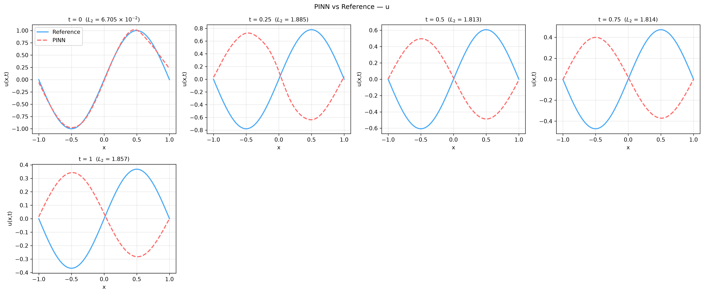
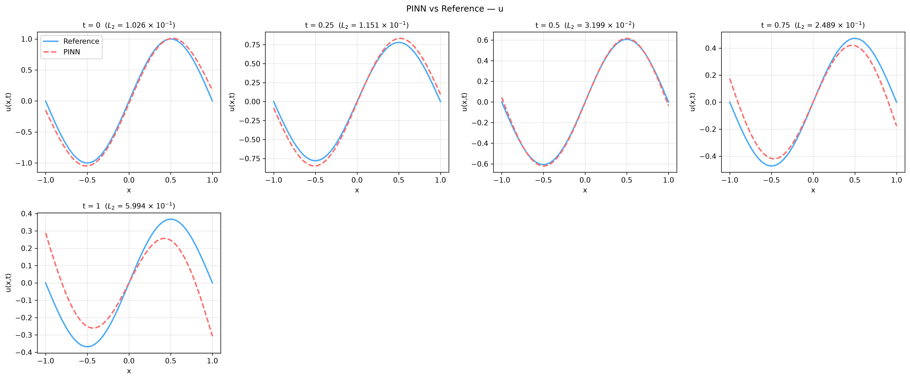

# 20. Diagnosing a run that does not converge

A run that ends with a poor solution rarely says why. This tutorial breaks a run that works in three
common ways, one at a time, and shows what each looks like in the Training Log and in Error Analysis. Each
run takes under a minute on a CPU, so you can repeat all of them in a few minutes.

**What you will learn**

- read the loss terms in the Training Log, and know which number belongs to which term;
- recognise a sign error in an equation, badly balanced loss weights and a run that is too short;
- why a small loss is not proof of a good solution, and why **Final loss (unweighted)** matters;
- fix a short run with an L-BFGS phase instead of more Adam iterations.

**The problem.** The *Diffusion 1D* example (from DeepXDE) solves

\[
u_t = u_{xx} - e^{-t}\left(\sin \pi x - \pi^2 \sin \pi x\right), \qquad x \in [-1, 1],\ t \in [0, 1],
\]

with \( u = 0 \) at \( x = \pm 1 \) and \( u(x, 0) = \sin \pi x \). Its exact solution is
\( u = e^{-t} \sin \pi x \), so every run can be compared with the truth.

## Prerequisites

- [Tutorials 1 and 2](01-ode.md) (the editors, **Solve**, the Training Log).
- [Tutorial 17](17-error-analysis.md) helps, but is not needed.

## Set up the reference run

1. In the **Examples** bar choose **Forward**, **Diffusion 1D**, **Default**.
2. **Equations** shows the residual typed for this example. The typeset line under it is what the network is
   trained on; reading it is the first check of any problem.

    ```text
    du_t - du_xx + exp(-t)*(sin(pi*x) - pi**2*sin(pi*x))
    ```

    { .screenshot loading=lazy }

3. **Training**: set **Phase 1**'s **Iterations:** to `5000` (the example uses 10000; 5000 is enough here).
4. **Results** › **Error Analysis**: set **Reference:** to **Exact solution formula**, type `exp(-t)*sin(pi*x)`,
   set **Compare at times:** to `0, 0.25, 0.5, 0.75, 1` and click **Run Error Analysis**.
5. Click **Solve**. Use **Problem › Save Problem As...** to keep this set-up; the runs below each change one setting
   and go back to it.

### What the reference run gives

In our run (CPU, 0.4 minutes) the last lines of the Training Log were:

```text
Step 5000: [8.468221e-05, 2.9223959e-06, 1.0270231e-05]
Final loss: 9.7875e-05
Final loss (unweighted): 9.7875e-05
```

The three numbers after **Step** are the loss terms, in the order of the **Loss weights** page: the equation
(PDE 1), the boundary condition (BC 1) and the initial condition (IC 1). The relative L2 errors were
5.0 × 10⁻³, 9.8 × 10⁻⁴, 1.5 × 10⁻³, 2.2 × 10⁻³ and 9.5 × 10⁻³ at \( t = 0, 0.25, 0.5, 0.75, 1 \).

This is the yardstick. A healthy run of this problem ends with all three terms small and well below the
starting loss, and the two final-loss lines equal (all weights are 1).

## Failure 1: a sign error in the equation

6. On **Equations** change the sign of `du_xx`:

    ```text
    du_t + du_xx + exp(-t)*(sin(pi*x) - pi**2*sin(pi*x))
    ```

    This is the heat equation run backwards in time, a problem with no stable solution.
7. Click **Solve**.

**What it looks like.** Our run ended with

```text
Step 5000: [0.0026449398, 0.002257368, 0.00035256078]
Final loss: 5.2549e-03
```

The loss is small in absolute terms, which is why this mistake is easy to miss. Compared with the reference
run, though, it stopped 50 times higher, and the PDE and BC terms are of the same size: the network cannot
satisfy the equation and the boundary condition together, so it trades one against the other. The relative
L2 error was 0.067 at \( t = 0 \), where the initial condition holds the solution in place, and 1.81 to 1.89
at every later time: the solution has the wrong sign.

<figure markdown>
{ loading=lazy }
<figcaption>The sign error: right at t = 0, upside down afterwards (5000 Adam iterations).</figcaption>
</figure>

**How to catch it.**

- Read the typeset equation, term by term, against the equation you meant. Write every residual in the
  form *left side − right side*, so that moving a term across changes its sign exactly once.
- A loss that ends far above where a similar problem ends, with two terms of the same size, usually means the conditions and the equation contradict each other: a sign, a missing term, or
  a condition on the wrong side.
- Errors that are small at \( t = 0 \) and large afterwards point at the equation, not at the initial
  condition.

Put the sign back before the next run.

## Failure 2: loss weights out of balance

8. On **Loss weights** set **BC 1 (Dirichlet, u):** and **IC 1 (u):** to `0.001`, leaving **PDE 1 (u):** at `1`.

    { .screenshot loading=lazy }

9. Click **Solve**.

**What it looks like.** Our run ended with

```text
Step 5000: [0.00014527749, 2.0377454e-05, 3.5892187e-06]
Final loss: 1.6924e-04
Final loss (unweighted): 2.4112e-02
```

On its own, the final loss looks almost as good as the reference run's. The second line gives it away: without
the weights the loss is 140 times larger. The terms after **Step** are *weighted*; divided by their weights,
the boundary term is 0.020 and the initial-condition term 0.0036, hundreds to thousands of times the
reference run's.
The network has solved the equation for some other boundary and initial values. The relative L2 errors
were 0.10, 0.12, 0.032, 0.25 and 0.60.

<figure markdown>
{ loading=lazy }
<figcaption>Weights 0.001 on the conditions: the right shape, the wrong values at the boundary.</figcaption>
</figure>

**How to catch it.**

- Compare **Final loss** with **Final loss (unweighted)**. When they differ by orders of magnitude, a
  term with a small weight is being left unsatisfied.
- Divide each term after **Step** by its weight before comparing them.
- Typical fixes: weight the conditions at least as much as the equation (new problems give the initial
  condition 100), or let PINNStudio choose: **Scale by initial losses** sets each weight to \( c / L_i(0) \);
  per-point weights (RBA, SA-PINN, [tutorial 11](11-point-weights.md)) adapt them during training.

Set the two weights back to `1` before the next run.

## Failure 3: a run that is too short

10. On **Training** set **Phase 1**'s **Iterations:** to `300` and click **Solve**.

Our run ended at a loss of 9.4 × 10⁻², with relative L2 errors of 0.15, 0.14, 0.079, 0.35 and 0.92: the
error grows with time, and all three loss terms were still falling when the run stopped
(`Step 300: [0.0478, 0.0383, 0.0077]`). A loss curve that is still going down at the end is the
signature of under-training.

The usual cure is not simply more Adam iterations but an L-BFGS phase after them:

11. Click **Add Phase**, set **Phase 2**'s **Optimizer:** to **L-BFGS** and **Iterations:** to `2000`, and
    click **Solve**.

    { .screenshot loading=lazy }

L-BFGS stopped by itself after 1394 iterations (the log's last line is `Step 1694`, counting the 300 Adam
steps), when the loss stopped improving. The final loss was 2.4 × 10⁻⁶ and the relative L2 errors
5.1 × 10⁻⁴, 6.4 × 10⁻⁴, 5.4 × 10⁻⁴, 8.7 × 10⁻⁴ and 3.7 × 10⁻³, better than the 5000-iteration reference run,
in 0.3 minutes instead of 0.4.

## Expected results

| Run | Final loss | Relative L2 error, t = 0 … 1 | Diagnosis |
|---|---|---|---|
| Reference (Adam 5000) | 9.8 × 10⁻⁵ | 5.0 × 10⁻³ … 9.5 × 10⁻³ | healthy |
| Sign error | 5.3 × 10⁻³ | 0.067, then 1.8 – 1.9 | PDE and BC terms end equal; wrong sign after t = 0 |
| Weights 0.001 on BC and IC | 1.7 × 10⁻⁴ (2.4 × 10⁻² unweighted) | 0.032 … 0.60 | weighted and unweighted losses differ |
| Adam 300 | 9.4 × 10⁻² | 0.079 … 0.92 | all terms large; stopped too early |
| Adam 300 + L-BFGS | 2.4 × 10⁻⁶ | 5.1 × 10⁻⁴ … 3.7 × 10⁻³ | healthy |

These are single runs on a CPU in float32; yours will differ in the digits, not in the pattern.

## A checklist for your own problems

1. **Equations**: read the typeset form of every residual; check signs and that each term is where you
   meant it.
2. **Boundary conditions**: in the geometry view every edge should have a colour (a condition); an edge
   without one has no boundary loss.
3. **Training Log**: compare the terms after **Step** (divided by their weights) and the two final-loss lines.
4. **Loss curve** (**Results › Live loss**): still falling at the end means *train longer or add L-BFGS*;
   flat from early on, far above where it should be, means *the problem as typed is not the problem you
   meant*.
5. **Error Analysis**: where and when the error is large says which part is wrong: near a boundary, at
   later times, or at a steep front (more points, [RAR](10-rar.md), or [causal training](12-causal-windows.md)).

## Troubleshooting

| Symptom | What to check |
|---|---|
| The loss becomes `nan` | A term divides by zero or takes the log or square root of a negative number somewhere in the domain; check the expression, or lower the learning rate. |
| The loss jumps up and down and does not settle | The learning rate is too high for this problem; try 0.0005 or a learning-rate decay. |
| L-BFGS stops after a few iterations | It starts from where Adam left off: if Adam ended far from a solution, give Adam more iterations first. |
| The error is large only at one time | Check whether the reference is close to zero there (a relative error divides by it); look at the absolute error map. |

## Next steps

- [Choosing a strategy](../guide/choosing-a-strategy.md): which method to try for which kind of problem.
- [Troubleshooting](../help/troubleshooting.md) in Help, for error messages.
- [Loss weights](../guide/loss-weights.md) in the user guide.
