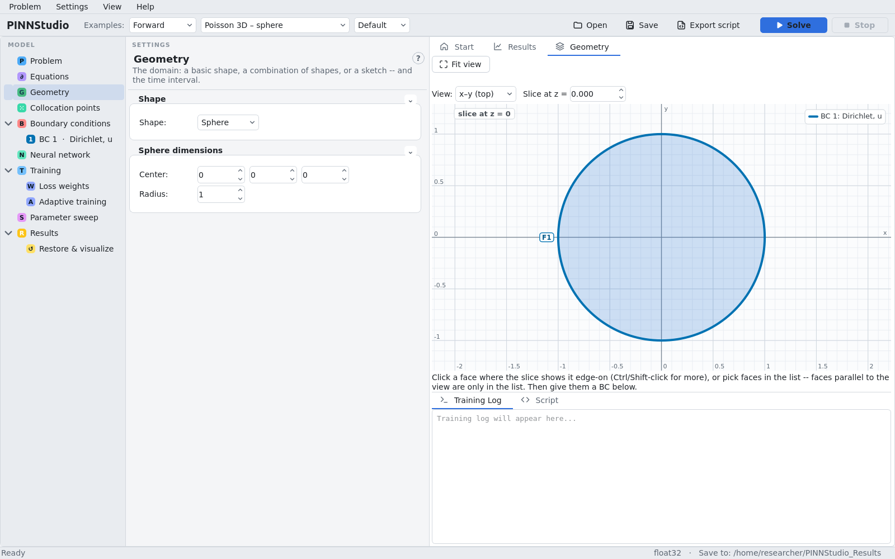
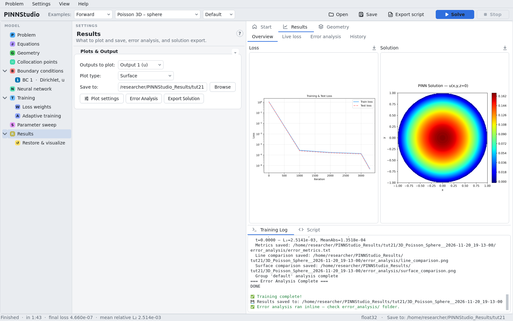
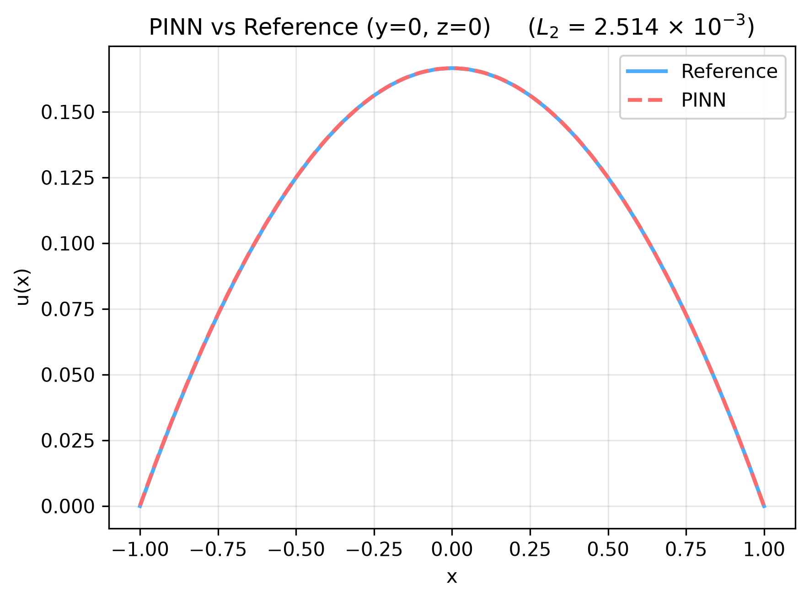

# 21. A 3D problem (Poisson in a sphere)

Everything in the earlier tutorials carries over to three space dimensions; what changes is how you look at
the domain and the solution, and what training costs. This tutorial solves a Poisson equation inside a sphere,
whose exact solution is known, and shows the 3D geometry view, slices of the solution and the error check.

**What you will learn**

- the **Geometry** view of a 3D domain: flat slices, faces (F1, …) and the rotating **3D** view;
- what the solution plots of a 3D problem show (a slice, and a line through it);
- how many points a 3D domain needs, and why 3D training is slower;
- an L-BFGS phase that stops by itself.

**The problem.**

\[
-\left(u_{xx} + u_{yy} + u_{zz}\right) = 1 \quad \text{in the unit ball } x^2 + y^2 + z^2 < 1,
\qquad u = 0 \text{ on the sphere}.
\]

Its exact solution is \( u = (1 - r^2)/6 \) with \( r^2 = x^2 + y^2 + z^2 \): zero on the sphere, \( 1/6 \) at the
centre.

## Prerequisites

- [Tutorials 1–3](01-ode.md) (the editors, the geometry view, Error Analysis).
- About 2 minutes of training on a CPU with the shortened phases below.

## Steps

1. In the **Examples** bar choose **Forward**, **Poisson 3D – sphere**, **Default**. The example comes with a
   reference solution, `reference_data/3D/poisson_sphere/solution.txt` (columns x, y, z, u), already set up in
   Error Analysis.
2. **Problem**: **3D (x, y, z)** and **Stationary**.
3. **Equations**: one output `u` and the residual

    ```text
    -du_xx - du_yy - du_zz - 1
    ```

    In 3D the derivatives in `z` are available as well: `du_z`, `du_zz`, `du_xz`, …
4. **Geometry**: **Shape:** **Sphere**, **Center:** `0`, `0`, `0`, **Radius:** `1`. The **Geometry** tab shows a
   flat slice through the domain: **View:** chooses the plane (**x–y (top)**, **x–z (front)** or **y–z (side)**) and **Slice at z =** where it
   cuts. The sphere has one face, **F1**, which every boundary condition of the sphere refers to. Choose **3D**
   under **View:** to see the whole domain as a solid you can rotate; **Show points** there draws the training
   points.

    { .screenshot loading=lazy }

5. **Boundary conditions**: one row, **Dirichlet BC**, **Where:** **Whole boundary**, **Value:** `0`.
6. **Collocation points**: 2000 domain points and 300 boundary points. **Neural network**: 4 hidden layers of 50
   neurons, tanh.
7. **Training**: the example trains Adam for 20000 iterations, then L-BFGS for up to 20000. For this tutorial
   set **Phase 1**'s **Iterations:** to `3000` and **Phase 2**'s to `1000`.
8. Click **Solve**.

## Expected results

Our run on a CPU took 1 minute 43 seconds. L-BFGS stopped by itself after 288 of its 1000 iterations (the last
log line is `Step 3288`), when the loss no longer improved; the final loss was 4.7 × 10⁻⁷. The relative L2 error
against the reference was 2.5 × 10⁻³.

The **Overview** shows the loss and the solution. In the loss curve, Adam brings the loss down to about
3 × 10⁻⁵ and L-BFGS takes it two orders of magnitude further in a few hundred iterations. The solution plot of a
3D problem is a slice: here \( u \) on the plane \( z = 0 \), largest (\( 1/6 \)) at the centre and zero on the
circle where the plane cuts the sphere.

{ .screenshot loading=lazy }

Error Analysis compares along a line through the centre (\( y = 0 \), \( z = 0 \)) and on the slice; the PINN
and the reference curves lie on top of each other.

<figure markdown>
{ loading=lazy }
<figcaption>Along the line y = 0, z = 0 (3000 Adam iterations and 288 L-BFGS iterations).</figcaption>
</figure>

### What 3D costs

- **Derivatives.** The residual needs three second derivatives per point instead of one or two, each a
  further pass of automatic differentiation.
- **Points.** 2000 points in a 3D volume are sparse: about 13 per axis, against 45 per axis for the same number
  in 2D. That is enough for this smooth solution, but a solution with sharp features in 3D needs many more
  points (and time), or [RAR](10-rar.md) to put them where they are needed.
- **A GPU** helps more as the number of points and derivatives grows; see
  [Training speed](../reproducibility/environment.md#training-speed).

## Variations to try

- On **Results**, **Plot settings** (its **Line** tab) sets the y and z where the line and the slice are taken;
  the default is the middle of the domain.
- **Geometry**: change **Shape:** to **Cuboid**, or build a cube with a spherical cut-out with **Custom** (the
  example *Poisson 3D – cube with spherical cut-out* is built that way). The 3D view shows a cut-out as a hole,
  and **Show points** confirms that no training point falls inside it.
- Train with the example's full phases. With a smooth solution like this one, most of the gain comes from the
  L-BFGS phase.

## Troubleshooting

| Symptom | What to check |
|---|---|
| A face has no colour in the 3D view | No boundary-condition row covers it. |
| Training is much slower than in 2D | Expected: see *What 3D costs*. Try fewer domain points first, then increase. |

## Next steps

- [Tutorial 8](08-geometry.md): custom geometry (in 2D; the same ideas apply in 3D).
- [Geometry and domain](../guide/geometry.md) in the user guide, for 3D shapes and the 3D view.
- [Tutorial 20](20-diagnosing.md), when a run does not converge.
