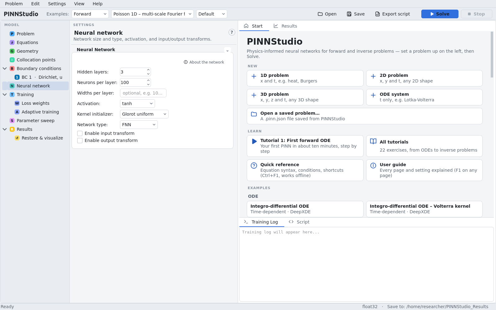
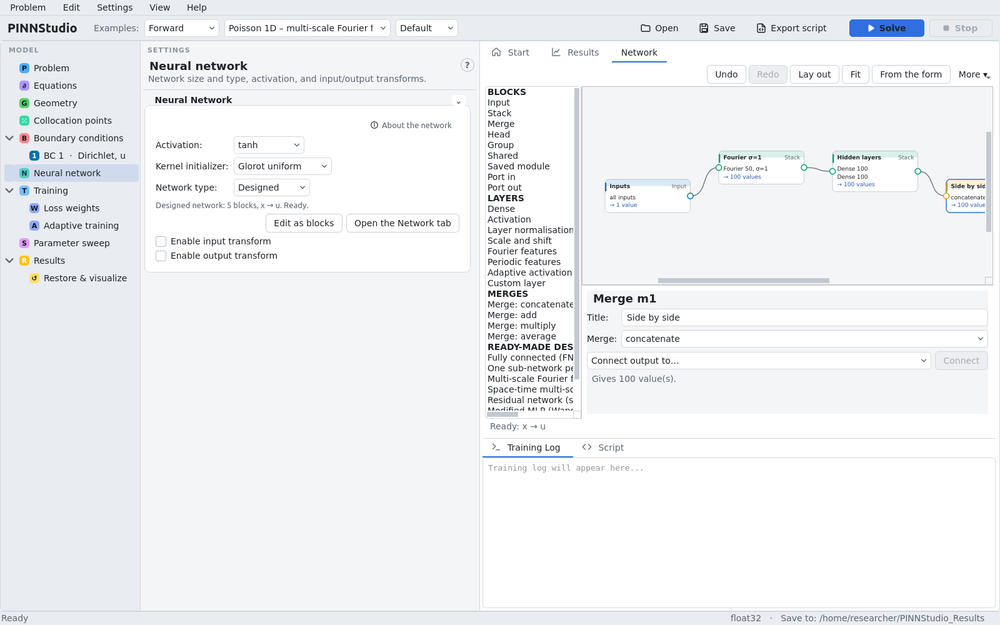
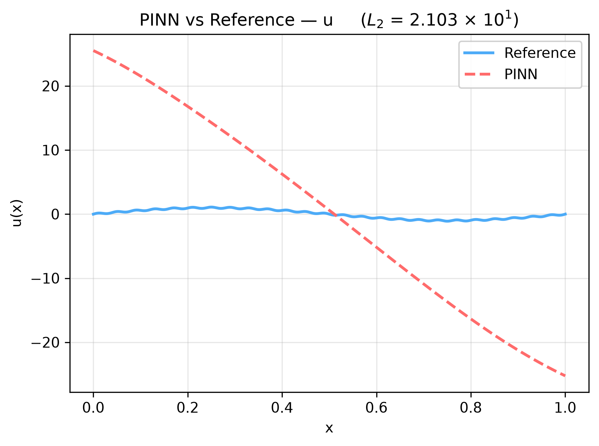
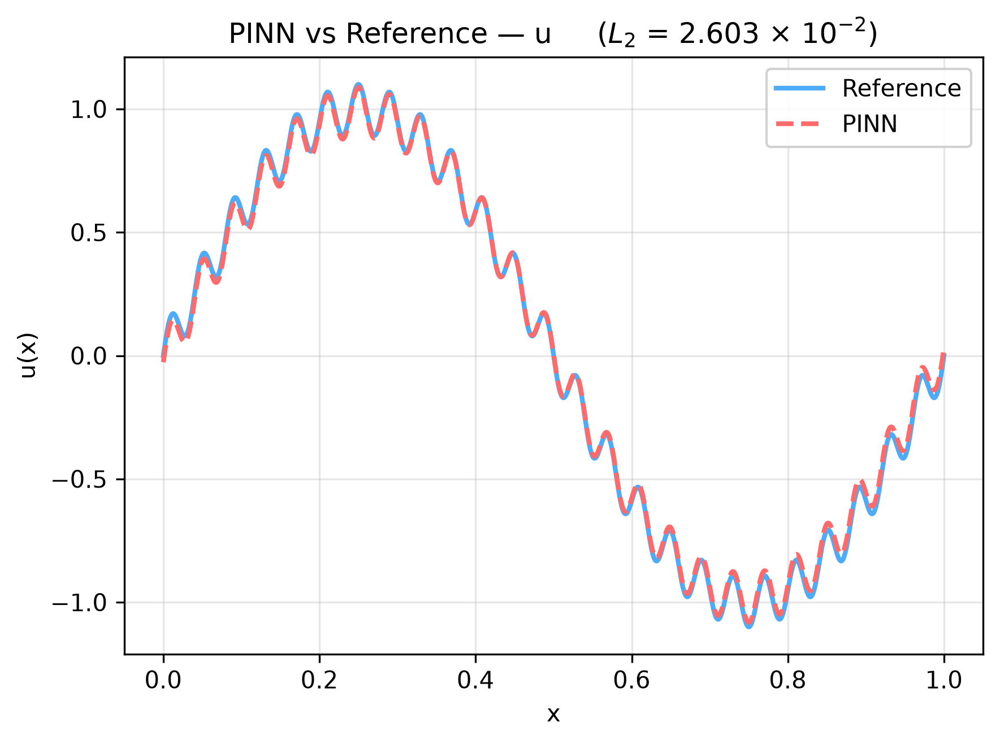
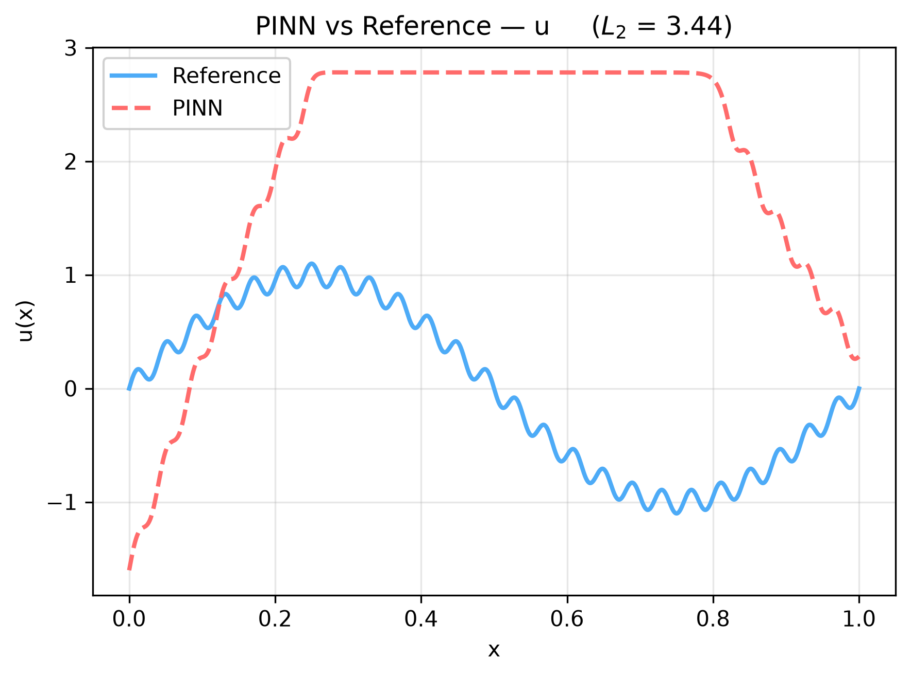

# 22. Designing a network as blocks

The **Neural network** page offers four fixed architectures. The **Network** tab lets you build the network
yourself, as blocks on a canvas, and change any part of it. This tutorial takes a problem that a plain network
cannot solve, shows the network that does solve it as blocks, removes one part of it, and measures what each
change does.

**What you will learn**

- turn the form's network into blocks (**Network type:** **Designed**) and read the canvas;
- what a Fourier feature stack, a shared block and a merge do;
- change a design (delete blocks) and see the change checked as you make it;
- compare the runs in **Results › History**.

**The problem.** A 1D Poisson equation whose solution has two scales:

\[
u_{xx} = -(2\pi)^2 \sin(2\pi x) - 0.1\,(50\pi)^2 \sin(50\pi x), \quad x \in [0, 1], \qquad u(0) = u(1) = 0,
\]

with the exact solution \( u = \sin(2\pi x) + 0.1 \sin(50\pi x) \): a slow wave with 25 small fast waves on top.
The fast wave is small in \( u \) but not in the equation: its second derivative is
\( 0.1\,(50\pi)^2 \approx 2500 \), a thousand times larger than the slow wave's. A network that misses it leaves a
residual in the thousands.

## Prerequisites

- [Tutorials 1–2](01-ode.md) (Solve, the loss terms, Error Analysis).
- About 5 minutes of training on a CPU for the three runs below.

## Steps

### Run A: a plain fully connected network

1. In the **Examples** bar choose **Forward**, **Poisson 1D – multi-scale Fourier features**, **Default**. The
   example comes with the exact solution set up in Error Analysis.
2. **Training**: the example trains Adam for 20000 iterations. For this tutorial set **Phase 1**'s
   **Iterations:** to `5000`.
3. **Neural network**: set **Network type:** to **FNN**. The form shows 3 hidden layers of 100 neurons, tanh.

    { .screenshot loading=lazy }

4. Click **Solve**.

### Run B: the multi-scale Fourier network, as blocks

5. Load the example again (step 1) and set **Iterations:** to `5000` again (step 2). Its network type is
   **MsFFN**, the multi-scale Fourier feature network.
6. **Neural network**: set **Network type:** to **Designed**. The form's size rows disappear, and a
   **Network** tab appears on the right; click it. It holds the same MsFFN, now as seven blocks. It is the same network: the
   designer only shows it differently.

    { .screenshot loading=lazy }

    Read the canvas from left to right:

    - **Inputs** feeds `x` to two **Fourier feature** stacks. Each multiplies `x` by 50 random frequencies drawn
      with spread σ (1 for one, 10 for the other) and gives their sines and cosines: 100 values.
    - **Hidden layers** (two Dense layers of 100) turn the σ = 1 features into 100 values. **Hidden layers
      (σ=10)**, with a dashed outline, is a **Shared** block: it calls the same stack again on the σ = 10
      features, with the same weights. Select it, and the inspector says **Calls: s2**.
    - **Side by side** concatenates the two 100-value results, and **Outputs** (a head) maps the 200 values
      to `u` with one linear layer. (At this window size the head is just past the right edge; drag the
      canvas, or press **F** to fit.)

    Every block shows how many values it gives (`→ 100 values`); a block that cannot work says why instead.

7. Click **Solve**.

### Run C: one scale only

8. On the canvas, click **Fourier σ=10** and press **Delete**, then click **Hidden layers (σ=10)** and press
   **Delete** (after the first deletion it has no input, and the status line under the canvas says so). The
   **Neural network** page now reads *Designed network: 5 blocks, x → u. Ready.*

    { .screenshot loading=lazy }

9. Click **Solve**.

## Expected results

Our runs on a CPU, 5000 Adam iterations each:

| Run | Network | Time | Final loss | Relative L2 error |
|---|---|---|---|---|
| A | FNN, 3 × 100 | 1.0 min | 3.1 × 10⁶ | 21 |
| B | Designed: Fourier σ = 1 and σ = 10, shared hidden layers | 2.0 min | 17 | 2.6 × 10⁻² |
| C | Designed: Fourier σ = 1 only | 1.2 min | 1.7 × 10⁶ | 3.4 |

**Run A fails.** The loss stays in the millions, and the network learns a smooth curve that is not even close in
size: an error of 21 means 2100 %. A plain tanh network learns low frequencies first (its *spectral bias*); the
fast wave is out of its reach in this many steps, and without it the residual stays huge.

{ loading=lazy }

**Run B solves it.** The PINN and the reference lie on top of each other, fast waves included, with an error of
2.6 %. The σ = 10 Fourier features give the network inputs that already oscillate quickly.

{ loading=lazy }

The example's own **MsFFN** (the form, same settings) reached 1.7 × 10⁻² in our run. It is the same network:
the designer creates the layers in another order, so the random initial weights differ, and so does the result
in the second digit.

**Run C shows which part mattered.** Without the σ = 10 branch the network has no fast features, and it
fails again (error 3.4). The σ = 1 branch alone cannot represent the fast wave.

{ loading=lazy }

To see the three side by side, open **Results › History**, select the three runs and click **Compare**: their
loss curves and errors are drawn together.

## Variations to try

- Give run C's Fourier stack **Sigma (σ):** `10` instead of `1` (select the stack, then its Fourier layer in the
  inspector): one branch with the fast scale. Does it get the slow wave right as well?
- Add a third branch with σ = 50: from **Inputs**, a new **Stack** with a **Fourier features** layer, a
  **Shared** block calling **Hidden layers**, and a connection into **Side by side**. Drag from a block's right
  port to another's left port; the target turns green when the connection is allowed and red, with the reason,
  when it is not.
- Instead of deleting, sweep: on **Parameter sweep**, the design's own settings are listed (the units of each
  Dense layer, the σ of each Fourier layer), so one sweep can try several σ values.

## Troubleshooting

| Symptom | What to check |
|---|---|
| The status line says *nothing is connected to it* | A block was left without its input after a deletion: connect it or delete it. |
| The Network tab is missing | **Network type:** is not **Designed**. |
| Run B gives the same numbers as run A | The type was changed back to FNN before Solve; the run folder's `solution_results/model_config.json` records which network trained. |

## Next steps

- [Network designer](../guide/network-designer.md) in the user guide: every block, layer and key, groups,
  custom PyTorch layers, saved modules and the block library.
- [Networks and Fourier features](../reference/networks.md), for the background of MsFFN and STMsFFN.
- [Tutorial 13](13-compare.md): comparing configurations with parameter sweeps.
